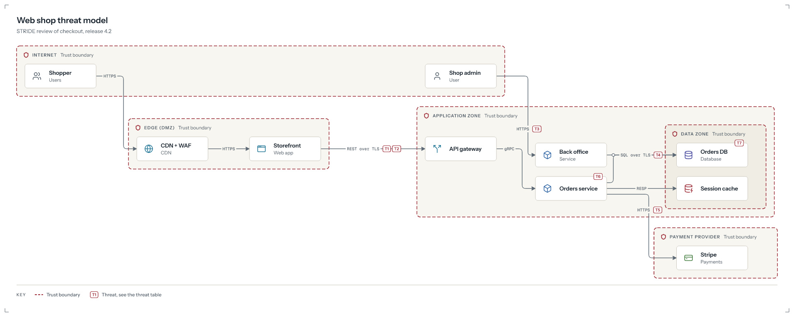

# Cartography

Architecture diagrams that look good: write a short YAML file or build the diagram interactively from a template, and get a clean, consistent drawing.

Diagram types: architecture, C4, Azure, AWS and Google Cloud, Kubernetes, network, database (ERD), roles / groups / access packages, GitHub, data products (with ports and data contracts), sequence, git branching, roadmap, journey map, capability map (with heatmaps), teams (org chart and Team Topologies), DDD context map, matrix (RACI, CRUD), UML class diagram and mind map. Not sure which one you need? See [Which diagram type do I need?](docs/types.md)

Status: early development. See [docs/requirements.md](docs/requirements.md).

**Docs, gallery, benchmark.** `pnpm docs:build` builds the documentation site into `docs/site/dist`, the web app included; `pnpm docs:serve` serves it on localhost (the pages also open from disk, offline): [get started](docs/getting-started.md), a gallery (`gallery/index.html`) of every template and every file in [examples](examples), drawn light and dark, each with its YAML and an "Open in the editor" link, the [layout benchmark](docs/benchmark.md) against Mermaid and D2 (including where Cartography loses), and guides for people coming from [Mermaid](docs/coming-from/mermaid.md), [D2](docs/coming-from/d2.md), [draw.io](docs/coming-from/drawio.md), [PlantUML](docs/coming-from/plantuml.md) and [Structurizr](docs/coming-from/structurizr.md), or with nothing drawn yet but [a code repository](docs/repo-import.md).

## The editor

```sh
pnpm install
pnpm web          # → http://localhost:5178
pnpm web:build    # static app in packages/web/dist, runs from any folder, offline
```

YAML on the left, the drawing on the right; both stay in sync and select the same element.

- **Start** by picking what you want to draw: a card per type says what it is for and what it is not for, and a search box ranks the types by your words ("who has access", "tables and keys"). Then a template, then how to work: **Ask Claude** (a few questions become a prompt; Claude drafts the diagram with your own API key, checked by the engine and fixed automatically — or copy the prompt into any chat), the **Builder** (build visually: shapes panel, no YAML; `⌘\` switches) or **YAML**. The names used across the app, docs and CLI are in the [glossary](docs/glossary.md). Or paste a Mermaid diagram (flowchart, architecture-beta, erDiagram, sequenceDiagram), a D2 or PlantUML diagram, or open or drop a draw.io or Excalidraw file, and get it back as Cartography. Open a folder of diagrams to edit files in place (Chrome/Edge).
- **Write** with autocomplete from each type's schema; problems show on the right line, and the last good drawing stays while you type.
- **Build** without YAML: add shapes from the palette (`A`, or drag them onto the drawing and into a group), edit them in the inspector, drag from the dot on an element to connect it, rename with every reference following.
- **Select** several with shift-click or a marquee, `⌘C`/`⌘V` copy and paste, double-click to rename in place.
- **Arrange**: drag elements or whole groups; positions are saved next to the diagram as `<name>.layout.json`, lines follow, nothing lands on top of something else.
- **Undo** everything with `⌘Z`: typing, builder edits and moves share one history.
- **Export** SVG, PNG, a 16:9 slide, or copy as PNG for slides and docs; an Office-safe SVG for PowerPoint and Word; draw.io, Excalidraw or Mermaid to carry on in another tool. `?` shows every shortcut.
- **Animate** a diagram's steps (or its layers) as a GIF, MP4 or WebM: each step held, a short blend to the next, the caption as a lower third (`carto animate walkthrough.yaml -o walkthrough.gif`, or Export → Animation). See [docs/animate.md](docs/animate.md).
- **Send** one interactive HTML file instead of a PNG (`carto export-html shop.yaml`, a folder, or Export → Interactive HTML): every view and step, zoom, search, drill-down and element details, offline from disk. See [docs/html-export.md](docs/html-export.md).
- **Describe** every diagram in plain words, from its model: in each exported SVG, PNG, PDF and slide as alt text, in the editor (Export → Describe in words) and as `carto describe`. See [docs/describe.md](docs/describe.md).
- **Wiki pages** without a plugin: `carto export-md` (GitHub, GitLab, Obsidian), `carto export-confluence` (storage-format pages and attachments), or Export → Copy for Confluence / Notion. See [docs/wiki-export.md](docs/wiki-export.md).

Diagrams look better than the usual tools: lines that share a path are spaced evenly or merge into a trunk, labels stay off group borders, supporting links (Key Vault, logging) can be badges on the card instead of lines (`badges: [identity]`). See [docs/comparison](docs/comparison/README.md) for Mermaid and D2 side by side, and [the benchmark](docs/benchmark.md) for the numbers.

**A look of its own**: the default style, Survey, draws a diagram as a map sheet: paper tints that deepen as groups nest, bare icons, labels set on the lines, a key. Transit, Drafting and a hand-drawn Sketch look for workshops are built in as alternatives, a theme file puts a client's colours, font and logo on top, and the vendors' official Azure, AWS, Google Cloud and Kubernetes icons can be used once you have downloaded them. See [docs/style.md](docs/style.md), [docs/themes.md](docs/themes.md) and [docs/icons.md](docs/icons.md).


**One model, many diagrams**: describe systems once in a `type: model` file, `include:` it in a context, container or Azure deployment diagram and reference elements by id (`api: { ref: shop.api, kind: container-app }`); `views:` pick what each drawing shows (`expand: [shop]`, `'* -> shop'`, `tag:external`), and `links:` drill down from a box to its detailed diagram, as real links in exported SVG. See [docs/model.md](docs/model.md) and [examples/model](examples/model).

**The folder as one model**: open a folder in the editor and ⌘P searches every element, view and file in it; double-click a system to go down to its containers and ⌘[ to come back, see where an element is used, and rename it in every file at once (previewed, pins follow). `carto validate <folder>` checks dangling refs and conflicting ids across files. See [docs/workspace.md](docs/workspace.md) and [examples/workspace](examples/workspace).

**What runs where, per environment**: a node in an Azure, AWS, Google Cloud or Kubernetes diagram says which part of the model it runs (`api: { of: shop.api, kind: ecs-service, env: prod }`); a view per environment draws production, test and dev from one file, and `complete: true` warns about parts that run nowhere. `carto import plan.json` reads Terraform state or plan JSON. See [docs/model.md](docs/model.md), [examples/deployment](examples/deployment) and [examples/cloud](examples/cloud).

**A data mesh from the files you have**: `carto render mesh/ -o mesh.svg` draws a folder of data product and data contract files (ODPS, ODCS) as one map: products per domain, their ports, what reads what, and the keys between contracts (ODCS 3.1 `relationships`). Running it again keeps what you changed by hand. **Focus** cuts any drawing of boxes and lines down to one thing and what is around it: `focus: { on: revenue, hops: all, direction: upstream }`, `carto render --focus revenue --hops 2`, or `F` in the editor. See [docs/data-products.md](docs/data-products.md).


**Who reaches what, from your exports**: `carto render exports/` draws a folder of `az role assignment list`, Microsoft Graph or AzureHound JSON as an access diagram (scopes as a tree, groups and members, access packages, directory roles), and a folder of `gh api` answers as the GitHub organisation (teams, repositories, rulesets, environments, CODEOWNERS). Large tenants stay readable (members folded into groups, a who × where matrix, `--scope`, `--depth`), importing again keeps your edits, and `carto diff march/ june/` says who gained and lost what, in plain words. See [docs/access-import.md](docs/access-import.md).

**What runs where in Azure, from your exports**: `carto render resources.json` draws `az graph query` output, `az bicep build` output or `terraform show -json` (azurerm) as an azure diagram: management groups, subscriptions, resource groups, networks and subnets, each resource in the subnet it sits in, private endpoints, gateways, peerings and VPNs as lines, Key Vault references and diagnostics as badges, what a plan creates, changes and deletes marked. Large estates stay readable (plumbing left out, many of a kind as one counted card, `--subscription`, `--rg`, `--depth`), importing again keeps your edits and pins, and `carto diff` compares two exports. Read from files only. See [docs/azure-import.md](docs/azure-import.md).

**What the code says, from the repository**: `carto import .` reads the files a repository already has and draws one diagram of each into `diagrams/`: a Compose file as the services and what they use, a Helm chart (rendered here, no Helm) and manifests as Kubernetes, Bicep (compiled here, no Azure CLI) as Azure, OpenAPI as the API by tag (with its callbacks as a sequence), AsyncAPI files as the services and the channels between them, and each GitHub Actions workflow as a process. Importing again after the code changed keeps your hand edits; in the web app, *Diagrams from the code* in the command palette of an open folder does the same. See [docs/repo-import.md](docs/repo-import.md).

**Or read live, with your own tools**: `carto import --live k8s|azure|access|github` runs your logged-in `kubectl`, `az` or `gh`, read-only (an allow-list of reading commands, shown and confirmed before they run; Secret and ConfigMap values never read), and feeds the answers to the same importers. `--into diagram.yaml` imports over a diagram and keeps your edits; `carto diff --live k8s shop.yaml` shows what changed in the cluster since. See [docs/live-import.md](docs/live-import.md).

**Threat models, context maps, RACI**: mark trust boundaries and STRIDE threats on an architecture, C4 or Azure diagram and get numbered tags on the drawing, suggested threats as warnings and a threat table (`carto render --view threats`, `carto threats shop.yaml -o threats.md`); draw a DDD context map with U/D ends and ACL, OHS, PL, CF patterns (`type: context-map`); or a RACI or CRUD matrix that checks itself (`type: matrix`), exported to PowerPoint as a real table. See [docs/threats.md](docs/threats.md), [docs/context-map.md](docs/context-map.md) and [docs/matrix.md](docs/matrix.md).



**Share a diagram as a link**: *Copy share link* (or `carto share shop.yaml`) puts the diagram itself in the link's `#fragment`, which never reaches a server; the link opens a read-only viewer with zoom, present and export, and *Open in editor* makes it the reader's own. See [docs/share.md](docs/share.md).

**Wizards**: answer a few questions and get a finished diagram after a vendor's reference architecture: an Azure landing zone (CAF), the AKS baseline, hub and spoke, an AWS three-tier app or multi-account landing zone, a data mesh, a C4 starter, a Git strategy, a Team Topologies setup. No AI needed; the drawing grows as you answer in the start dialog, or `carto new --wizard azure-landing-zone` asks in the terminal. See [docs/wizards.md](docs/wizards.md).

**Blocks**: the patterns you draw again and again (a hub with firewall and Bastion, App Service + Key Vault + SQL behind private endpoints, a standard Kubernetes namespace) saved once as `blocks/<name>.block.yaml` with parameters, then dragged in from the shapes panel or inserted with `B` as plain YAML, ids made unique; when a block changes, each instance offers its update as a diff. `carto blocks list|show|new|insert` does the same from the terminal. See [docs/blocks.md](docs/blocks.md).

**Steps and presenting**: `steps:` tells a drawing in parts (`- customer -> web -> api: The order comes in`), with what is shown, what stands out and the sentence you say. Press `P` to present it full screen, or export it: one slide per step in PowerPoint, one page per step in PDF, with every shape in the same place. See [docs/steps.md](docs/steps.md).

**Layers**: `tags: [security]` on nodes, groups and lines, and `layers: { security: { tags: [security] }, phase-2: { tags: [phase-2], dim-others: true } }` give one file a security view, a data view, a phase-2 view: only what is on the layer, laid out on its own, or everything in place with the rest faded. `L` in the editor, `carto render --layer security` or `--all-layers -o out/` (a slide per layer in a deck). See [docs/layers.md](docs/layers.md).

CLI: `carto import diagram.mmd` turns Mermaid (or Markdown with mermaid blocks) into Cartography YAML; `carto import shop.d2` and `carto import flow.puml` do the same for D2 (boxes, sql_tables, sequence diagrams) and PlantUML (sequence, component, deployment, C4-PlantUML, state, activity, entity). A kind guessed from the words (`Orders DB` is a database) gives the icon; its name is not added as a caption the source never had (`caption: ""`). Also imported: Structurizr DSL, Kubernetes manifests, Terraform state or plan JSON, network inventories (CSV, NetBox), git history, ODPS and ODCS files, Azure / Entra ID access exports (az, Graph, AzureHound), Azure resources (Resource Graph, ARM / Bicep, azurerm Terraform), GitHub organisations (`gh api`), and from a code repository Docker Compose, Helm charts, Bicep source, OpenAPI / Swagger, AsyncAPI and GitHub Actions workflows ([docs/repo-import.md](docs/repo-import.md)).

**Other tools, both ways**: `carto export shop.yaml -o shop.drawio` writes a draw.io file that stays editable (real shapes, groups as containers, connectors attached to their shapes, ERD tables as tables, a page per view); `.excalidraw` and `.mmd` work the same way. `carto import diagram.drawio` (compressed or not, every page) or `sketch.excalidraw` reads a drawing back and guesses its type from the stencils; `--keep-positions` keeps its layout as pins. `carto render --svg-safe [--outline-text]` writes an SVG that PowerPoint, Word and Keynote take whole. What each format keeps and loses: [docs/interop.md](docs/interop.md).

**Review notes**: comment threads on elements, lines, groups or spots of the canvas, kept in `<name>.notes.json` beside the diagram (never in the YAML), so a review travels and merges in git. In the editor: <kbd>N</kbd> or right-click adds one, numbered bubbles on the drawing, reply, resolve, review mode, unread marks; notes follow renames and stay, orphaned, when their element goes. `carto notes shop.yaml` lists them as markdown and `carto render --notes` puts them on paper. See [docs/notes.md](docs/notes.md).

**Architecture decisions**: ADRs as Markdown in `decisions/` (MADR, Nygard/adr-tools and log4brains folders are read as they are), with front matter saying which elements, lines and views each is about. Numbered page markers on the drawing (filled accepted, dashed proposed, struck superseded), a Decisions panel in the editor (<kbd>⇧D</kbd>; <kbd>⌥⇧D</kbd> writes one about the selection), renames follow, `carto decisions` writes the log or the table, `carto render --decisions` puts them on paper. See [docs/decisions.md](docs/decisions.md).

**Architecture review**: well-architected lint over the drawing: built-in rule packs for Azure, AWS, Kubernetes, systems and C4, GitHub and data products (WAF in front of public endpoints, private endpoints, zones, diagnostics, network policies, call chains, single points of failure, contracts), your own rules in `.cartography/rules.yaml`, findings set aside with a reason. A Review tab with flags on the drawing (<kbd>⇧W</kbd>), a finding becomes a decision in one click, and `carto review` fails CI on findings or writes a report (HTML, Markdown, PDF). See [docs/review.md](docs/review.md).

**In CI and pull requests**: `carto validate` checks diagrams (`--drift` finds saved positions for things that are gone), `carto diff` shows what changed between two versions as a list and as a marked-up picture, and a GitHub Action puts that picture in one comment on the pull request. An edit keeps the rest of the drawing where it was (`carto render --stable`). See [docs/ci.md](docs/ci.md).

In VS Code: an extension (`packages/vscode`, installed from a `.vsix`, not on the Marketplace) previews a diagram beside its YAML as you type, shows the engine's problems with quick fixes, completes from each type's schema, exports SVG, PNG and PowerPoint, imports Mermaid, D2, PlantUML, draw.io, Excalidraw and Structurizr, and draws ```` ```cartography ```` blocks in the Markdown preview. See [docs/vscode.md](docs/vscode.md).

AI assistants: an MCP server (`cartography-mcp`) and an agent skill let Claude Code, Claude Desktop and other MCP clients write diagrams that are checked against the schema and scored for layout quality before you see them. See [docs/mcp.md](docs/mcp.md).

## In your docs

Keep the diagram as YAML next to the docs and let the site draw it. A remark plugin (Docusaurus, Astro, MDX) and a markdown-it plugin (VitePress, Eleventy) turn a fenced `cartography` block or `` into plain SVG while the site builds, a light and a dark one: no headless browser, no build server. `<carto-diagram src="shop.yaml">` draws in the reader's browser instead and adds zoom, pan and drill-down into linked diagrams; `carto embed shop.yaml` writes one HTML file with all of it. See [docs/embed.md](docs/embed.md) and the working sites in [examples/docs](examples/docs) (Docusaurus, VitePress, MkDocs, a plain page).

## Try it

```sh
mise install            # Node 24 + pnpm (or bring your own)
pnpm install
pnpm carto types                                  # which type for what (add words to rank them)
pnpm carto new azure my-infra.yaml                # start from a template
pnpm carto new --wizard azure-landing-zone lz.yaml  # or answer a few questions
pnpm carto render my-infra.yaml -f png -t dark    # → my-infra.png
pnpm carto themes                                 # the built-in themes: survey (default), transit, drafting…
pnpm carto render examples/model/containers.yaml --all-views   # one SVG per view
pnpm gallery                                      # render all examples → gallery/out/index.html
pnpm test
pnpm lab                                          # layout quality per example, variants side by side
pnpm docs:build                                   # the docs site → docs/site/dist/index.html
pnpm bench                                        # the layout benchmark (d2 optional) → docs/benchmark.md
pnpm licences && pnpm pack:check                  # licence check; what npm would get, without publishing
```

Fonts: Instrument Sans, Geist Mono, Barlow, IBM Plex Sans, IBM Plex Mono, Kalam and Inter (all SIL OFL 1.1; licence texts in `packages/theme/fonts`). Icons: Lucide (ISC). Node placement: Graphviz dot (EPL) via @hpcc-js/wasm-graphviz (Apache-2.0); lines are drawn by our own router.
