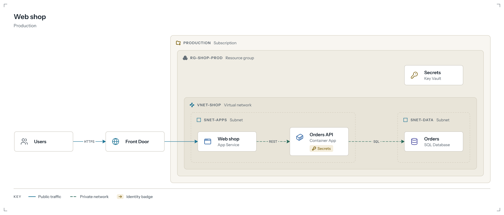

# Linework

Architecture diagrams that look good: write a short YAML file or build the diagram interactively from a template, and get a clean, consistent drawing.

Status: early development. Docs: [get started](docs/getting-started.md), [the glossary](docs/glossary.md) (the words the app, docs and CLI use), [which diagram type do I need?](docs/types.md), [accessibility](docs/accessibility.md), and the docs site (`pnpm docs:build`, then `pnpm docs:serve`; the pages also open from disk, offline) with a gallery of every template and example, light and dark.

## Try it

```sh
mise install && pnpm install                      # Node 24 + pnpm (or bring your own)
pnpm linework new azure shop.yaml                 # start from a template (pnpm linework types: which type for what)
pnpm linework render shop.yaml -o shop.png        # → shop.png (also .svg, .pptx, .pdf)
pnpm linework export shop.yaml --to html          # one interactive HTML file to send
pnpm web                                          # the editor → http://localhost:5178
```

Or build the command line once and run it with plain Node.js 24, anywhere, without the clone's
`node_modules`:

```sh
pnpm build                                        # the web app, packages/cli/dist and packages/mcp/dist
node packages/cli/dist/linework.mjs render shop.yaml -o shop.png
cp -r packages/cli/dist ~/opt/linework && ln -s ~/opt/linework/linework.mjs ~/bin/linework  # linework on your PATH
pnpm smoke                                        # check the bundles from a folder outside the repo
```

`linework.mjs` is one file with everything inside; the folder holds what it reads beside it: `fonts/`,
`examples/`, `web/` (the editor `linework serve` serves) and resvg's native binary for PNG. That binary
is for the machine that built it (macOS arm64, Linux x64, …): build on the platform you run on.

`pnpm linework --help` lists every command in five groups (Create, Draw, Export, Check, Look); `linework <command> --help` puts the common options first.



## What's in it

The editor: YAML and the drawing side by side (or the **Builder**, no YAML), always in sync. `?` shows every key.

| Feature | Key or command | More |
| --- | --- | --- |
| Start from a type, a template or your own AI | **New**, `linework new` | [ai](docs/ai.md) |
| Add, connect, rename, move (positions in `<name>.layout.json`) | `A`, `C`, `F2`, drag | [getting started](docs/getting-started.md) |
| Tidy the layout, pins stay | `T` | [style](docs/style.md) |
| Steps: tell a drawing in parts, present it | `S`, `P` | [steps](docs/steps.md) |
| Focus: one thing and what is around it | `F`, `linework render --focus x` | [data products](docs/data-products.md) |
| Layers: a security, data or phase-2 view of one file | `L`, `linework render --layer x` | [layers](docs/layers.md) |
| Compare with an earlier version or a snapshot | `⇧⌘D`, `linework diff` | [compare](docs/compare.md) |
| Your own AI (Claude Code, Copilot, Cursor…) changes diagrams through MCP: proposals to accept, files changed on disk marked | `⌘J`, `linework serve` | [ai](docs/ai.md), [mcp](docs/mcp.md) |
| One model, many diagrams: includes, views, links between files | `include:`, `views:`, `links:` | [model](docs/model.md) |
| Describe a diagram in plain words | Export → Describe in words, `linework describe` | [describe](docs/describe.md) |
| One interactive HTML file to send | Export → Interactive HTML, `linework export --to html` | [html export](docs/html-export.md) |
| PowerPoint and PDF, a slide per step; a client's template | Export, `linework deck` | [powerpoint templates](docs/powerpoint-templates.md) |
| A share link (the diagram travels in the `#fragment`) | Export → Copy share link, `linework share` | [share](docs/share.md) |
| Themes, a client's colours and logo, vendor icons | **Theme**, `linework themes`, `linework icons` | [themes](docs/themes.md), [icons](docs/icons.md) |
| Checks and picture diffs in CI and pull requests | `linework validate`, `linework diff`, the GitHub Action | [ci](docs/ci.md) |

**Diagram types**: architecture, C4, Azure, AWS and Google Cloud, Kubernetes, network, database (ERD), roles / groups / access packages, GitHub, data products (ports and data contracts), sequence, git branching, roadmap, journey map, process, states, capability map (with heatmaps), teams (org chart and Team Topologies), DDD context map, matrix (RACI, CRUD), UML class diagram and mind map.

**A look of its own**: the default style, Survey, draws a diagram as a map sheet: paper tints that deepen as groups nest, bare icons, labels on the lines, a key. Lines that share a path are spaced evenly or merge into a trunk; supporting links (Key Vault, logging) can be badges on the card. Transit, Drafting and a hand-drawn Sketch are built in. See [style](docs/style.md), [the comparison with Mermaid and D2](docs/comparison/README.md) and [the benchmark](docs/benchmark.md), including where Linework loses.

**From what you already have**: your own AI converts Mermaid, D2, PlantUML, Structurizr, draw.io, Excalidraw and Terraform files, and checks what it wrote with the MCP tools. See [from other tools](docs/ai.md#from-other-tools).

**Elsewhere**: a VS Code extension (`packages/vscode`, from a `.vsix`) with a live preview, problems and quick fixes, that also gives Copilot and the other VS Code agents the MCP server, with proposals over the preview ([vscode](docs/vscode.md)); an MCP server and agent skill so Claude Code and other MCP clients write diagrams checked against the schema ([mcp](docs/mcp.md)).

## Working on it

```sh
pnpm web:build        # static app in packages/web/dist, runs from any folder, offline
pnpm test             # unit tests; pnpm typecheck
pnpm gallery          # render all examples → gallery/out/index.html
pnpm lab              # layout quality per example, variants side by side
pnpm bench            # the layout benchmark (d2 optional) → docs/benchmark.md
pnpm licences && pnpm pack:check
```

Requirements and decisions: [docs/requirements.md](docs/requirements.md).

Fonts: Instrument Sans, Geist Mono, Barlow, IBM Plex Sans, IBM Plex Mono, Kalam and Inter (all SIL OFL 1.1; licence texts in `packages/theme/fonts`). Icons: Lucide (ISC). Node placement: Graphviz dot (EPL) via @hpcc-js/wasm-graphviz (Apache-2.0); lines are drawn by our own router. Licence: MIT.
