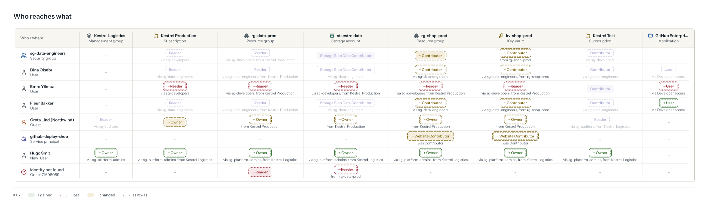
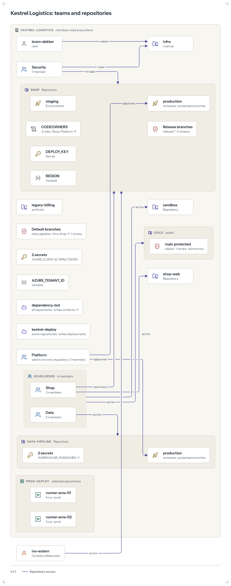

# Who reaches what: importing Azure, Entra ID and GitHub access

Access is already written down, in the exports the tools you have can make: `az role assignment list`, Microsoft Graph, AzureHound, `gh api`. Cartography reads a folder of those files and draws who reaches what: an [access diagram](types.md) for Azure and Entra ID, a GitHub diagram for an organisation. Nothing is fetched and nothing leaves your machine: you run the export, Cartography reads the files. Or let it run the same commands with your own `az` or `gh` login, read-only: [live import](live-import.md).

```sh
carto render exports/ -o access.svg            # the picture, nothing else is written
carto import exports/                           # the diagram: exports.yaml beside the folder
carto import exports/ -o -                      # to the terminal
carto diff exports-march/ exports-june/ -o june.md   # who gained and lost what, in words
```

A folder (and the folders under it) is read whole. What each file is shows from what is in it, not from its name; a file that is neither is passed over and said so. The examples below use the invented tenant and organisation in [examples/access/import](../examples/access/import) and [examples/github/import](../examples/github/import): every name and GUID in them is made up.



## Azure and Entra ID

### What to export

```sh
mkdir exports && cd exports
az role assignment list --all --include-inherited -o json > role-assignments.json
az role definition list -o json > role-definitions.json          # role names and permissions of custom roles
az account management-group list -o json > management-groups.json
az account management-group show --name <root> --expand --recurse -o json > management-group-tree.json
az account list -o json > subscriptions.json
az ad user list -o json > users.json                              # names, and who is a guest
az ad group list -o json > groups.json
az ad sp list --all -o json > service-principals.json
for g in $(az ad group list --query '[].id' -o tsv); do
  az ad group member list --group "$g" -o json > "group-members-$g.json"
done
```

Only `role-assignments.json` is needed; every other file adds names, nesting or members. Without the listings of users, groups and service principals an identity is drawn by its id, and the import says which listing would name it.

Microsoft Graph responses are read as they come (`{ "value": [ … ] }`), one response per file or a folder of them:

| Graph request | What it adds |
| --- | --- |
| `/groups`, `/groups/{id}/members` (`transitiveMembers` too) | groups, nested groups, members |
| `/users`, `/servicePrincipals` | names, guests, managed identities |
| `/directoryRoles`, `/roleManagement/directory/roleAssignments` | Global Administrator and the other directory roles |
| `/identityGovernance/entitlementManagement/accessPackages?$expand=resourceRoleScopes($expand=role,scope)` | access packages and what they grant |
| `…/assignmentPolicies`, `…/assignments` | who may ask, who approves, how long, who holds one |

With `az rest` that is, for example, `az rest --url "https://graph.microsoft.com/v1.0/identityGovernance/entitlementManagement/accessPackages?\$expand=resourceRoleScopes(\$expand=role,scope)" > access-packages.json`.

[AzureHound](https://github.com/SpecterOps/AzureHound) output (`azurehound list -o azurehound.json`) is read too: the `{ "data": [ { "kind": "AZUser", "data": {…} } ], "meta": { "type": "azure" } }` format, after the collector's source at v3.1.3. Since AzureHound collects the whole directory, an assignment whose principal it does not describe is drawn as *Identity not found*.

### What the diagram shows

- **Scopes as a tree.** A scope string (`/providers/Microsoft.Management/managementGroups/…`, `/subscriptions/…/resourceGroups/…/providers/…`) becomes the management group, subscription, resource group and resource it names, each in the one above it.
- **An assignment once, where it was made.** What is below inherits it: the matrix view (`--view access`) shows it as inherited, *from Kestrel Production*, in a dashed cell; one held through a group reads *via sg-developers*.
- **Groups and their members**, nested groups too: a member of a group in a group reaches what both reach.
- **Access packages**: the catalog, what each grants, who may ask and who approves, how long, and who holds one now. `--view packages` is the packages × grants matrix.
- **Directory roles** (Global Administrator, User Administrator) on the directory.
- **Every name a readable id**: `sg-developers`, `kestrel-production`, `rg-shop-prod`. The GUID or resource id stays with it (`object-id`, `resource-id`, `role-id`), so the next import knows it again whatever you rename it to.

### A large tenant

Hundreds of users and dozens of scopes are not one picture. Without flags, the import keeps it readable and says what it did, each time with the flag that undoes it:

| By default | Flag |
| --- | --- |
| Members of groups are folded into their groups above 30 (*sg-developers, 96 members*) | `--principals all` draws each; `--principals groups` always folds; `--collapse-above 50` |
| Groups and service principals that reach exactly the same are one entry (*sg-\*-readers, 8 groups*) | `--group-by none` |
| Above 24 scopes, the deepest are folded into what they are in; a role held further down reads *Contributor (in part)* | `--depth 3` draws resources, `--depth 1` only management groups and subscriptions |
| More than 20 identities open as the who × where matrix (`view: access`) | `--view graph`, or `--focus` |
| | `--scope rg-shop-prod` or `--scope /subscriptions/…`: one part, with what is above it, since its roles reach it |

[examples/access/import/large](../examples/access/import/large) holds 300 invented principals: `carto render examples/access/import/large` draws 23 rows.

## GitHub

### What to export

The importer reads the REST answers as `gh api` saves them, a file per answer, in the folders that say which team or repository it is about. This script writes such a folder; it only reads, and needs `read:org` (and admin on the organisation for secrets, runners and installations). Run it yourself: Cartography never calls GitHub.

```sh
#!/bin/sh
# gh-export.sh <org> <folder>: the organisation as gh api answers, for carto import <folder>.
set -eu
org=$1; out=$2
mkdir -p "$out/teams" "$out/repos" "$out/rulesets"
cd "$out"
get() { gh api --paginate --slurp "$1" > "$2" 2>/dev/null || echo '{"message":"Not Found"}' > "$2"; }
gh api "orgs/$org" > org.json
get "orgs/$org/teams" teams.json
get "orgs/$org/members" members.json
get "orgs/$org/members?role=admin" owners.json
get "orgs/$org/outside_collaborators" outside-collaborators.json
get "orgs/$org/repos" repos.json
get "orgs/$org/rulesets" rulesets.json
for id in $(gh api "orgs/$org/rulesets" --jq '.[].id'); do gh api "orgs/$org/rulesets/$id" > "rulesets/$id.json"; done
get "orgs/$org/actions/secrets" secrets.json          # names only: GitHub never gives a value
get "orgs/$org/actions/variables" variables.json      # the import keeps names only
get "orgs/$org/actions/runners" runners.json
get "orgs/$org/actions/runner-groups" runner-groups.json
get "orgs/$org/installations" installations.json
for t in $(gh api --paginate "orgs/$org/teams" --jq '.[].slug'); do
  mkdir -p "teams/$t"
  get "orgs/$org/teams/$t/members" "teams/$t/members.json"
  get "orgs/$org/teams/$t/repos" "teams/$t/repos.json"
done
for r in $(gh api --paginate "orgs/$org/repos" --jq '.[] | select(.archived | not) | .name'); do
  mkdir -p "repos/$r/rulesets"
  get "repos/$org/$r/collaborators?affiliation=direct" "repos/$r/collaborators.json"
  get "repos/$org/$r/environments" "repos/$r/environments.json"
  get "repos/$org/$r/rulesets" "repos/$r/rulesets.json"
  for id in $(gh api "repos/$org/$r/rulesets" --jq '.[] | select(.source_type == "Repository") | .id'); do
    gh api "repos/$org/$r/rulesets/$id" > "repos/$r/rulesets/$id.json"
  done
  branch=$(gh api "repos/$org/$r" --jq .default_branch)
  get "repos/$org/$r/branches/$branch/protection" "repos/$r/branch-protection.json"
  get "repos/$org/$r/actions/secrets" "repos/$r/secrets.json"
  get "repos/$org/$r/actions/variables" "repos/$r/variables.json"
  gh api "repos/$org/$r/contents/.github/CODEOWNERS" -H 'Accept: application/vnd.github.raw' > "repos/$r/CODEOWNERS" 2>/dev/null || rm -f "repos/$r/CODEOWNERS"
done
```

GitHub's own error answers, saved by the script (*Branch not protected*, *Not Found*), are read as what they say. Rather one file? The same answers in one JSON object are read too: `{ "org": …, "teams": […], "repos": […], "team_members": { "<team>": […] }, "team_repos": {…}, "collaborators": { "<repo>": […] }, "environments": {…}, "repo_rulesets": {…}, "branch_protection": {…}, "repo_secrets": {…}, "codeowners": { "<repo>": "…" } }` (see [kestrel-combined.json](../examples/github/import/kestrel-combined.json)).

### What the diagram shows



- **Teams**, a team with teams in it drawn around them; a line for what a team holds **itself**, not what it has from the team above it. A team that holds the same on every repository says so on itself (*admin on every repository*) instead of a line to each.
- **Repositories** with what is in them: environments with their reviewers, rulesets, classic branch protection, CODEOWNERS (how many rules, whose), secrets and variables by name. Organisation rulesets say which repositories they cover.
- **People** who hold a role directly, and outside collaborators, outside the organisation. Members of teams are folded into their teams above six.
- **Runners** by group, and installed apps with what they may write.

`--as access` draws the same organisation as an access diagram instead: teams are groups, repositories resources, read < triage < write < maintain < admin a ladder, owners owner on the organisation. Its matrix (`--view access`) answers "who can write to `shop`" row by row.

### A large organisation

Above 24 repositories, those whose names start the same are one entry (*shop-\*, 15 repositories*), and a line says on how many of them a team holds its role (*read · 13 of 15*). What is inside each repository is left out (`--depth 2` draws it). `--group-by none` draws every repository, `--group-by access` puts together those reached in exactly the same way, `--scope shop-` draws one family. [examples/github/import/large](../examples/github/import/large) is 120 repositories, 28 teams and 300 members.

## Running it again

The diagram `carto import` (or `carto render --write`) made is yours to edit; importing again over it keeps what you did:

| The export wins | Yours stays |
| --- | --- |
| who holds which role where, members, packages, rulesets | title, subtitle, comments, `views:`, `focus:`, `steps:` |
| what is gone from the export goes | a label or caption you changed, an id you renamed |
| captions the import wrote (*14 members*) | entries and lines you added yourself |

Pins in `<diagram>.layout.json` stay, since ids stay. In a GitHub diagram an imported entry carries the tag `imported`; take the tag off and the import leaves that entry as it is.

## What was gained and lost

```sh
carto diff exports-march/ exports-june/                 # words in the terminal
carto diff exports-march/ exports-june/ -o june.md      # the same as markdown, for a pull request or an audit file
carto diff exports-march/ exports-june/ -o june.svg     # the newer drawing: gained highlighted, lost as ghosts where it was
carto diff exports-march/ exports-june/ --view access -o june.png   # the matrix with the cells marked
carto diff access-march.yaml access-june.yaml            # two diagrams work the same way
```

The newer export is imported over the older one, so what both have keeps its id. The words are effective access, not a list of changed assignments: joining a group counts, a role on a subscription is told once and not again for everything in it, and a group's change says whom it carries along:

```text
+ sg-data-engineers gained Contributor on rg-shop-prod, and with it Dina Okafor, Fleur Bakker
+ Hugo Smit gained Owner on Kestrel Logistics (via sg-platform-admins)
+ Fleur Bakker gained User on GitHub Enterprise (via Developer access)
- Emre Yilmaz lost Reader on Kestrel Production (via sg-developers)
~ github-deploy-shop changed from Contributor to Website Contributor on rg-shop-prod
```

In the matrix a gained cell reads `+ Owner`, a lost one `− Reader` struck through, a changed one `~ Maintain` with *was Write* under it, and the key says so: never colour alone. GitHub diagrams are told the same way, teams in teams included (*Developers gained write on route-planner, and with it Data, Shop*). `--json` puts the changes under `access`; `--exit-code` exits 1 when anyone gained or lost anything, for a scheduled check.

## Checks

Quiet warnings, never changes to the picture:

- a guest with Owner (or another owner-level role) on a management group, subscription or organisation;
- a user who holds directly what a group they could be in already holds on the same scope;
- an assignment to an identity that no longer exists (*Identity not found*): it can go;
- a repository without a ruleset or branch protection on its default branch (only where its rulesets were exported);
- a team that is admin on more than five repositories itself;
- a person who holds directly what their team already gives them, and an outside collaborator with admin.

## In the editor

Drop the export files (or one combined GitHub JSON) on the page, or pick them with **Open YAML file…**: they open as one diagram. Open a folder of exports with **Open folder…** and it is drawn into `access.yaml` or `github.yaml` there (⌘S writes it); the command palette offers *Who reaches what in …* or *GitHub organisation of …* to bring it up to date, keeping your edits. Select a group and press `F` for what it reaches (`D` turns it upstream: who reaches it).
