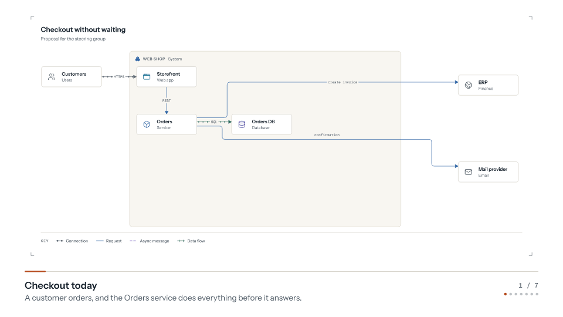

# Animation: steps as a GIF or a video

A diagram with [steps](steps.md) tells a story one part at a time. As an animation it tells it on its own: in a
README, a pull request, a chat message or a slide that plays by itself. Each step is held for a moment, then
blends into the next: what appears fades in, what goes fades out, and what stands back or comes forward shifts
with it. The drawing never moves, because it is laid out once. The step's title and caption are a lower third
under the drawing, with "3 / 7" and a dot per step on the right.



## Making one

- In the editor: **Export → Animation (GIF / MP4)**, or *Animation* in the command palette (⌘K). Pick the format,
  the size, how long each step stays, light or dark, and whether new lines are drawn along their path. `Enter`
  exports, `Esc` closes; the choices are remembered (the theme follows the editor). Everything is made in the
  browser: the GIF by Cartography's own encoder, MP4 (H.264) and WebM (VP9) by the browser's video encoder
  (WebCodecs). A format the browser cannot encode is greyed out.
- On the command line:

  ```sh
  carto animate walkthrough.yaml -o walkthrough.gif
  carto animate walkthrough.yaml -o walkthrough.mp4 --size 1920x1080 --hold 3
  carto animate shop.yaml --layers -o shop-layers.gif
  carto animate shop.yaml --walk "customer -> web -> api -> db" -o request.webm
  ```

  | Option | |
  | --- | --- |
  | `-o out.gif\|out.mp4\|out.webm` | the file; its extension picks the format |
  | `--view name`, `--theme name` | as for `carto render` (`--theme survey-dark` for a dark one) |
  | `--layers` | walk the layers instead of the steps (below) |
  | `--walk "a -> b -> c"` | walk a route hop by hop (below) |
  | `--hold 2.5` | seconds each step stays; the last one stays twice as long |
  | `--transition 0.5`, `--no-transitions` | seconds of the blend between steps; or cut |
  | `--draw-lines` | lines that appear are drawn from where they start to where they end, after the rest has faded in |
  | `--fps 30` | frames per second of a video (a GIF's blends run at 15) |
  | `--size 1920x1080` | the frame; `1280x720` by default (`720p` and `1080p` work too). Always 16:9 |
  | `--no-captions` | no lower third: the drawing alone, larger |

  MP4 and WebM are made by **ffmpeg** when it is on the `PATH` (Cartography never installs anything). Without it
  `carto animate` still writes the GIF, plus the frames as PNGs in `<name>-frames/` with a `frames.txt` that says
  how long each one shows, and prints the one ffmpeg command that turns them into the video elsewhere.

## What it tells

- **Steps** (the default): the diagram's `steps:` (or a view's), each one a beat. A diagram without written steps
  tells the ones it implies: a dynamic view line by line, a sequence diagram message by message.
- **Layers** (`--layers`, or *Tell: Layers* in the dialog): the drawing as the story leaves it, then each of its
  [layers](layers.md) in turn, standing out with the rest faded **in place**, whatever the layer's own
  `dim-others` says, so nothing moves between beats. The layer's title and caption are the lower third.
- **A walk** (`--walk`, command line): a route through the drawing, a beat per hop. The hop's line and ends are in
  focus, where the walk has been stays at full strength, and what it has not reached yet stands back: a request
  followed from the browser to the database.

## Size and quality

A GIF has 256 colours. Diagrams are flat colour, so Cartography picks one palette for the whole animation from
the exact colours of its steps: every fill and every paper tint stays exact, and the in-between shades of text
edges share what is left. Each frame stores only the rectangle that changed, and a step held for 2.5 seconds is
one frame shown that long. The invoice walkthrough (7 steps) is about 0.8 MB at 1280×720 and 1.1 MB at
1920×1080; the one above, 960×540 with its lines drawn, 0.45 MB.

A video is smaller per second and smoother, and the better pick for a slide or a long story; a GIF plays
anywhere a picture does (a README, a wiki, a chat).

| | GIF | MP4 | WebM |
| --- | --- | --- | --- |
| Plays in | everything that shows pictures | everything that plays video | browsers, VLC |
| Made in the editor by | Cartography | the browser (H.264) | the browser (VP9) |
| Made by `carto animate` with | nothing else | ffmpeg | ffmpeg |
| Invoice walkthrough, 1280×720 | 0.8 MB | 0.6 MB | 0.5 MB |
