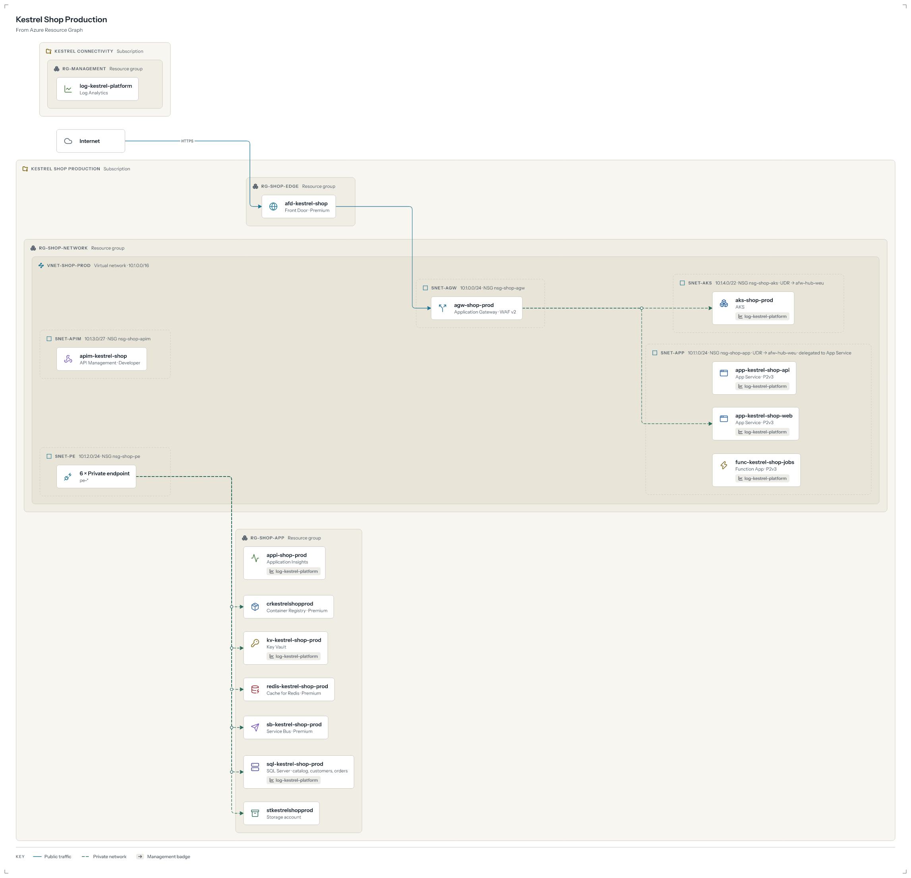
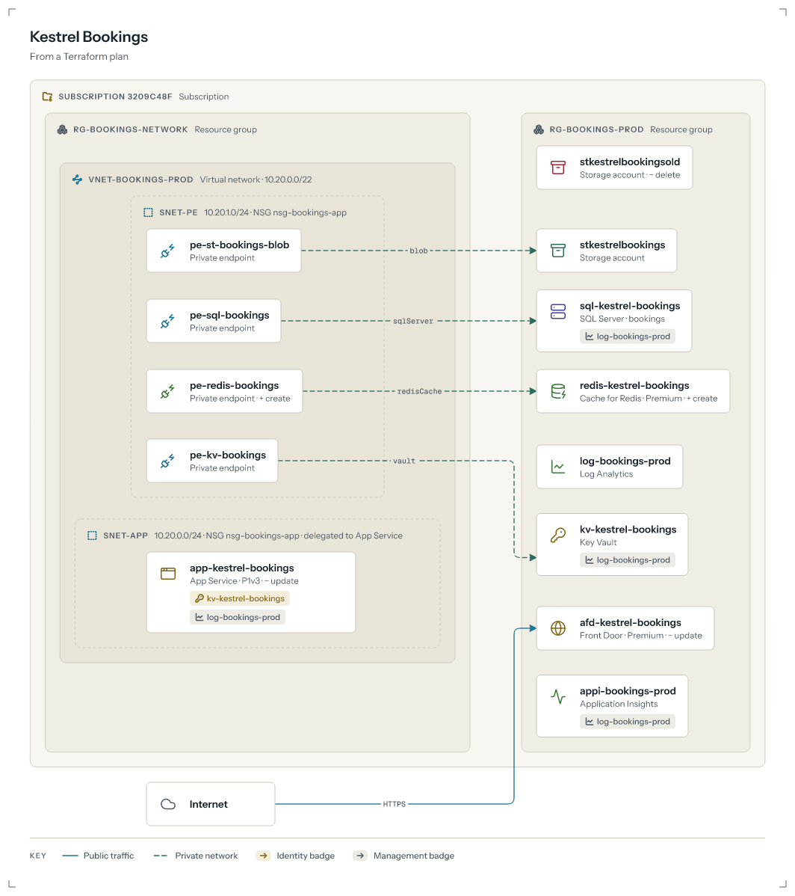

# What runs where in Azure: importing Resource Graph, Bicep and Terraform

What is deployed is already written down, in exports the tools you have can make: Azure Resource Graph, the JSON `az bicep build` compiles, `terraform show -json`. Cartography reads those files and draws an [azure diagram](types.md): management groups, subscriptions, resource groups, networks and subnets, each resource in the one it is in, and lines for what the export says goes where. Nothing is fetched and nothing leaves your machine: you run the export, Cartography reads the files. It never calls Azure, never runs Bicep or Terraform. To have Cartography run `az graph query` for you instead, with your own login and read-only: [live import](live-import.md).

```sh
carto render exports/ -o estate.png             # the picture, nothing else is written
carto import exports/                            # the diagram: exports.yaml beside the folder
carto import plan.json                           # one file: plan.yaml beside it
carto import exports/ -o -                       # to the terminal
carto diff exports-march/ exports-june/ -o june.png   # what was added, changed and removed
```

A folder is read whole; what each file is shows from what is in it, not from its name. A file that is none of these is passed over and said so. The examples below use the invented company in [examples/azure/import](../examples/azure/import) (made by its `make-fixtures.mjs`): every name, GUID and host in it is made up.



## What to export

### Azure Resource Graph

```sh
mkdir exports && cd exports
az graph query -q "resources" --first 1000 -o json > resources.json
az graph query -q "resourcecontainers" --first 1000 -o json > containers.json          # names of subscriptions, resource groups, management groups
```

`az graph query` returns at most 1000 rows per call; for more, page with `--skip-token` (the answer says `skip_token`) and save each page as its own file, or narrow it: `-q "resources | where subscriptionId == '<id>'"`, `--management-groups <mg>`, `--subscriptions <id> <id>`. Both `{ "data": [ … ] }` and the bare array (`--query data`) are read, and so is `az resource list -o json`, which has the same rows with fewer properties.

Diagnostic settings are not in Resource Graph. To see which resources send their logs where, save them too; the list is read whatever it is called:

```sh
for id in $(az graph query -q "resources | project id" --first 1000 --query "data[].id" -o tsv); do
  az monitor diagnostic-settings list --resource "$id" -o json
done | jq -s 'add' > diagnostic-settings.json
```

### Bicep and ARM templates

```sh
az bicep build --file main.bicep --outfile main.json                 # compiled, not deployed
az bicep build-params --file main.bicepparam --outfile main.parameters.json   # optional
az group export --name rg-shop -o json > rg-shop.json                # or a template exported from the portal
```

Bicep source (`.bicep`, with its modules and a `.bicepparam` next to it) is read too, without `az bicep build`: it is compiled here to the same template, then read as below; what that compiler reads and what it names instead is in [diagrams from a code repository](repo-import.md#bicep). Bicep itself is never run. Expressions are worked out as far as the template says: parameters with their defaults (or from a parameters file in the same folder), variables, `concat`, `format`, `resourceId` and its kin, `copy` loops, conditions, child resources, extension resources with a `scope` (diagnostic settings), and modules (nested deployments) with what they are given, the resource group they are deployed to, and the outputs another resource reads from them. What can only be known when it is deployed reads as such: `uniqueString(…)` and `guid(…)` become `…` (`stbookings…`), a parameter without a default keeps its words in braces (`{env}`), and the import says which. The resource group the template is deployed to is drawn as *Target resource group*. A linked template (`templateLink`) is not fetched.

### Terraform

```sh
terraform show -json > state.json                                 # the state
terraform plan -out plan.out && terraform show -json plan.out > plan.json   # a saved plan
```

`azurerm_*` resources are drawn as an azure diagram (AWS and Google Cloud resources in the same file go to [the cloud type](types.md#cloud) instead: `carto import` there). Resources that only join two others are read onto the one they belong to: a subnet's security group and route table associations, VNet integration of an App Service, a network interface in a load balancer pool, peerings, routes, diagnostic settings. A plan's new resources have no id yet: the configuration in the plan says what they refer to.

A plan is drawn as it will be after it is applied, with what it does on each card, in words and in colour: **+ create** (green), **~ update** and **± replace** (amber), **− delete** (rose; still drawn, where it was). A change to a part of something (a Front Door origin, a database) marks what it is part of. For the picture with what is added and removed ringed, as a reviewer of a pull request wants it, compare the state with the plan: `carto diff state.json plan.json -o plan.png`.



## What the diagram shows

- **Containers as Azure has them**: management groups (from `resourcecontainers`, when there are two subscriptions or more), subscriptions, resource groups, virtual networks with their address space, subnets with their range, security group, route out and delegation (*10.1.1.0/24 · NSG nsg-shop-app · UDR → afw-hub-weu · delegated to App Service*; the firewall is named when a route's next hop is its address).
- **Each resource where it sits**: in its subnet when the export says so (a private endpoint's subnet, a machine's network interface, an App Service's VNet integration, an AKS node pool, a delegated PostgreSQL server, API Management, gateways, Bastion, the firewall), else in its resource group. Network placement wins: an app from *rg-shop-app* in a subnet of *rg-shop-network* is drawn in the subnet.
- **About 70 resource types** as a kind of their own (App Service, Function App, Container Apps, AKS, VMs, SQL, PostgreSQL, Cosmos DB, Storage, Redis, Key Vault, Service Bus, Event Hubs, API Management, Front Door, Application Gateway, firewall, VPN and ExpressRoute gateways, private endpoints, DNS zones, Log Analytics, Application Insights, OpenAI, AI Search, Data Factory, Databricks, …); any other type is a plain service named after its type, and the import lists those types. A card's caption says what matters of it: the App Service plan's size, a SQL server's databases, a SKU.
- **Lines**: private endpoint → what it reaches (with the sub-resource: *blob*, *vault*, *sqlServer*); Front Door → its origins and Application Gateway → its backends, by host name or address (an address of a network interface stands for its machine, or for the cluster drawn alone in that subnet); load balancer → the machines in its pools; VNet peerings; VPN and ExpressRoute connections to on-premises; the internet to what faces it (Front Door, a gateway or load balancer with a public frontend, external API Management).
- **Badges, not lines, for what is on nearly everything**: Key Vault references in app settings (`@Microsoft.KeyVault(…)`, where the export has app settings: templates and Terraform, not Resource Graph) and diagnostic settings or workspace links to Log Analytics. `badges: [identity, management]` in the YAML; take one out to draw it as lines.

Not read: tags, secrets and app setting values (only which vault a reference names), role assignments (`carto import` reads them as an [access diagram](access-import.md)), NSG rules, firewall rules, DNS records, what a connection string names without a resource id (an app's link to its database, when nothing but a connection string says so), `dependsOn` (deployment order, not traffic).

## A large estate

Hundreds of resources are not one picture. Without flags the import keeps it readable and says what it did, each time with the flag that undoes it:

| By default | Flag |
| --- | --- |
| Plumbing is left out: network interfaces, disks, security groups, route tables, public IPs, App Service plans, Container Apps environments, firewall policies, managed identities, SQL databases (named on their server) | `--all` draws them |
| Above 12 cards in one place, three or more of a kind are one counted card: *7 × Storage account* (*stkestrel\**); private endpoints and private DNS zones from four, wherever they are. A plan's changes are never folded | `--collapse-above 50` |
| Networks and subnets are drawn | `--depth 2` stops at resource groups, `--depth 1` at subscriptions |
| | `--subscription "Kestrel Data*"` or `--rg 'rg-shop-*,rg-hub-network'`: one part (names, ids, `*` wildcards, commas between several), with what it leads to (a private endpoint's target, a gateway's backends, the workspace its logs go to) |

The focus engine works on the result: `carto render estate.yaml --focus agw-shop-prod` draws the gateway with what it reaches; in the editor select it and press `F`. A peering is a line between two networks, and a line on a group counts for everything in it: with `--hops 2` a focus inside a peered network brings the other network along.

[examples/azure/import/landing-zone](../examples/azure/import/landing-zone) is a hub-and-spoke landing zone of about 150 resources in three subscriptions: `carto render examples/azure/import/landing-zone` draws 42 cards.

## Running it again

The diagram `carto import` (or `carto render --write`) made is yours to edit; importing again over it keeps what you did:

| The export wins | Yours stays |
| --- | --- |
| kind, where it is (`in`), the caption, plan marks | title, subtitle, comments, `views:`, `focus:`, `steps:` |
| what is gone from the export goes | a label you changed, a tone you chose |
| lines of the import's styles between imported cards | entries and lines you added yourself |

Every imported entry carries the tag `imported`; take the tag off and the import leaves that entry as it is. Ids come from names (`app-kestrel-shop-web`, a subnet name that is used twice gets its network: `snet-pe-vnet-shop-prod`) and an earlier id is found again by kind and name, so pins in `<diagram>.layout.json` hold. One resource more in the export is one line more in the YAML, and drawn with `--stable` the rest stays where it was.

## What changed between two exports

```sh
carto diff exports-march/ exports-june/                 # in the terminal: + node kv-kestrel-shop-certs
carto diff exports-march/ exports-june/ -o june.png     # the newer drawing, added and changed marked, removed as ghosts
carto diff state-march.json state-june.json             # two files work the same way
```

The newer export is imported over the older one, so what both have keeps its id and its place.

## In the editor

Drop the export files on the page, or pick them with **Open YAML file…**: they open as one azure diagram. Open a folder of exports with **Open folder…** and it is drawn into `azure.yaml` there (⌘S writes it); the command palette offers *Azure resources in …* to bring it up to date, keeping your edits. Everything is read in the browser.
