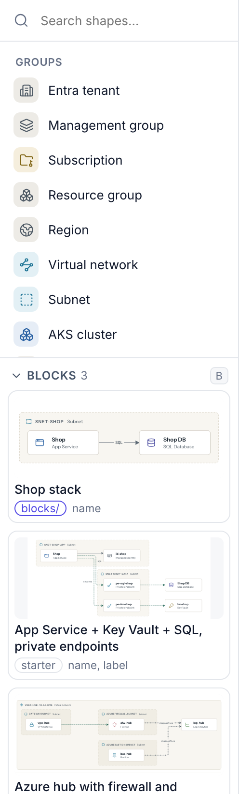
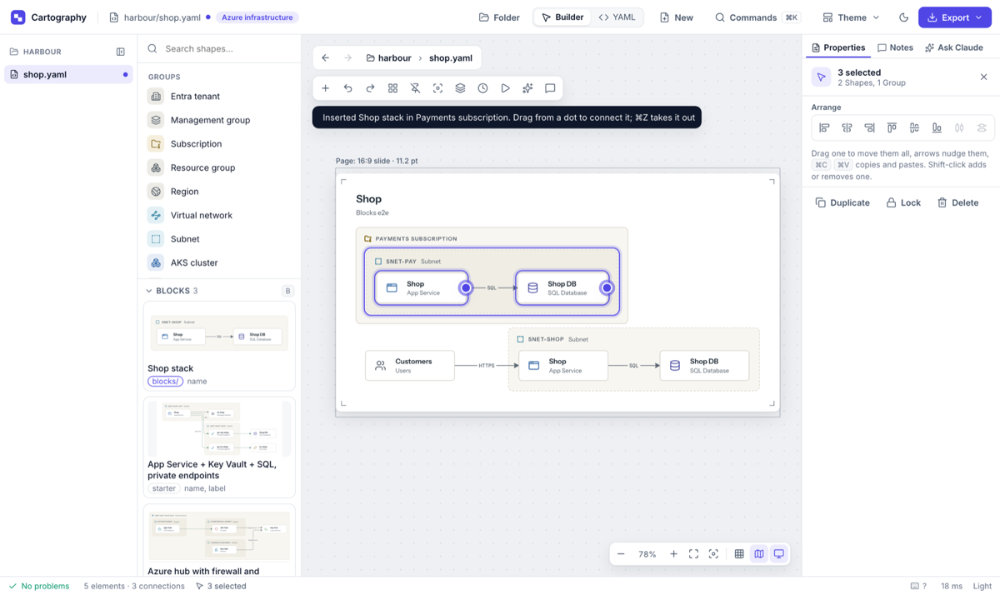
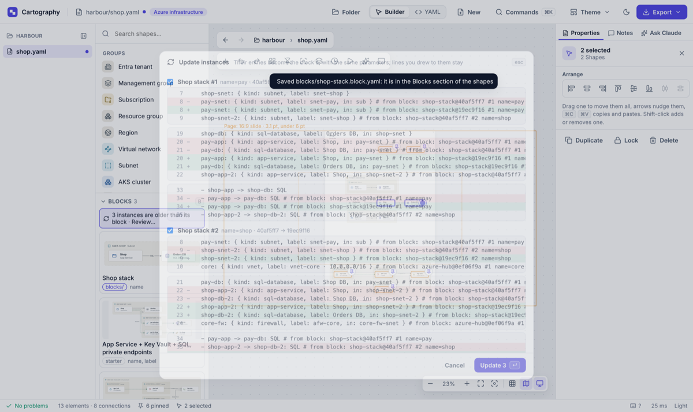

# Blocks: the patterns you draw again and again

A block is a fixed fragment of one diagram type: a hub with its firewall and Bastion, an App Service with its Key Vault and SQL behind private endpoints, the standard namespace of a service on Kubernetes. Save it once (from a selection, in the editor or with `carto blocks new`), then insert it in any diagram of that type: its parameters filled in, its ids made unique, in the group you choose.

An inserted block is **plain YAML**. Nothing stays linked: each entry carries a comment that says where it came from, and that is all.

```yaml
nodes:
  pay-app: { kind: app-service, label: Payments, in: pay-app-snet } # from block: azure-app-stack@2dff0ca9 #1 name=pay label=Payments
```

Blocks differ from `include:` (a whole file pulled in, still linked): a block is small, fixed and copied in.

## Block files

A block lives in `blocks/<name>.block.yaml` in your project folder, or in your own library (the browser keeps one for the editor; the CLI reads `~/.config/cartography/blocks/`, or `$CARTO_CONFIG_DIR/blocks/`). Starter blocks ship in [examples/blocks](../examples/blocks). A name found in the folder wins over your library, which wins over the starters.

```yaml
type: azure
title: Azure hub with firewall and bastion
description: A hub VNet with Azure Firewall, Bastion and a VPN gateway in their own subnets
tags: [network, hub, landing zone]
params:
  name: { default: hub, label: Hub name }
  cidr: { default: 10.0.0.0/16, label: Address space }

groups:
  ${name}: { kind: vnet, label: "vnet-${name} · ${cidr}" }
  ${name}-fw-snet: { kind: subnet, label: AzureFirewallSubnet, in: "${name}" }

nodes:
  ${name}-fw: { kind: firewall, label: "afw-${name}", in: "${name}-fw-snet" }

edges:
  - ${name}-fw -> ${name}-logs: { label: diagnostics, style: management }

pins:
  nodes:
    ${name}-fw: { x: 0, y: 40 }
```

- **`type`** is the diagram type it belongs to; everything else that is not `title`, `description`, `tags`, `params` or `pins` is the fragment (nodes, groups, edges, or whatever collections the type has). A setting such as `provider: aws` is used to check and preview the block, not inserted.
- **`params`**: each `${name}` in an id, a label or any other value is asked for on insert, its default filled in. A parameter that ends up in an id must be an id too (letters, digits, `-`, `_`). Inside `{ }` quote a value that holds `${…}`.
- **`pins`** (optional): where each node stands, from the block's top-left. A block dropped on the drawing keeps its nodes in these places from where it was dropped; without pins, as its preview draws them. Saved from the editor, a block records the places they had there.
- **The fragment rules**: filled in with its defaults, a block is valid for its type's schema and draws on its own: every line and every `in:` points at something inside the block. Every `${…}` is declared under `params:`. `carto blocks show` and the Blocks section say what breaks a rule.

The **hash** in `name@hash` changes with the fragment and its parameters, not with the title, description, tags, comments or pins.

## In the editor



The shapes panel of the **Builder** has a **Blocks** section: the blocks of this diagram's type, each with a preview, its source (`blocks/`, *mine*, *starter*) and its parameters. Search it when there are more than a few.

- **Insert**: click a block, or press **B** anywhere on the drawing and type a few letters, then **↵**. It goes into the selected group (or the group of the selected shape). Its parameters are asked for in a small form, defaults filled in; **↵** inserts.
- **Drag** a block onto the drawing or into a group: it lands where you let go, its nodes pinned as the block has them.
- **Unique ids**: when an id is taken (a second instance with the same name), every id of the block gets the same suffix (`-2`), so they stay recognisable as one set; references inside the block follow.
- **Lines to the rest** are yours to draw: the inserted shapes are selected and show their connect dots until your next edit; drag from a dot to another shape.
- **One undo step**: ⌘Z takes the whole insert out.



**Save as block…** (**⇧B**, ⌘K, or right-click a selection): the selected shapes and groups, with the groups they sit in, what a selected group holds and the lines between them. Lines to anything else are left out. The dialog asks for a title (the file name follows), a description and tags, and which parts become parameters:

- When the ids share a start (`shop-app`, `shop-db`), it offers `${name}` for it, ticked; labels that spell it the same way follow.
- Each label can become a parameter of its own; the ones that look specific to this drawing (the shared start, a number, *prod*, *test*) are suggested.

With a folder open it writes `blocks/<name>.block.yaml` there, or into your library in this browser; without a folder, into your library. Saving under a name that exists replaces that block (the button says *Replace*).

### When a block changes



When a block in reach is newer than the instances in the open diagram (their hash differs), the Blocks section says so: **N instances are older than their block · Review…** (also *Update instances of blocks* in ⌘K). The dialog shows, per instance, the change it would make to the YAML, what is new, what goes and how many of your own lines point at what goes. Untick what should stay; **↵** updates the rest in one undo step.

An update keeps the instance's parameters, ids (suffix included), the group it was put in and where its entries are in the file; lines you drew to it stay. Its entries become the block's, so changes made by hand to an instance are replaced: take the `# from block:` comment off an entry to make it the diagram's own.

## On the command line

```sh
carto blocks list                                  # what is in reach: ./blocks, your library, the starters
carto blocks show azure-hub -o hub.png             # its parameters and problems; -o draws a preview
carto blocks new shop-stack --from shop.yaml --select shop-app,shop-db --title "Shop stack"
carto blocks insert azure-app-stack into shop.yaml --into sub --param name=pay --param label=Payments
```

`new` writes `./blocks/<name>.block.yaml` (`--user` writes into your library), with `${name}` for the shared start of the ids and the places the shapes have when drawn. `insert` writes the file in place (`-o other.yaml`, or `-o -` for standard output); the rest of the file keeps its bytes.

## Starters

| Block | Type | Parameters |
| --- | --- | --- |
| `azure-hub` | azure | name, cidr: a hub VNet with Azure Firewall, Bastion and a VPN gateway in their subnets, logging to Log Analytics |
| `azure-app-stack` | azure | name, label: App Service with a managed identity, Key Vault and Azure SQL behind private endpoints |
| `aws-three-tier` | cloud (aws) | name, zone: one zone's slice: load balancer, ECS service, Aurora |
| `k8s-namespace` | kubernetes | name, host: a namespace with ingress and TLS secret, service, deployment, HPA, config map |
| `c4-web-api-db` | c4 | name, label: a software system with a web app, an API and a database |
