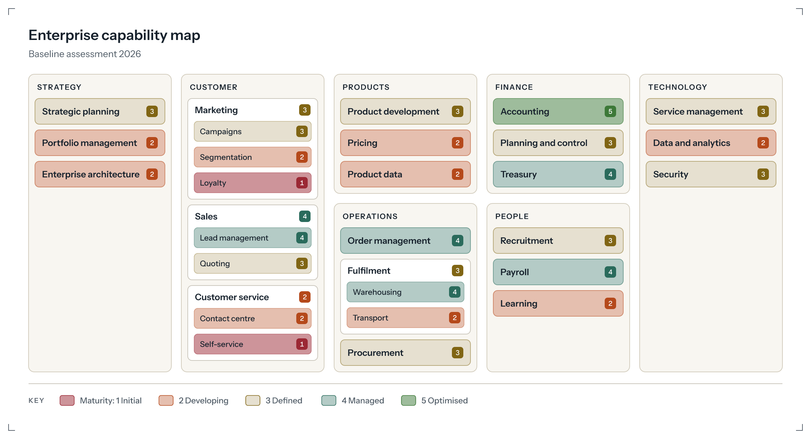
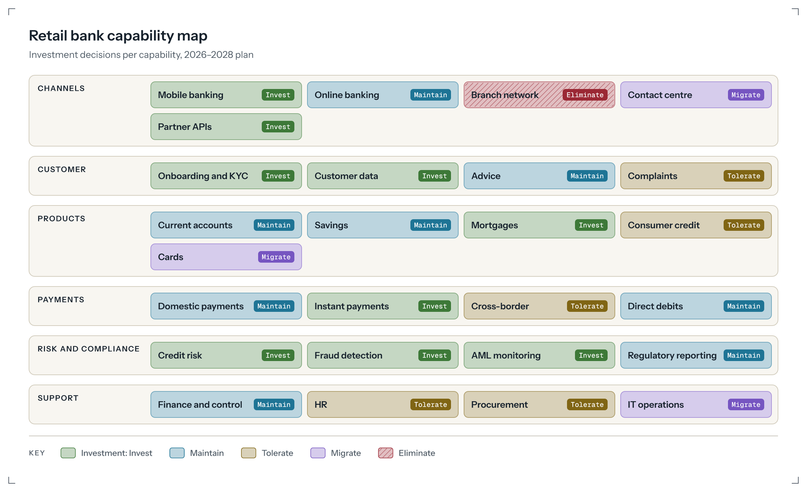
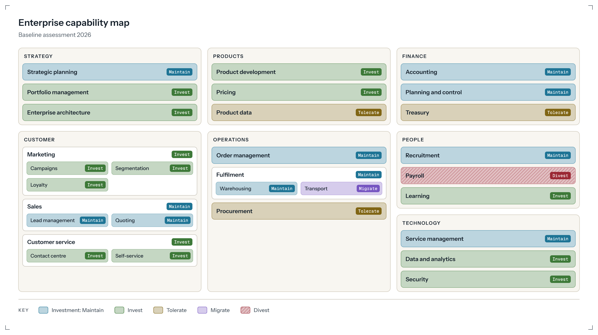
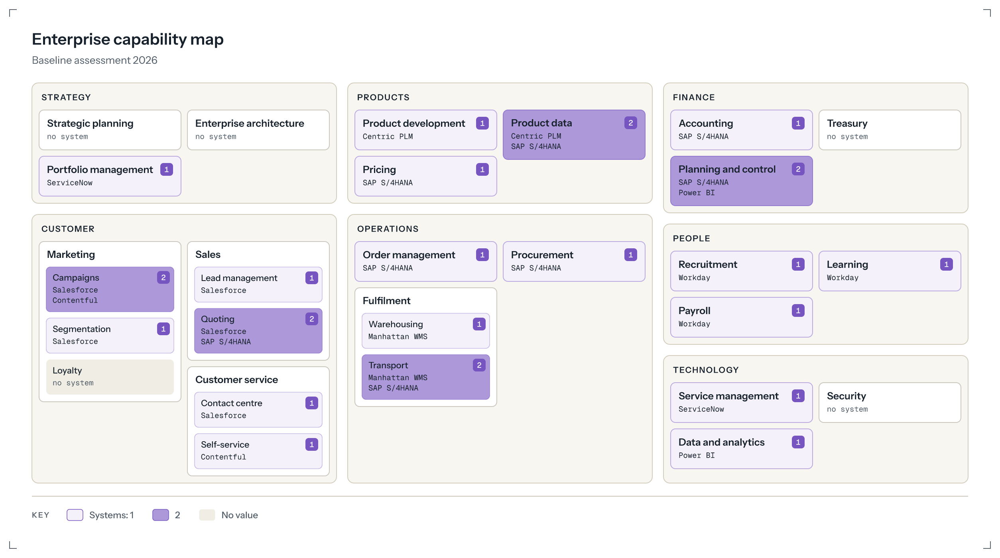

# Capability maps

`type: capabilities` draws what an organisation does, in three levels, without saying how or by whom: the picture a strategy deck opens with. Any property of the capabilities can colour the map as a heatmap (maturity, investment, fit, run cost, or one of your own), and capabilities can name the systems that support them.

It is not an enterprise-architecture repository. There is no value-stream modelling, no roll-up of scores, no import from LeanIX or Ardoq. What you get is a map that fits a slide, from a short YAML file, that you can diff and review like code.

```sh
carto new capabilities map.yaml                  # a small map with a maturity heatmap
carto render map.yaml --format png               # svg, png, pdf, pptx (native shapes)
carto render map.yaml --view investment -o investment.png
```



## The YAML is the outline

```yaml
type: capabilities
title: Enterprise capability map
heat: maturity

capabilities:
  Strategy:                             # level 1: an area
    - Strategic planning: { maturity: 3 }
    - Portfolio management: { maturity: 2 }
  Customer:
    - Marketing:                        # level 2, with its own value and level-3 chips
        maturity: 3
        capabilities:
          - Campaigns: { maturity: 3 }
          - Loyalty: { maturity: 1 }
    - Sales: [Lead management, Quoting] # level 2 with chips, no values
  Finance:
    capabilities:                       # the same as a map instead of a list
      Accounting: { maturity: 5 }
  Payroll: { parent: Finance }          # or flat, anywhere, with parent:
```

A capability is written in one of three ways, and they mix freely:

| Written | Means |
| --- | --- |
| `Name:` or `- Name` | a capability with nothing more to say |
| `Name: [A, B]` | a capability with these inside it |
| `Name: { maturity: 3, systems: [crm], capabilities: … }` | values, systems, and what is inside it |
| `Name: { parent: Other }` | a capability inside `Other`, written where it suits you (the builder writes this form) |

The names are the capabilities; a name used twice (Reporting under Sales and under Finance) is told apart by where it stands. `label:` overrides the drawn name, `caption:` and `description:` add text, `link:`/`links:` make it clickable, `tags:` work in `steps:` and `focus:`.

`depth: 2` draws the first two levels only, for a board that does not need the detail.

## Layout

Level 1 areas stand as **columns** by default; `layout: bands` lays them one under the other, each with its name on the left (good for layered maps: channels, core, support).

Every box of a level is as wide as the others, so the map reads as a grid. How many areas go in a row, whether they stack in lanes, and how many columns the capabilities and chips inside get is not guessed: the tree engine lays out every combination and keeps the one that comes out largest on a 16:9 slide. `columns: 4` fixes the areas per row (capabilities per row in bands). A map drawn before keeps its arrangement unless another is clearly better, so adding one chip moves only what stands under it.



## Heatmaps

`heat:` names the property that colours the map. Every capability with a value says it in a tag next to its name, so the colour only helps: the map reads in black and white and for colour-blind readers.

| Property | Scale | Reads as |
| --- | --- | --- |
| `maturity` | diverging, 1–5 | 1 Initial, 2 Developing, 3 Defined, 4 Managed, 5 Optimised; red to green |
| `fit` | diverging, 1–5 (or good, fair, poor) | 1 Poor … 5 Excellent |
| `investment` | categorical | invest green, maintain sky, tolerate amber, migrate violet, divest and eliminate red and hatched |
| `cost`, `spend`, `risk` | sequential | five steps from the lowest to the highest value; `€1.2M`, `800k`, `35%` read as numbers |
| `systems` | sequential | how many systems support it (counts `systems:`) |
| anything else | numbers sequential, words categorical | your own scale |

Spell out your own scale in the long form:

```yaml
heat:
  by: investment
  values:
    invest: green
    maintain: sky
    eliminate: { tone: rose, pattern: hatch, label: Switch off }
```

`scale:` (sequential, diverging, categorical), `min:`/`max:`, `labels:` (words for numbers), `tone:` (hue of a sequential scale) and `reverse:` (higher is worse) are the other keys. **Several heats are several views**: `heat: [maturity, investment]` gives the views `maturity` and `investment` (plus `map`, without colour); the first is the default drawing.



## Which systems support a capability

`systems:` lists what supports a capability: ids of model elements (from `include: [model.yaml]` or `elements:` in the same file) or plain names. With a model, the label comes from the element. Every capability's tooltip says "Supported by …", and the **`systems` view** lists them under each capability, with "no system" where there is none: the white spots of the landscape. `heat: systems` colours by how many there are.



## In the editor and on slides

The palette has one item, Capability: with a capability or area selected, the new one goes inside it (`parent:`). The inspector edits name, label, parent, systems and the usual heat values (maturity, investment, fit, cost, risk); other properties are edited in the YAML. Boxes are not dragged: the map places them.

PowerPoint export draws every box, chip and tag as a native shape with its text, the key included. Steps (`steps:`) work as for any type, for example to reveal one area at a time.
