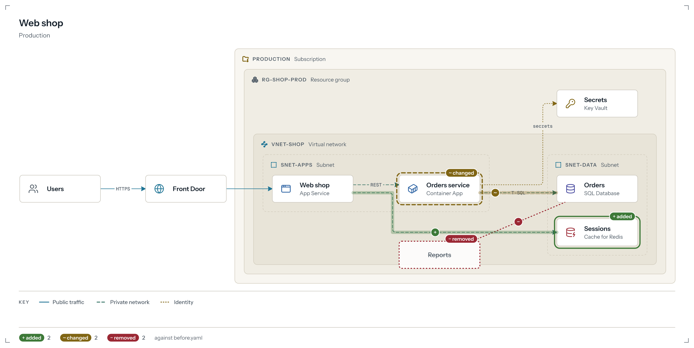
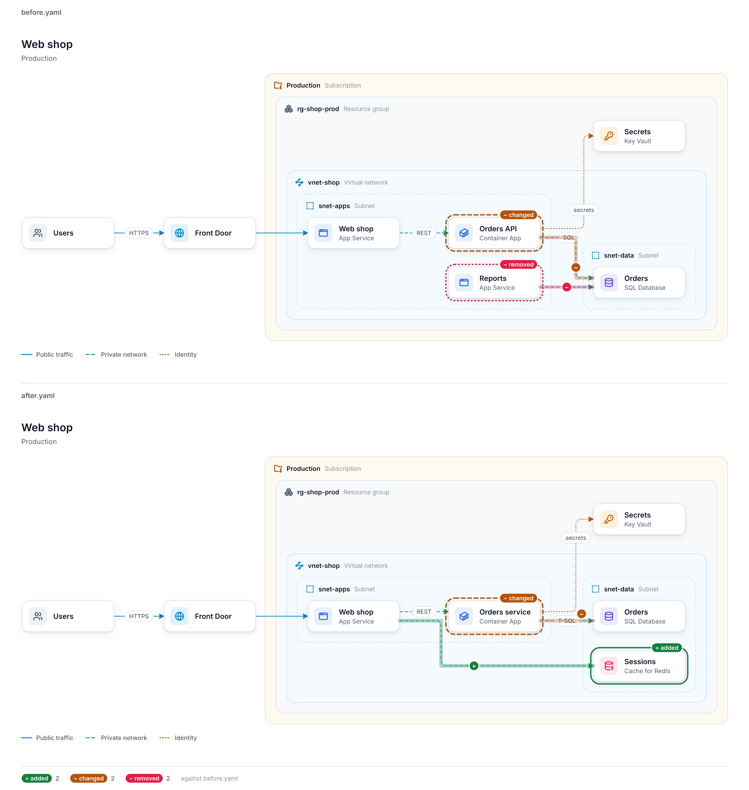

# Diagrams in CI

Diagrams live next to the code, so a pull request can change them. This page covers what you can check and show automatically:

| What | Command | Use |
|---|---|---|
| Is every diagram valid? | `carto validate` | fail the build on a broken diagram |
| Do saved positions still match? | `carto validate --drift` | catch pins for things that were renamed or removed |
| Does an edit redraw everything? | `carto render --stable` | keep the picture where it was after an edit |
| What changed? | `carto diff` | a list of changes and a marked-up picture |
| All of it on GitHub | the Action | one comment on the pull request, with pictures |

Everything runs on plain Node. No Docker, no headless browser, no server.



## Check diagrams: `carto validate`

```sh
carto validate docs/**/*.yaml
```

Prints `file ok` or the problems with line numbers, and exits 1 when a file has errors. Included files (`include:`) are read too, so a diagram that breaks because its model file changed is caught.

### Saved positions that no longer fit: `--drift`

When you drag things in the editor, their positions are saved next to the diagram in `<name>.layout.json`. Rename or remove an element in the YAML and its saved position stays behind. Nothing breaks: the entry is ignored. But the file slowly fills with entries that mean nothing, and a pin you thought you had is silently gone.

```sh
carto validate --drift docs/**/*.yaml         # exit 1 when a layout file names things that are gone
carto validate --drift --fix docs/**/*.yaml   # remove those entries
```

`--drift` reports, per file and per view: pinned nodes and groups, bent lines, locked elements and whole views that are no longer in the diagram. `--fix` removes exactly those entries and leaves the rest of the file alone. Run `--fix` locally and commit the result. In CI, use `--drift` without `--fix`.

## Keep the picture where it was: `carto render --stable`

A new line or a new box can make the layout engine choose a different arrangement. Mostly you do not want that: the diagram you knew is gone and the diff is unreadable.

- **In the editor** this is automatic. The app remembers the drawing you are looking at, and an edit moves as little as possible. A fresh arrangement is taken only when it is clearly better.
- **In the CLI** it is a choice, because the same input must always give the same picture:

```sh
carto render shop.yaml --stable
```

`--stable` writes a short note of where things were drawn into `shop.layout.json` (under `"layout"`, per view). Every later render, with or without `--stable`, reads that note and keeps things there. Only `--stable` writes it. Commit the layout file: then everybody, and CI, gets the same picture from the same two files.

Without a layout file, `carto render` is laid out from scratch every time, as before.

## What changed: `carto diff`

```sh
carto diff before.yaml after.yaml                 # two files
carto diff --git main docs/shop.yaml              # the file now, against the same file on main
carto diff --git HEAD~3 docs/*.yaml -o diffs/     # several, pictures into a folder
```

Elements are matched by id, so a renamed label is a change and not a removal plus an addition. Reordering the file changes nothing. With `--git`, included files are read from that commit too, so a change in a shared model file shows in every diagram that uses it.

```
docs/ci/after.yaml against before.yaml: 2 added, 2 removed, 2 changed
- node  reports        "Reports"
~ node  api            label: "Orders API" → "Orders service"
+ node  cache          "Sessions"
- line  reports -> db
+ line  web -> cache
~ line  api -> db      label: "SQL" → "T-SQL"
```

| Option | |
|---|---|
| `-o diff.svg`, `-o diff.png`, `-o folder/` | also write the picture |
| `--side-by-side` | before and after as two drawings, each with its own marks |
| `--json` | the same list for a script: `nodes`, `groups`, `edges`, each with `id`, `status` and `changes` (`field`, `before`, `after`), plus `counts` |
| `--view name` | compare one view |
| `--fresh` | lay the newer drawing out from scratch (default: things stay where they were, so only real changes stand out) |
| `--exit-code` | exit 1 when something changed, like `git diff --exit-code` |

### Reading the picture

The picture is the newer drawing. On top of it:

- **added**: a solid outline and the tag `+ added`
- **changed**: a dashed outline and the tag `~ changed`
- **removed**: a dotted ghost where the element used to be, and the tag `− removed`

A key in the corner repeats this. Colours follow the theme, but nothing depends on colour: the outline pattern and the words say the same, so it reads in greyscale and for colour-blind readers.

Side by side:



The two example files are [ci/before.yaml](ci/before.yaml) and [ci/after.yaml](ci/after.yaml).

Limits: sequence, git flow and roadmap diagrams are drawn as one shape. Their changes are listed in words, and the picture marks the diagram as a whole.

## The GitHub Action

On a pull request the action finds the diagrams the change touches, draws what changed and keeps **one comment** up to date. On a push it can draw every diagram to SVG or PNG and commit or upload the pictures.

Copy [ci/diagrams.yml](ci/diagrams.yml) to `.github/workflows/diagrams.yml`. The short version:

```yaml
name: Diagrams
on:
  pull_request:
    types: [opened, synchronize, reopened, closed]

permissions:
  contents: write        # pictures go to the cartography-diffs branch
  pull-requests: write   # the comment

jobs:
  diagrams:
    runs-on: ubuntu-latest
    steps:
      - uses: actions/checkout@v4
        with:
          fetch-depth: 0
      - uses: misja-pronk/cartography/packages/action@main
```

Pin the action to a tag or a commit instead of `@main` once you rely on it.

### What it looks at

- Every tracked YAML file whose top-level `type:` is a diagram type (or `model`). Other YAML is ignored: workflows, compose files, OpenAPI. Narrow it with `files`.
- A diagram counts as touched when its own file changed, when its `.layout.json` changed, or when a file it reads through `include:` changed. For the last kind the comment says through which file.
- Views are compared one by one. A view that still looks the same is left out.
- A diagram that reads a changed file but draws the same is named in one line, without a picture.
- New and removed diagrams are listed. A diagram that no longer draws is reported with its errors, as annotations on the lines too, and the step fails (`fail-on-error`).

The comparison is with the commit where the pull request left its base branch. That needs history: `fetch-depth: 0`. With the default shallow checkout the action fetches the tip of the base branch and compares with that, which also shows changes made on the base branch since.

### Inputs

| Input | Default | |
|---|---|---|
| `mode` | `auto` | `auto`: diff on pull requests, render otherwise. `diff`, `render`, or `setup` (only install, see below) |
| `files` | every YAML file | git globs, one per line or comma separated; `!` in front leaves files out |
| `views` | `true` | also compare or draw every view |
| `base` | the pull request's base | diff: commit or branch to compare with |
| `images` | `auto` | diff: `branch`, `artifact`, `none`, or `auto` (see below) |
| `image-branch` | `cartography-diffs` | the branch that holds the pictures |
| `comment` | `true` | diff: keep one comment up to date |
| `side-by-side` | `false` | diff: before and after instead of one marked-up drawing |
| `max-images` | `12` | diff: at most this many pictures in the comment |
| `scale` | `2` | pixels per unit in PNG files |
| `formats` | `svg` | render: `svg`, `png` or both |
| `output` | next to each diagram | render: a folder for the pictures. diff: where this run's files go |
| `commit` | `false` | render: commit the pictures that changed and push |
| `commit-message` | `Render diagrams [skip ci]` | |
| `upload-artifact` | `auto` | upload the output folder as an artifact |
| `artifact-name` | `cartography-diagrams` | |
| `fail-on-error` | `true` | fail the step when a diagram has errors |
| `token` | the job's token | used for the comment only |
| `setup-node` | `true` | install Node 24; turn off when the runner has it |

Outputs: `mode`, `changed` (number of diagrams touched, or pictures drawn), `diagrams` (JSON list of paths), `images` (`branch`, `artifact` or `none`), `output` (folder), `comment-url`, `commit`.

Each run also writes `diff.json` (the structural diff of every touched diagram), `comment.md` and the PNG files into the output folder, and the comment's text into the job summary.

### Where the pictures go

A comment can only show a picture that has an address. GitHub gives a workflow no place to upload one, so there is a choice to make. The action supports three ways and picks with `images`:

| `images` | How | Good | Not so good |
|---|---|---|---|
| `branch` | PNG files are pushed to a branch in your repository (`cartography-diffs`), the comment links to them | pictures right in the comment; works in private repositories; no outside service | needs `contents: write`; not possible for pull requests from forks |
| `artifact` | PNG files are uploaded as a workflow artifact, the comment has the words and a link to the run | needs no write access; works for forks | one click and a download away; artifacts expire (90 days by default) |
| `none` | words only | fastest | no picture |

`auto`, the default, uses the branch when the pull request comes from the same repository and falls back to the artifact when it cannot push (a fork, or no `contents: write`). When you set `branch` yourself and the push fails, the step fails, so you notice.

About the branch:

- It holds **one commit**, without history. Each run replaces the commit, so the repository does not grow with every push.
- Each pull request has its own folder (`pr-12/`). A new push replaces that folder. When the pull request closes, the folder is removed. That is why the example listens to `closed`.
- File names start with the commit (`4755cf6-docs-shop.png`), so a new push gets new addresses and nobody looks at a cached old picture.
- Your working branch and the checkout are not touched: the commit is built without checking anything out.
- Two runs at the same time do not lose each other's pictures: the push is refused when the branch moved, and the action starts over.
- If the branch is protected, allow the workflow to force-push it, or pick another name with `image-branch`.

Ways that were considered and not chosen:

- **Embedding the picture in the comment** (data URI or inline SVG): GitHub removes both.
- **Linking to the artifact as an image**: artifact links are zip downloads that need a login. They cannot be shown inline.
- **The job summary**: it shows Markdown, but local pictures have no address there either. The action writes the words to the summary in every mode.
- **Committing the pictures into the pull request's own branch**: adds commits to the author's branch, triggers the workflow again, causes merge conflicts in binary files, and is impossible for forks.
- **An outside image host**: a second service, a second secret, and your architecture on somebody else's server.
- **SVG instead of PNG**: GitHub shows SVG files from a repository, but through a sanitiser that can drop fonts and styles. PNG looks the same everywhere.

### Pull requests from forks

For a pull request from a fork, GitHub gives the workflow a read-only token and no secrets. That is the protection, and the action works within it:

- no push and no comment are attempted
- the words go to the job summary and, with the pictures, into the artifact
- a notice in the log says so

Nothing needs to be configured for this, and no secret is needed.

**Do not switch the workflow to `pull_request_target` to get a comment on fork pull requests.** That event runs with a token that can write and with access to secrets, and checking out the pull request's code under it lets a stranger's change run with those rights. The well-known ways this goes wrong: a changed `package.json` script or lockfile, a changed workflow helper, a changed action in the repository. Cartography does not run code from a diagram, and it refuses to read files outside the repository (an `include:` or icon path with `../`, an absolute path or a symlink pointing out). But the rest of your workflow, and the checkout itself, are not protected by that.

If you do want comments on fork pull requests, the safe pattern is two workflows: the first runs on `pull_request` without rights and uploads the artifact (this action does that already); the second runs on `workflow_run`, has write access, never checks out the pull request's code, and only downloads the artifact and posts `comment.md`. The second half is not part of this action yet.

Inputs reach the action as environment variables and are never pasted into a shell script, so a branch or file name cannot become a command. Text from a diagram (labels, ids, error messages) is escaped before it goes into the comment.

### On push: draw every diagram

```yaml
on:
  push:
    branches: [main]

permissions:
  contents: write

jobs:
  render:
    runs-on: ubuntu-latest
    steps:
      - uses: actions/checkout@v4
      - uses: misja-pronk/cartography/packages/action@main
        with:
          formats: svg
          commit: true
```

Each diagram becomes `<name>.svg` next to it, each view `<name>-<view>.svg`. With `commit: true` only pictures that changed are committed, as `github-actions[bot]`, with `[skip ci]` in the message so the commit does not start the workflow again. If the branch is protected against direct pushes, use `output: pictures` instead: the pictures are written to that folder and uploaded as an artifact.

Use `README` images like `` and they stay up to date by themselves.

### Validate and drift in the same job

`mode: setup` only installs, and puts `carto` on the PATH for the steps after it:

```yaml
      - uses: misja-pronk/cartography/packages/action@main
        with:
          mode: setup
      - run: |
          shopt -s globstar nullglob
          carto validate --drift docs/**/*.yaml
```

(`shopt -s globstar` makes `**` reach into subfolders in bash; `carto` takes the file names the shell gives it.)

Any later step can use the CLI after the action ran, in every mode: `carto validate architecture/` fails the job on a diagram with errors.

### Good to know

- **Self-hosted runners**: set `setup-node: false` when Node 24 is installed. The action needs `git`, `node` and either `corepack` or `npm` (to get pnpm).
- **Speed**: the first step installs the action's own packages (about 130 MB, a few seconds from a warm cache). A pull request that touches no diagram is done right after.
- **Pictures in the comment differ slightly from `carto render`?** The diff picture keeps things where they were in the older version, so that only real changes stand out. Commit a layout file written with `render --stable` to get the same from both.
- **The comment disappears** when a later push takes the diagram change back. Other comments are never touched: the action finds its own by a hidden marker.
- **Large changes**: the comment shows at most `max-images` pictures and stays under GitHub's size limit by dropping the tables first. Everything is in `diff.json`.
- **GitHub Enterprise Server**: the server and API addresses are taken from the runner.
