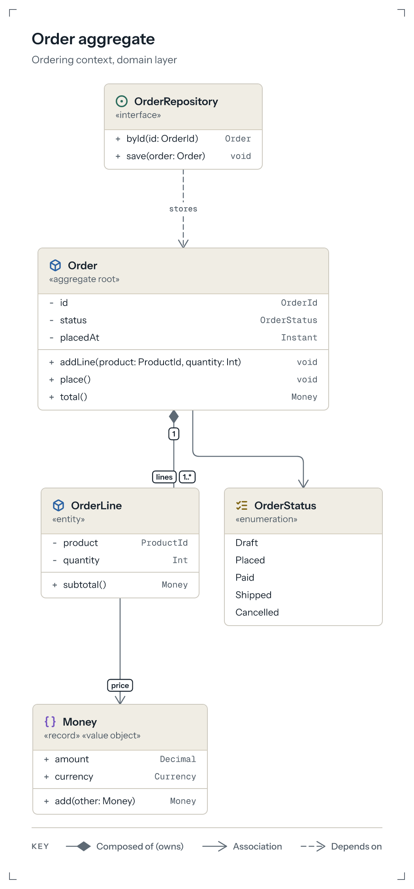
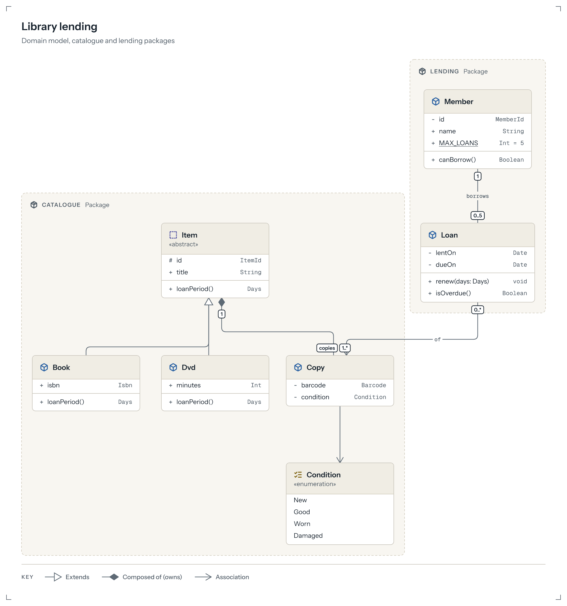

# Class diagrams

`type: class` draws UML class diagrams: classes, interfaces, abstract classes, enums and records with their members, packages around them, and the relations UML draws, with the ends UML gives them. Parents stand above their children; wholes above their parts.

```sh
carto new class orders.yaml
carto render orders.yaml -o orders.png
carto render orders.yaml -o orders.pptx       # native shapes: members stay text you can edit
carto export orders.yaml -o orders.mmd        # a Mermaid classDiagram for a README
```



## Classes

```yaml
type: class
title: Order aggregate
classes:
  Order:
    stereotype: aggregate root
    members:
      - -id: OrderId
      - -status: OrderStatus
      - "+addLine(product: ProductId, quantity: Int): void"
      - +total(): Money
  Money: { kind: record, stereotype: value object, members: [+amount: Decimal, +currency: Currency] }
  OrderStatus: { kind: enum, values: [Draft, Placed, Paid] }
  OrderRepository: interface
  Repository: { kind: interface, generic: T }
```

| Key | Means |
| --- | --- |
| `kind` | `class` (default), `interface`, `abstract`, `enum` or `record`; written alone (`OrderRepository: interface`) when it is all there is |
| `members` | attributes and operations, one per line; operations (with brackets) go under a rule below the attributes |
| `values` | an enum's values |
| `stereotype` | one or more words drawn «like this» under the name: aggregate root, value object, entity, service |
| `generic` | type parameters: `T` draws `Repository<T>` |
| `package` | the package it stands in (see below) |
| `extends`, `implements` | a parent class, the interfaces it implements: the same as writing the relation |
| `label`, `tone`, `description`, `link` | as everywhere |

### Members

A member is one line: visibility, then `name: Type` for an attribute or `name(parameters): Result` for an operation.

| Written | Drawn |
| --- | --- |
| `+name: String` | public attribute (`+` public, `-` private, `#` protected, `~` package) |
| `-count: Int = 0` | with its initial value |
| `+total(): Money` | an operation and what it returns |
| `+{static} of(amount: Decimal): Money` | static: underlined (Mermaid's `$` after the member works too) |
| `+{abstract} area(): Double` | abstract: in italics (or `*` after the member) |

YAML reads `- +name: String` as a little map; that is fine, it means the same line. A line with a colon inside its brackets (`"+add(product: ProductId): void"`) needs quotes, or YAML stops at the first colon.

The visibility stands in a narrow column of its own, so names line up; types are right-aligned in the theme's monospace face, as in a database table.

## Relations

```yaml
relations:
  - Order "1" *-- "1..*" OrderLine: { role: lines }   # composition: Order owns its lines
  - Team o-- Person                                    # aggregation: shares them
  - Card --|> PaymentMethod                            # generalization: extends
  - SqlOrders ..|> OrderRepository                     # realization: implements
  - OrderLine --> Money: price                         # association, navigable towards Money
  - Customer -- Address                                # association, no direction said
  - OrderService ..> Clock                             # dependency: uses
```

The arrows are Mermaid's and PlantUML's: a triangle `<|` / `|>`, a filled diamond `*`, a hollow diamond `o`, an open arrowhead `<` / `>`; `--` a solid line, `..` a dashed one. Either end may carry the mark (`Vehicle <|-- Car` is `Car --|> Vehicle`).

- **Multiplicities** go in quotes beside the class they belong to: `Order "1" *-- "1..*" OrderLine`, or as `multiplicity: ["1", "1..*"]`.
- **Role names**: `role:` names the second end, `roles: [order, lines]` both.
- **A label** after the colon names the association: `- OrderLine --> Money: price`.

Multiplicities and roles are small tags on the line just past its end mark; the label sits in the middle.

## Layout

The hierarchy decides the shape: parents above their children (one triangle per parent, the children's lines joining on a trunk as UML draws them), wholes above their parts, then every other relation in the direction it is written, unless it would turn the drawing round, in which case it is routed around without ranking. `direction: right` lays the same out left to right.

## Packages

```yaml
packages:
  catalogue: Catalogue
  lending: { label: Lending, parent: library }
classes:
  Book: { package: catalogue }
```

A package is a dashed group around its classes, nested with `parent:`.



## What it checks

- A relation, `extends:` or `implements:` naming a class that is not there: an error.
- Inheritance in a circle (A extends B extends A): an error on the line that closes it, and that line is left out.
- The same attribute twice, or the same operation with the same parameter types (overloads are fine): a warning.
- A class *implementing* a class, or *extending* an interface: a warning that says which word fits.
- `values:` on something that is not an enum: a warning.

## Importing

- **Mermaid** `classDiagram`: classes with `{ … }` bodies and `Class : +member` lines, `<<interface>>` and other annotations, generics `~T~`, `namespace`, relations with multiplicities and labels, `direction`. Notes, styles and links are named in the report.
- **PlantUML** class diagrams: `class`, `abstract class`, `interface`, `enum`, `record`, `<<stereotype>>`, members (`- String name` or `- name : String`, `{static}`, `{abstract}`), `extends` / `implements`, `package` and `namespace`, relations with direction words (`-up->`) and colours (`-[#red]->`) taken out.
- **D2** `shape: class`: fields and methods (`+name: type`, `method(a int): (x, y int)`; no sign means public) become members. A D2 file of only classes becomes a class diagram; classes beside other boxes stay boxes in the architecture and come in as a class diagram of their own as well.

## Exporting

PowerPoint draws each class as native shapes: the header, a text box per member (with its visibility), the rule between compartments, and the UML ends as small shapes on the lines. draw.io gets its own table rows and its `block`, `diamond` and `open` ends; Excalidraw its outlined triangle and diamond heads. Mermaid export writes a `classDiagram` with namespaces, stereotypes, members and multiplicities (role names have no place there; the report says so).

## Class, ERD or C4?

- **Tables, columns and foreign keys** are a database: use `erd`. A class diagram is about types in code: behaviour (operations) and inheritance, which tables do not have.
- **The components inside a service and how they call each other** are `c4` (the component view). A class diagram goes one level further down, into the types.
- **Bounded contexts and how they integrate** are a `context-map`; the classes inside one context are a class diagram.

Examples: [examples/class](../examples/class)
