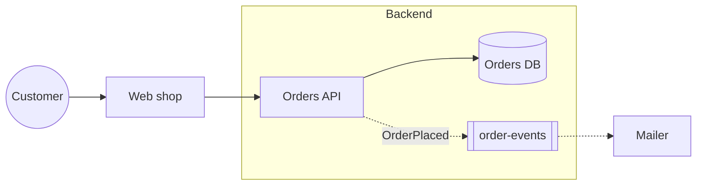

# Coming from Mermaid

Mermaid is the diagram language most people already know: it is in GitHub, GitLab, Notion and most docs tools. Cartography reads it, and writes it back. Use Mermaid where a renderer is all you have; use Cartography where the drawing has to hold up in a design document, a review or a slide.

## Bring your diagrams

```sh
carto import diagram.mmd               # one Mermaid diagram → diagram.yaml
carto import README.md                 # every ```mermaid block in a Markdown file
carto export diagram.yaml -o back.mmd  # and back, when a page only renders Mermaid
```

In the editor: paste the Mermaid text on the start dialog (*Import from Mermaid…*), or drop a `.mmd` file on the window. The import says what it could not carry; nothing is dropped without a word.

What is read: `flowchart` and `graph`, `architecture-beta`, `stateDiagram`, `erDiagram`, `sequenceDiagram`, `classDiagram`, `gitGraph`, `gantt`, `timeline`, `journey` and `mindmap`.

## What maps to what

| Mermaid | Cartography |
| --- | --- |
| `flowchart LR` / `TD` | `type: systems` with `direction: right` / `down`; a flowchart with decisions can be `type: process` |
| `A[Label]` | a node: `a: { kind: service, label: Label }`; the kind is guessed from the shape and the words |
| `A[(Orders DB)]`, `A((Customer))`, `A[[Kafka]]` | `kind: database`, `kind: user`, `kind: topic` |
| `A --> B`, `A -.-> B`, `A ==> B` | `- a -> b`, with `style: async` for dotted and the main path for thick |
| `A -->\|label\| B` | `- a -> b: label` |
| `subgraph id [Title] … end` | `groups: { id: { label: Title } }` and `in: id` on each node |
| `classDef`, `style`, `linkStyle` | not carried: kinds, line styles and themes do this job |
| `architecture-beta` `service x(database)[DB] in g` | `x: { kind: database, label: DB, in: g }`, the kind read from the title too |
| `erDiagram` | `type: erd`: tables, columns, keys; relations follow from the keys |
| `sequenceDiagram` | `type: sequence`: participants, messages, replies, `alt`/`loop` frames |
| `classDiagram` | `type: class`: classes with their members (`+String name` becomes `+name: String`), `<<interface>>` and other annotations, generics `~T~`, `namespace` as packages, relations with multiplicities and labels; notes and styles left out. Exported back as a `classDiagram` |
| `mindmap` | `type: mindmap`: the root as the centre, the indents as levels, node shapes taken off; `::icon()` left out. Exported back as a `mindmap` |
| `stateDiagram-v2` | `type: states`: states, composite states, start and end, guards |
| `gantt`, `timeline` | `type: roadmap`: sections become lanes, `after` stays a dependency |
| `gitGraph` | `type: gitflow`: branches, merges, tags |
| `title:` in the front matter, `title …`, or a `%%` comment above the diagram | `title:`; without any, the file's name |
| `click` | left out, with a warning: add `links:` to the node |
| `journey` | `type: journey` |

## The same diagram, both ways



`carto import shop.mmd` gives, untouched:

```cartography
type: systems
title: shop
direction: right
captions: written

groups:
  backend: { kind: group, label: Backend }

nodes:
  user: { kind: user, label: Customer }
  web: { kind: client, label: Web shop }
  api: { kind: api, label: Orders API, in: backend }
  db: { kind: database, label: Orders DB, in: backend }
  bus: { kind: topic, label: order-events, in: backend }
  mail: { kind: email, label: Mailer }

edges:
  - user -> web
  - web -> api
  - api -> db
  - api -> bus: { label: OrderPlaced, style: async }
  - bus -> mail: { style: async }
```

The kinds are guessed from the shapes and words (a cylinder is a database, `Orders API` an API): they give the icon, and `captions: written` keeps them from adding a caption the source never had. Leave it out and every card says its kind under its name.

## What you lose

- **Rendering everywhere.** GitHub, GitLab and many wikis draw Mermaid in place. Cartography needs a build step (the [docs plugins](../embed.md), the [GitHub Action](../ci.md)) or an exported SVG. `carto export -o x.mmd` is the way back when only Mermaid will do.
- **Per-element styling.** `classDef` and `style` are not read. Cartography styles by kind and theme; colour per box is on purpose not a thing.
- **Diagram kinds Cartography does not have:** pie, quadrant, sankey, XY charts, requirement and C4-in-Mermaid (use `type: c4` instead) are not imported.
- **Hand-tuning by edge order.** Mermaid's layout follows the order you write things in, and people learn to nudge it that way. Cartography lays out on its own rules; to fix a position, drag it in the editor and the place is saved next to the file.

## What you gain

- **Icons and kinds** that say what a box is (a database, a queue, a function, an Azure App Service), a key that explains them, and a look that holds up next to a client's slide template ([the Survey style](../style.md)).
- **Lines that route around boxes**, share a track where they go the same way, and keep their labels off other lines. See the [layout benchmark](../benchmark.md), including where Mermaid does better.
- **Stable edits.** Adding a box keeps the rest where it was in the editor and with `carto render --stable`, so a diff in a pull request shows what changed.
- **One model, many views**: a context, container and deployment diagram from the same elements ([model.md](../model.md)), and drill-down links between diagrams.
- **Real exports**: PNG, PDF, a 16:9 slide, PowerPoint with one slide per step, an editable draw.io file.
