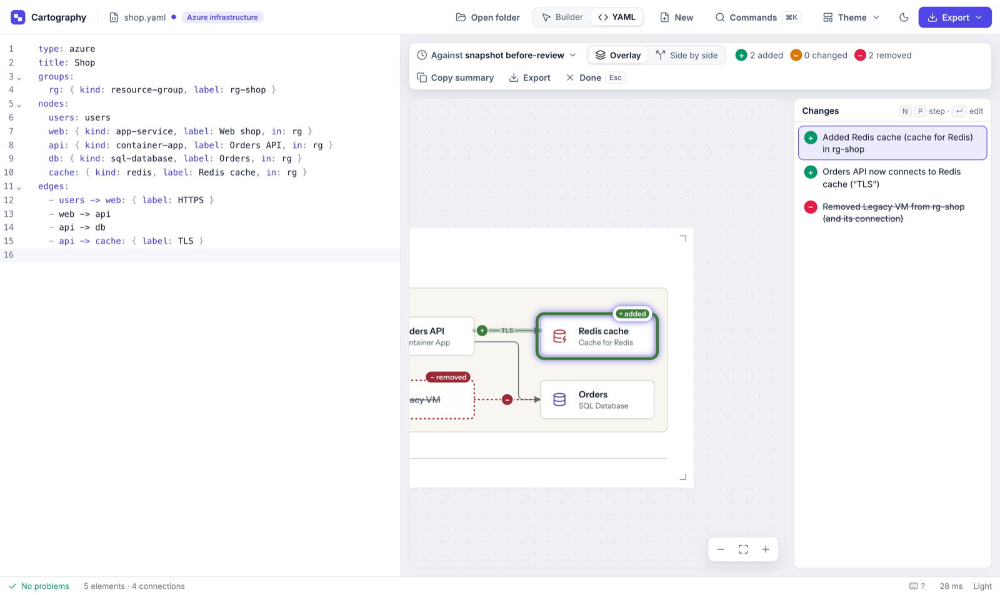
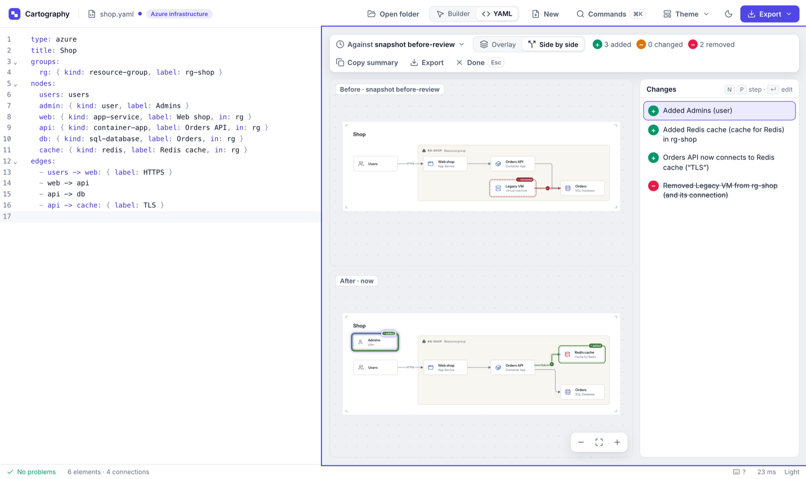

# Compare versions

What changed in a diagram since the review, since the last commit, since last quarter? The editor shows it **live**: the drawing as it is now against an earlier version, with what was added, changed and removed marked, a list of the changes in plain words, and a summary to paste into a change request. The command line does the same with `carto diff`.



## Compare with…

**⇧⌘D** (with the drawing in focus: elsewhere it stays the browser's), *Compare with an earlier version* in the drawing toolbar's **⋯**, or *Compare with…* in the command palette (⌘K). It offers:

| Version | What it is |
|---|---|
| **Last saved** | The file on disk (in an open folder), or the document as it was opened or last saved: your unsaved changes. |
| **A snapshot** | A copy you took earlier with **⇧⌘S** (*Take snapshot…*), by name: "before the review", "Q3". |
| **Another file** | Another diagram in the open folder, or *Pick a file…*: last quarter's copy, a colleague's version. |
| **HEAD and earlier commits** | When the open folder is a git repository: the file at HEAD, and each earlier version of it with the commit that made it, its author and when. |

Each version is drawn with its own pins (its `.layout.json`), so it looks as it did. A commit is read with the files it includes **as they were in that commit**, as `carto diff --git` does; a snapshot or another file reads its includes from beside the open diagram, as they are now.

While comparing, the YAML stays editable: every edit shows up in the comparison as you type.

## Overlay and side by side

**Overlay** is one drawing: the current one, with what was added and changed outlined and tagged, and what was removed drawn as a dotted, struck-through **ghost where it stood**. The newer drawing is laid out *knowing the older one* (the layout's stability memory), so what both have stays in place and the picture shows the change, not a reshuffle.

**Side by side** is before and after, each with its own marks: the older one shows what was removed and changed, the newer what was added and changed. Panning and zooming moves both together. Wide drawings stand under each other, so each stays readable.



Marks never rest on colour alone: each kind has its own sign (**+** added, **~** changed, **−** removed), its own outline (solid, dashed, dotted), its word on the tag, and in the list removed rows are struck through.

## The changes, one by one

The list on the right says each change in words, with the names the drawing shows:

- *Added Redis cache (cache for Redis) in rg-shop*
- *Orders API now connects to Redis cache (“TLS”)*
- *Moved Web shop from rg-shop to snet-edge*
- *Renamed “Orders” to “Orders service”*
- *Removed Legacy VM from rg-shop (and its connection)*

Lines that went with a removed element are counted with it, not listed one by one. The counts at the top count the same way, so they match the list; so do the key under the picture, the Markdown summary, the slides and `carto diff -o changes.md` (its table, element by element, still lists every line). Click a change, or step with `]` and `[` (or `J` and `K`), as through steps, and the drawing moves to it and marks it; `↵` edits it.

| Key | |
|---|---|
| **]** / **[** | Next / previous change (**J** and **K** too) |
| **↵** or double-click | Back to editing, with that element selected |
| **M** | Overlay or side by side |
| **0** / **+** / **−** | Fit / zoom in / zoom out; pinch or ⌘-scroll zooms, two fingers or a drag pan |
| **Esc** | Back to editing |

The toolbar counts what was added, changed and removed, and says what the drawing is compared with; click that name to pick another version.

## Taking it away

- **Copy summary**: the changes as Markdown, for a change advisory board or a pull request: a heading, the counts, the sentences, then a table element by element.

  ```markdown
  ## Changes to Shop since snapshot before-review

  3 added, 2 removed.

  - Added Admins (user)
  - Added Redis cache (cache for Redis) in rg-shop
  - Orders API now connects to Redis cache (“TLS”)
  - Removed Legacy VM from rg-shop (and its connection)

  ### Element by element
  …
  ```

- **Export → Summary (.md)**: the same as a file.
- **Export → Before and after (.pptx)**: two slides, before and after, each with its marks (SVG, with a PNG for apps that cannot show SVG); the sentences are in the speaker notes.
- **Export → PNG / SVG**: the picture on screen, overlay or side by side, with a key and the fonts embedded.

## Snapshots

**⇧⌘S** asks for a name (the date and time unless you type one) and keeps the diagram as it is now, with its pins:

- always **in this browser** (IndexedDB), per document;
- in an open folder, also **next to the diagram** as `<name>.snapshots/<label>.yaml` (and `<label>.layout.json` when it has pins). These are plain files: commit them to keep a "before" for the team, or leave them out with a line in `.gitignore`. The file list does not show them as diagrams. Untick *Also in the folder* to keep a snapshot in the browser only; the choice is remembered.

A snapshot in the folder stands for the browser's copy of the same name. *Delete snapshot …* in the Compare with… list removes a browser copy; one in the folder is a file you delete like any other.

## Git in the browser

The browser has no git, so the editor reads the repository's `.git` folder itself: HEAD and branches (loose and packed refs, annotated tags), commits, trees and file contents, both loose objects and packfiles (with their deltas). Nothing is installed and nothing leaves the machine. It walks back along first parents from HEAD, up to 400 commits, and offers the last 15 versions of the open file.

Limits, said plainly:

- The open folder must be the **top of the repository** (the folder with `.git` in it). A subfolder cannot see the `.git` above it, and a **worktree or submodule**, whose `.git` is a file pointing elsewhere, cannot be followed: open the main checkout.
- Repositories with **SHA-256** object names are not read.
- A **shallow clone** ends where its history ends.
- Only the history of the current branch (first parents) is offered; for any other ref, use `carto diff --git <ref>`.

## On the command line

```sh
carto diff before.yaml after.yaml                  # two files
carto diff --git main shop.yaml                    # against a branch, tag or commit
carto diff --since HEAD~5 shop.yaml                # the same: what changed since
carto diff --snapshot "before review" shop.yaml    # against a snapshot the editor wrote
carto diff --snapshot Q3 shop.yaml -o changes.md   # the changes in sentences, as Markdown
carto diff --git main shop.yaml -o diff.png        # the overlay picture (--side-by-side for both)
```

`--json` gives the structural diff and the sentences (`explained`). See [In CI](ci.md) for the pull request comment that does this on every change.
