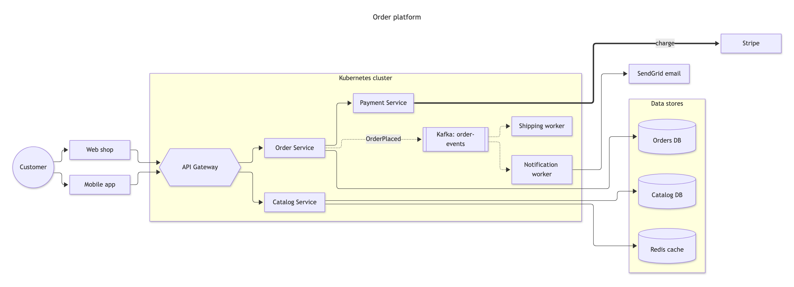
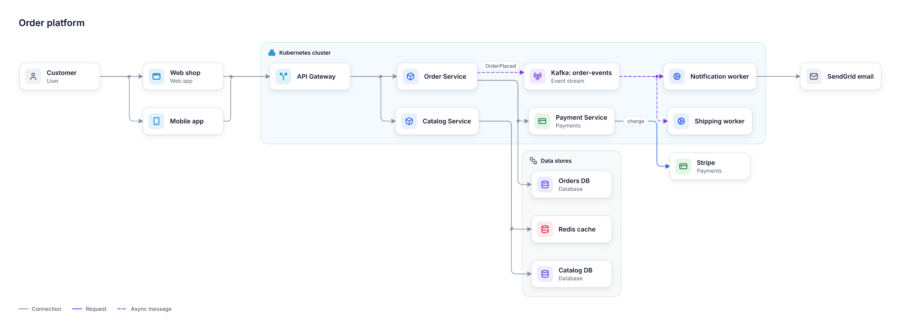
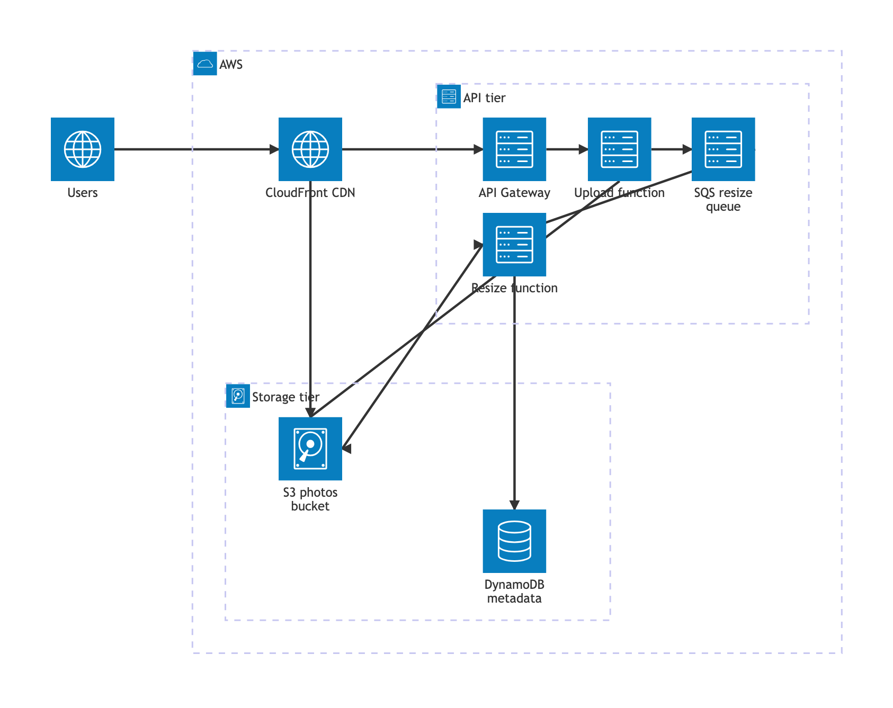
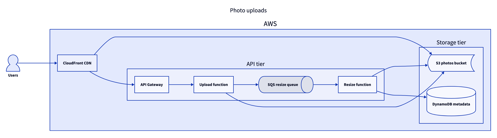
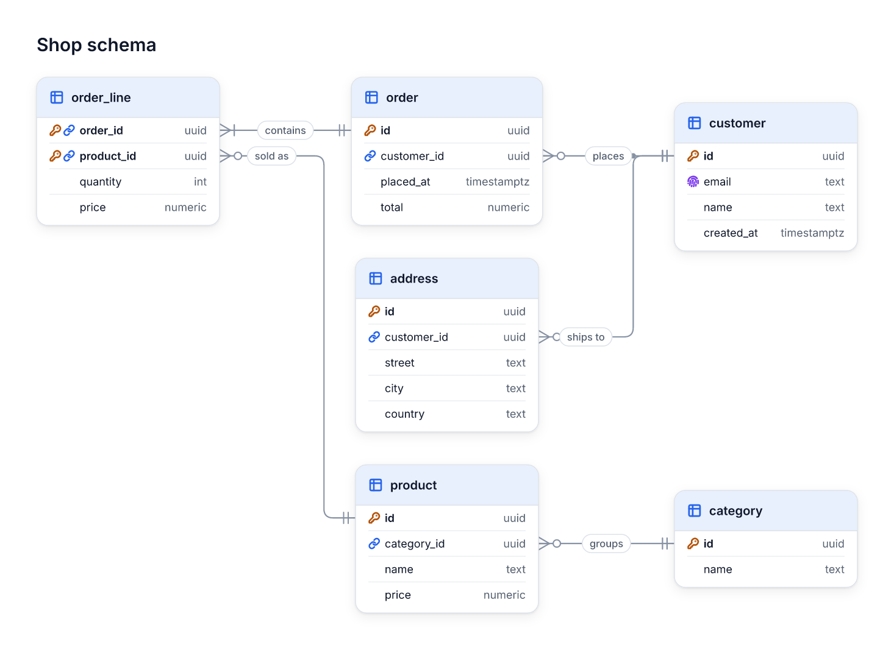
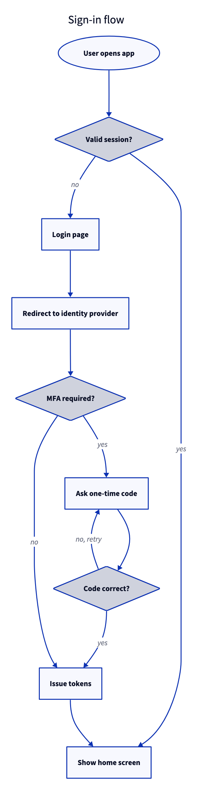
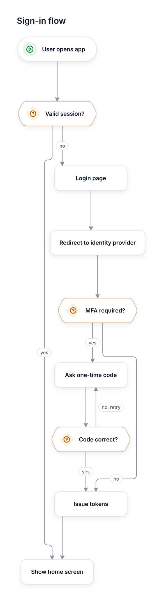

# Cartography next to Mermaid and D2

Five everyday diagrams, written once in Mermaid (and by hand in D2), each drawn by its own tool.
The Cartography column is **not hand-tuned**: it is the Mermaid source run through `carto import`
and rendered as is. The imported YAML is in [`cartography/`](cartography/).

| Source | What |
| --- | --- |
| [`src/*.mmd`](src/) | Mermaid, rendered with the `mermaid` npm package (default theme) in headless Chromium |
| [`src/*.d2`](src/) | D2 0.9, default layout (dagre) and theme |
| [`cartography/*.yaml`](cartography/) | `carto import src/<name>.mmd`, default light theme |

Regenerate everything with `pnpm compare` (needs `d2` on the PATH for the D2 column: `brew install d2`).

## Order platform — microservices (flowchart)

| Mermaid | D2 | Cartography |
| --- | --- | --- |
|  |  |  |

Imported as a `systems` diagram: the circle became a user, `[(…)]` databases, "Redis cache" a cache,
"Kafka: order-events" an event stream, `-.->` async messages and `==>` the main request path. Plain
`-->` lines stay grey and the legend names them ("Connection") next to the coloured ones. Captions only
appear where they add something: "Order Service" is not captioned "Service" again.

## Photo uploads — serverless (architecture-beta)

| Mermaid | D2 | Cartography |
| --- | --- | --- |
|  |  |  |

Mermaid's architecture diagrams only know five icons (cloud, database, disk, internet, server), so every
function and queue is a server there. The import reads the titles instead: Upload function is a function,
SQS resize queue a queue.

## Analytics platform — data pipeline (flowchart, top to bottom)

| Mermaid | D2 | Cartography |
| --- | --- | --- |
|  |  |  |

Subgraphs whose titles say nothing about what they are (Sources, Ingestion, …) become neutral groups
without a caption. Boxes no word gives away ("Debezium CDC", "dbt transformations") are plain steps
instead of guessed services.

## Shop schema (erDiagram)

| Mermaid | D2 | Cartography |
| --- | --- | --- |
|  |  |  |

Imported as an `erd` diagram. `FK` attributes are matched to the related table (`customer_id` → customer),
so lines attach to the column, with crow's feet from the relationship. Mermaid's "one or more" (`|{`)
keeps its bar (order_line "contains"), `PK, FK` columns show both the key and the link, and `UK` a
unique mark. Table ids are lowercased (`ORDER` → `order`); the import says so.

## Sign-in flow (flowchart with decisions)

| Mermaid | D2 | Cartography |
| --- | --- | --- |
|  |  |  |

Questions, `{…}` and plain `{{…}}` shapes import as decisions (pointed ends, a diamond tile, an amber
outline), `([…])` and `((…))` at the start or end of the flow as pills, and the other boxes as plain
steps without an icon or caption. Next to Mermaid this is now a fair match: the same shapes in the
same order, yes/no labels readable on every branch, and a slightly shorter drawing (decisions do not
need a diamond's height). Mermaid's diamonds are still the more familiar symbol at first sight, and the
long "yes" line from the first decision runs the whole height of the drawing in both tools.
