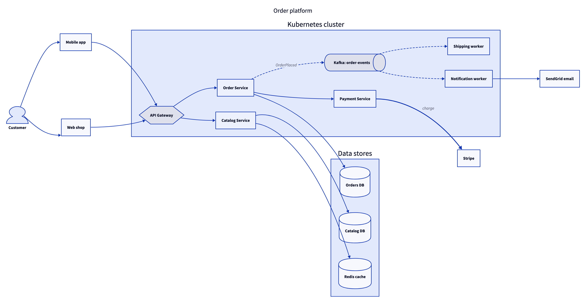
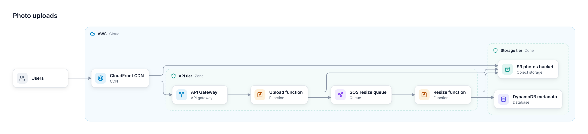
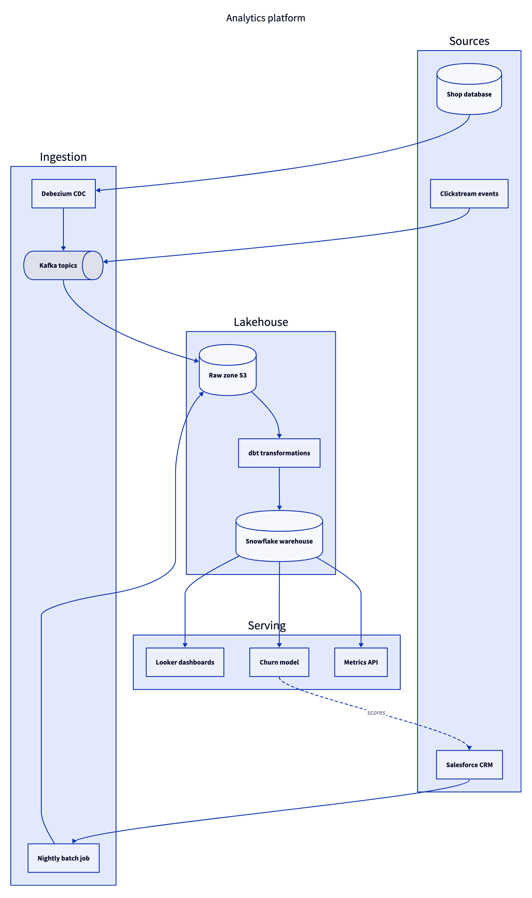
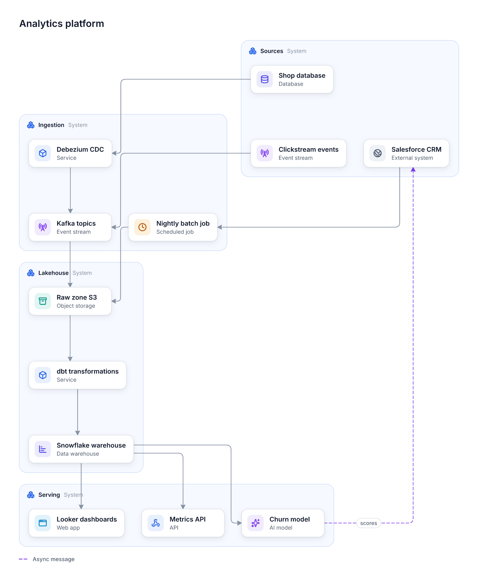

# Cartography next to Mermaid and D2

Five everyday diagrams, written once in Mermaid (and by hand in D2), each drawn by its own tool.
The Cartography column is **not hand-tuned**: it is the Mermaid source run through `carto import`
and rendered as is. The imported YAML is in [`cartography/`](cartography/).

| Source | What |
| --- | --- |
| [`src/*.mmd`](src/) | Mermaid, rendered with the `mermaid` npm package (default theme) in headless Chromium |
| [`src/*.d2`](src/) | D2 0.9, default layout (dagre) and theme |
| [`cartography/*.yaml`](cartography/) | `carto import src/<name>.mmd`, default light theme |

Regenerate everything with `pnpm compare` (needs `d2` on the PATH for the D2 column: `brew install d2`).

## Order platform — microservices (flowchart)

| Mermaid | D2 | Cartography |
| --- | --- | --- |
|  |  |  |

Imported as a `systems` diagram: the circle became a user, `[(…)]` databases, "Redis cache" a cache,
"Kafka: order-events" an event stream, `-.->` async messages and `==>` the main request path.

## Photo uploads — serverless (architecture-beta)

| Mermaid | D2 | Cartography |
| --- | --- | --- |
|  |  |  |

Mermaid's architecture diagrams only know five icons (cloud, database, disk, internet, server), so every
function and queue is a server there. The import reads the titles instead: Upload function is a function,
SQS resize queue a queue.

## Analytics platform — data pipeline (flowchart, top to bottom)

| Mermaid | D2 | Cartography |
| --- | --- | --- |
|  |  |  |

## Shop schema (erDiagram)

| Mermaid | D2 | Cartography |
| --- | --- | --- |
|  |  |  |

Imported as an `erd` diagram. `FK` attributes are matched to the related table (`customer_id` → customer),
so lines attach to the column, with crow's feet from the relationship.

## Sign-in flow (flowchart with decisions)

| Mermaid | D2 | Cartography |
| --- | --- | --- |
|  |  |  |

Cartography draws systems, not flow logic: it has no decision or start/stop shapes, so steps and
questions all become cards, most of them captioned "Service". For process flows like this one,
Mermaid and D2 say more.
