# Cartography next to Mermaid and D2

Eleven everyday diagrams, written once in Mermaid (and by hand in D2 where D2 has the kind), each drawn by its own tool.
The Cartography column is **not hand-tuned**: it is the Mermaid source converted to YAML once, by the
importer Cartography had then, and rendered as is. The YAML is in [`cartography/`](cartography/).

| Source | What |
| --- | --- |
| [`src/*.mmd`](src/) | Mermaid, rendered with the `mermaid` npm package (default theme) in headless Chromium |
| [`src/*.d2`](src/) | D2 0.9, default layout (dagre) and theme |
| [`cartography/*.yaml`](cartography/) | `src/<name>.mmd` converted, untouched, default light theme |

Regenerate everything with `pnpm compare` (needs `d2` on the PATH for the D2 column: `brew install d2`).

## Order platform — microservices (flowchart)

| Mermaid | D2 | Cartography |
| --- | --- | --- |
|  |  |  |

Imported as a `systems` diagram: the circle became a user, `[(…)]` databases, "Redis cache" a cache,
"Kafka: order-events" an event stream, `-.->` async messages and `==>` the main request path. Plain
`-->` lines stay grey and the legend names them ("Connection") next to the coloured ones. Captions only
appear where they add something: "Order Service" is not captioned "Service" again.

## Photo uploads — serverless (architecture-beta)

| Mermaid | D2 | Cartography |
| --- | --- | --- |
|  |  |  |

Mermaid's architecture diagrams only know five icons (cloud, database, disk, internet, server), so every
function and queue is a server there. The import reads the titles instead: Upload function is a function,
SQS resize queue a queue.

## Analytics platform — data pipeline (flowchart, top to bottom)

| Mermaid | D2 | Cartography |
| --- | --- | --- |
| 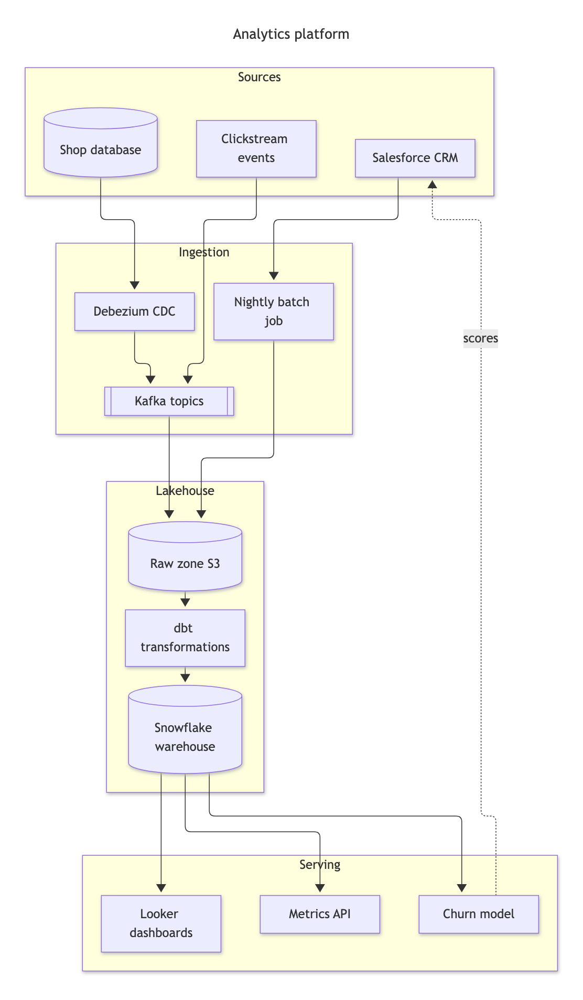 |  |  |

Subgraphs whose titles say nothing about what they are (Sources, Ingestion, …) become neutral groups
without a caption. Boxes no word gives away ("Debezium CDC", "dbt transformations") are plain steps
instead of guessed services.

## Shop schema (erDiagram)

| Mermaid | D2 | Cartography |
| --- | --- | --- |
| 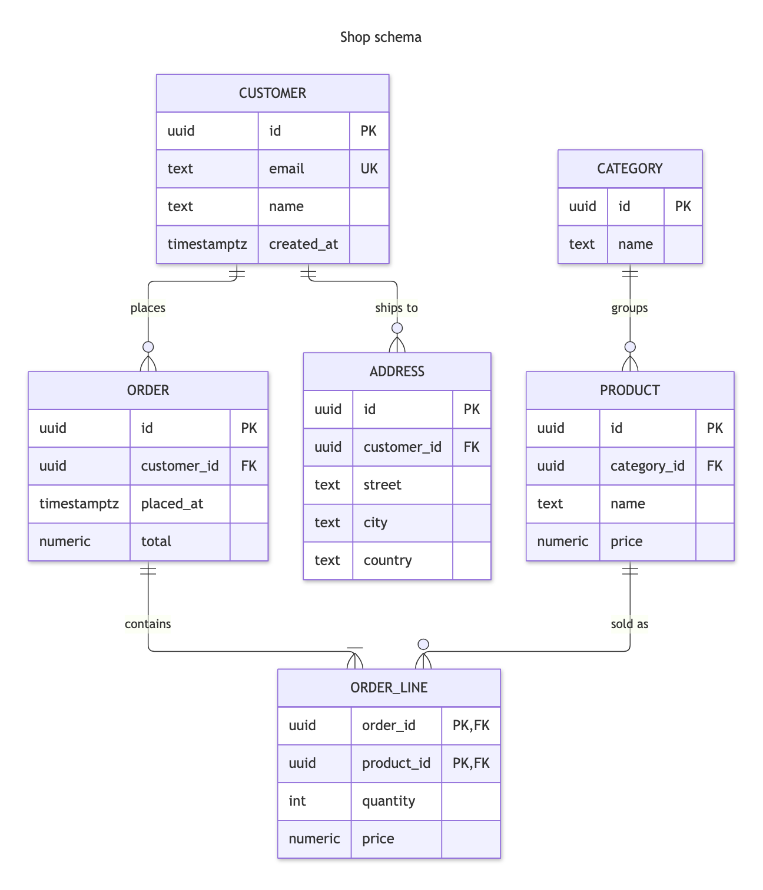 | 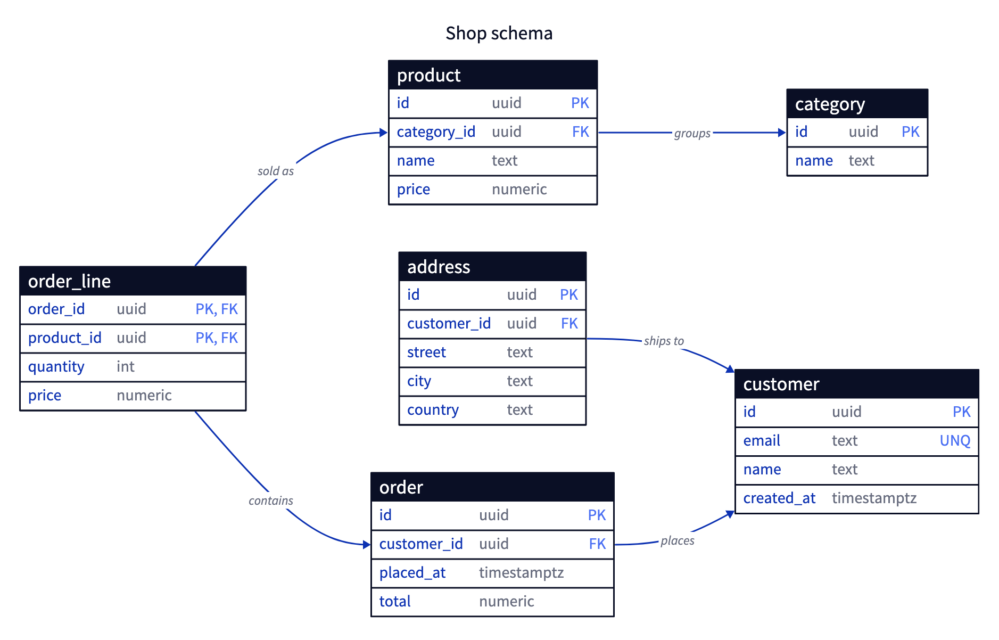 |  |

Imported as an `erd` diagram. `FK` attributes are matched to the related table (`customer_id` → customer),
so lines attach to the column, with crow's feet from the relationship. Mermaid's "one or more" (`|{`)
keeps its bar (order_line "contains"), `PK, FK` columns show both the key and the link, and `UK` a
unique mark. Table ids are lowercased (`ORDER` → `order`); the import says so.

## Sign-in flow (flowchart with decisions)

| Mermaid | D2 | Cartography |
| --- | --- | --- |
| 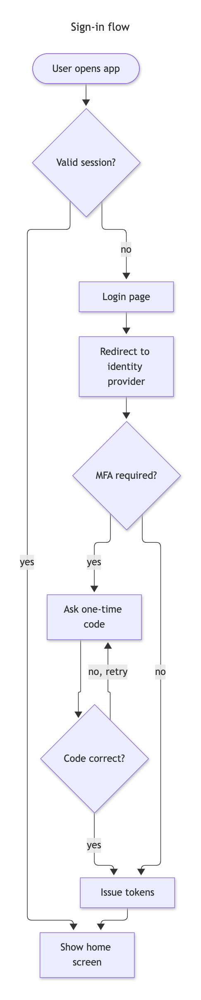 |  |  |

A flowchart that decides something imports as a `process`, not as an architecture diagram: here
three of its nine nodes are diamonds and two are terminals. Questions, `{…}` and plain `{{…}}` shapes
become decisions (a small diamond with the question beside it), `([…])` at the start a start event,
the other boxes tasks. The first chain of the source is the happy path: drawn straight and a little
heavier, and named in the key. The source says `flowchart TD`, and the import writes `direction: down`:
the flow runs down the page as in Mermaid, the happy "yes" straight down the left, the sign-in
steps in a column beside it. Each answer leaves its diamond at its own point with its label at the
exit, and the two ways back (retry, skip MFA) run down the right side, nested, without crossing.
Where Mermaid's picture is a strip six times as tall as it is wide, ours fits a page.

What changed against Mermaid's own picture, and may not be what you wanted: "Show home screen" was
a pill at the end in Mermaid and is a task here, because a second line leads into it. Mermaid's big
diamonds with the question inside are the more familiar flowchart at first sight.

## Leave request (flowchart with subgraphs)

| Mermaid | D2 | Cartography |
| --- | --- | --- |
| 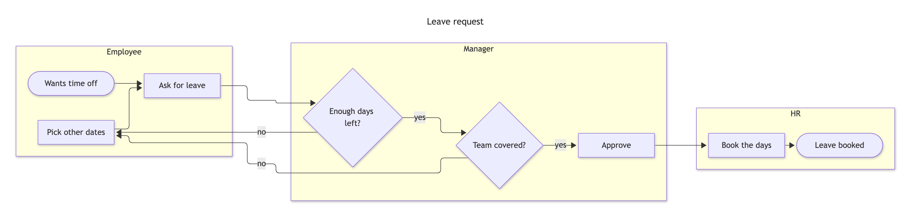 | 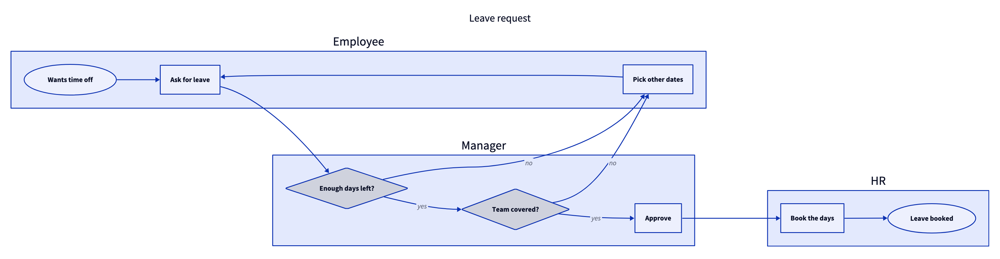 | 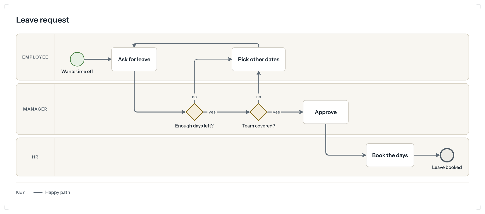 |

Three subgraphs, one per role. Mermaid and D2 draw them as boxes wherever the layout puts them, so
the flow runs from box to box and the "no" lines go back through the Manager box (Mermaid) or sweep
across the gap (D2). Imported as a `process` the subgraphs are swimlanes: every role a row over the
full width, the steps in the order of the flow from left to right, so who does what and when can both
be read off. Both "no" branches go straight up to "Pick other dates", and the way back to "Ask for
leave" runs along the top of the Employee lane.

Where the others still win: Mermaid's picture is a third shorter, and a reader who knows flowcharts
recognises it at once, where swimlanes ask for a moment. Our lanes are as tall as their busiest
column, so HR's lane is mostly empty. A subgraph inside a subgraph has no lane of its own: its steps
stand in the outer lane and the import says so. A flowchart where a line ends on a subgraph is not
taken as a process at all.

## Order lifecycle (stateDiagram-v2)

| Mermaid | Cartography |
| --- | --- |
| 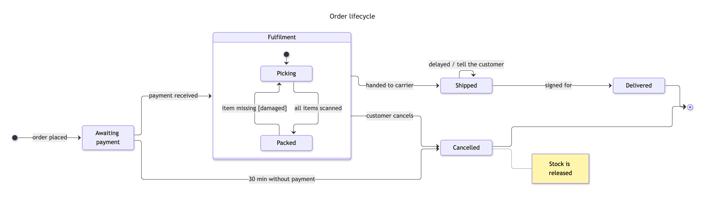 | 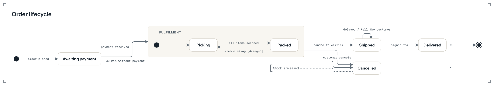 |

D2 has no state diagram. Imported as `states`: `[*]` became start and end at the level they stand
on, `state Fulfilment { … }` a composite state with its substates nested, the description
("Awaiting payment") the name, and the note the `note:` of its state. The main line reads left to
right in one row, the composite state included, where Mermaid lays the inside of a composite top
to bottom whatever the direction outside. Labels are set in mono beside their line with a halo;
Mermaid sets them on grey chips across the line. The self-transition is a small loop on the state in
both.

Where Mermaid still wins: its picture is more compact (ours is five times as wide as it is high,
which is small print on a page), its yellow note box is what people expect a note to look like,
and its two lines into "Cancelled" arrive apart where ours share the last stretch. Our dotted line
from the note takes a jog under the corner of its state. Fork and join bars and concurrent regions
(`--`) are not drawn here at all: they come in as plain states and one merged region, with a warning.

## Card payment (sequenceDiagram)

| Mermaid | D2 | Cartography |
| --- | --- | --- |
| 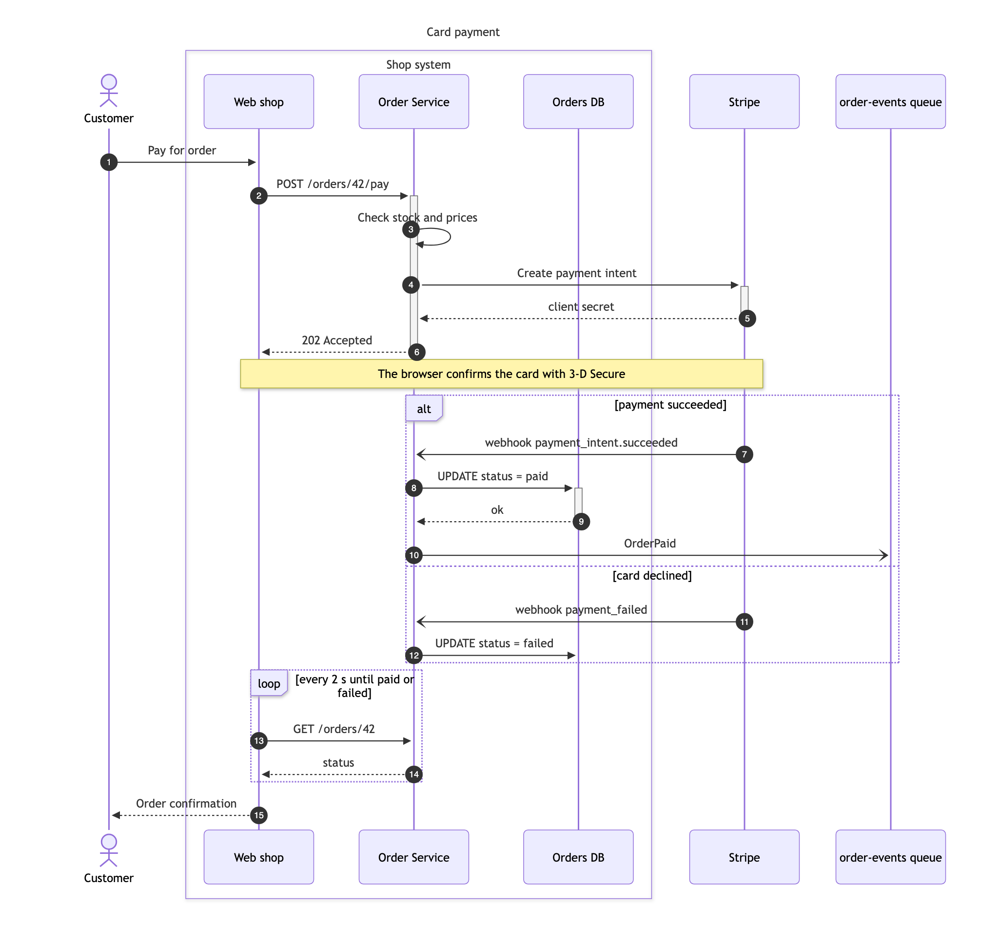 | 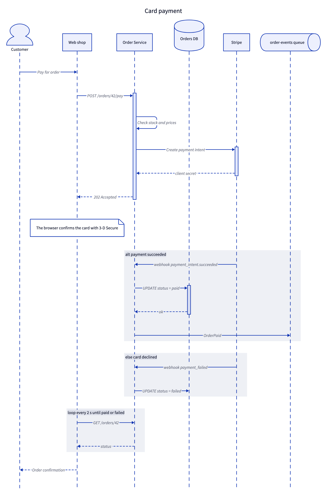 | 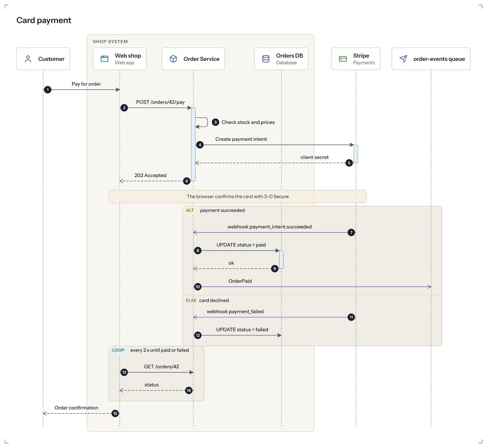 |

Imported as a `sequence` diagram: the actor became a person, "Orders DB" a database and "order-events
queue" a queue, each with its icon; `->>` became a call, `-->>` a reply and `-)` an async message
(violet, open head); the `box` became a tinted participant box, the `+`/`-` activations stay exactly as
written (`activations: explicit`). Every message owns its row and each gap between lifelines is as
wide as its widest label, so no label crosses a lifeline or a number badge. Mermaid's labels sit on
the lifelines they cross ("Check stock and prices", "Create payment intent") and its loop condition
wraps into the frame; D2 keeps labels clear by cutting the line around them, but has no participant
boxes or numbering and comes out almost twice as tall. Mermaid still has the stick-figure actor that
people recognise at once, and repeats the headers at the bottom by default (`footers: true` here).

## Release with a hotfix (gitGraph)

| Mermaid | Cartography |
| --- | --- |
| 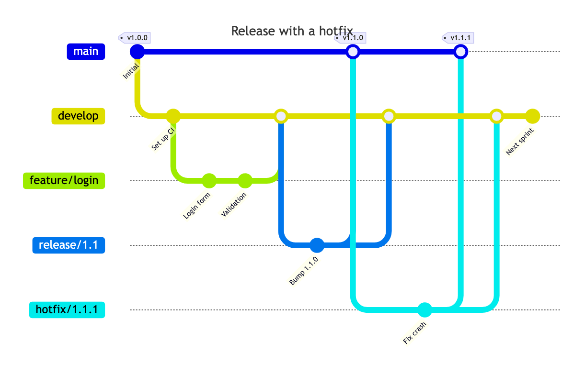 | 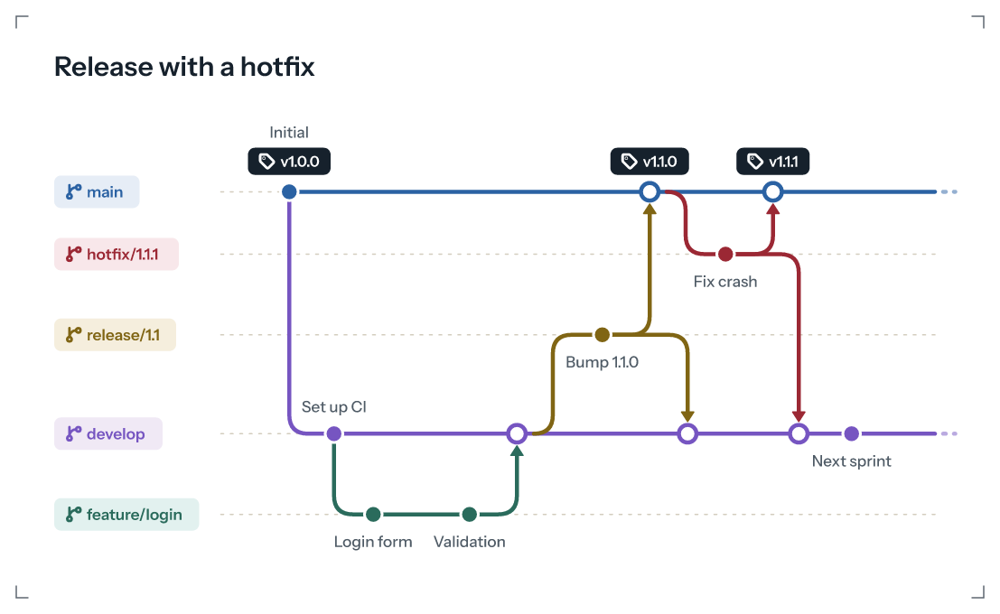 |

D2 has no git graph, so this one is Mermaid only. Imported as a `gitflow` diagram: each branch got
the colour of its kind (main blue, develop violet, release amber, hotfix red, feature teal) and the
lane order of the classic Git Flow picture, hotfix and release between main and develop, where
Mermaid stacks lanes in the order they were created and the hotfix ends up at the bottom, its lines
crossing every other lane. Mermaid's commit labels are rotated 45° and its release line runs through
the hotfix's corner; ours sit level under the dots, and merges arrive with an arrowhead. Mermaid's
own ids (`Initial`, `Set up CI`) are what it shows, so they became labels. What Mermaid does that we
do not: `order:` on branches (our lane order follows the branch kind), and highlighted commits.

## Migration plan (gantt)

| Mermaid | Cartography |
| --- | --- |
| 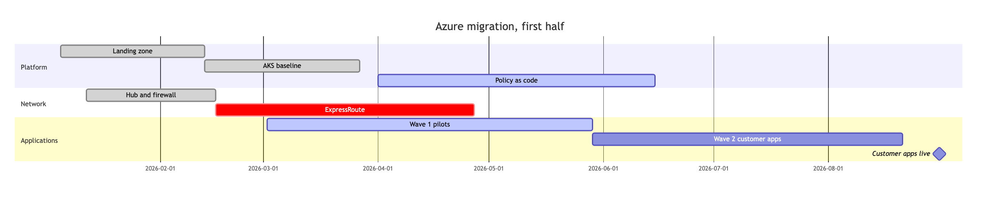 | 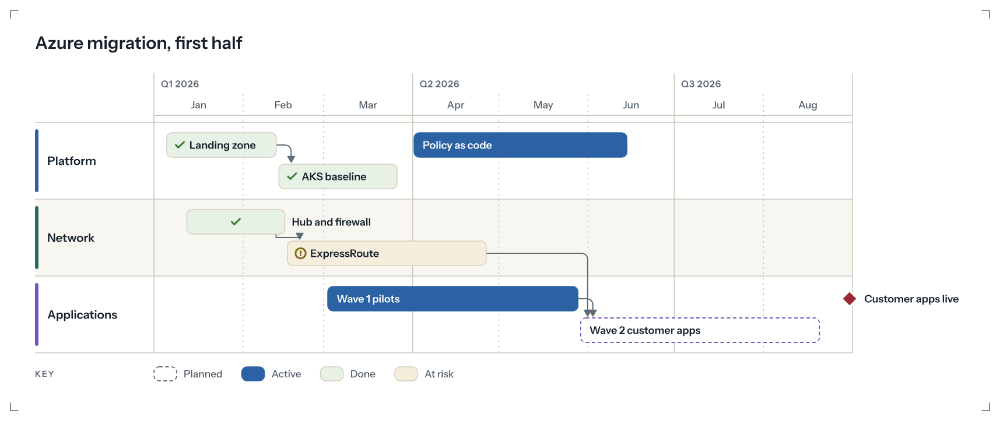 |

Imported as a `roadmap`: sections became lanes, `done`/`active`/`crit` became statuses with a legend,
`after` stayed a dependency and is drawn as an arrow (Mermaid only uses it to schedule), the milestone
kept its diamond. Ours reads like a steering-deck slide: month and quarter ticks instead of ISO dates
every month, lane names with a colour bar, overlapping items in tracks. Mermaid labels every bar
centred and fits more on a line (one row per task, no tracks to share), and its bright red for
critical tasks is louder than our amber "at risk". A bar too short for its label puts the label beside
it, which the arrow then has to leave from below; Mermaid keeps such labels inside and lets them
overflow.

## A developer's first week (journey)

| Mermaid | Cartography |
| --- | --- |
| 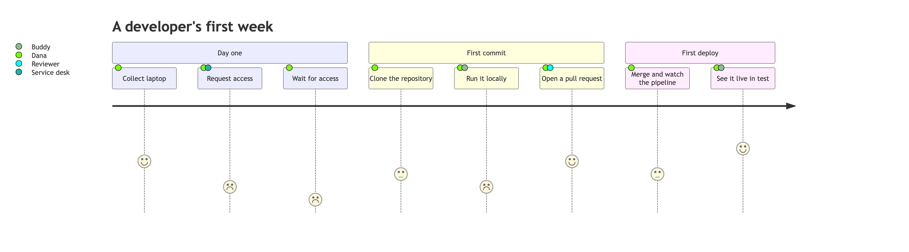 | 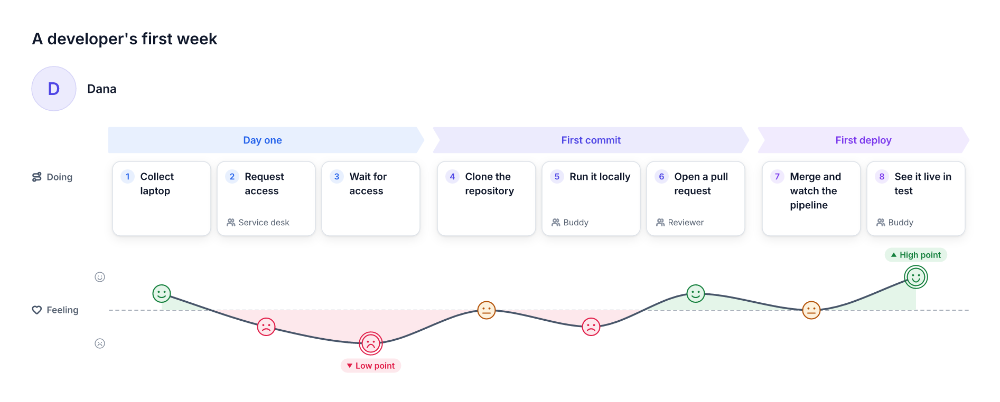 |

D2 has no journey. Imported as a `journey`: sections became phases, tasks numbered steps with their
score, and the actor in every task (Dana) became the persona, so only the others are named on the
cards where Mermaid needs a legend of coloured dots. The scores are joined into one curve around a
neutral line, with the low and the high point called out; Mermaid hangs a face per task from a
dashed line. This is the import as is, so it only has what Mermaid can say: thoughts, touchpoints,
pains, gains and opportunities are rows the YAML adds (see [examples/journey](../../examples/journey)),
as are the storyboard, blueprint and today-next-to-future views. Mermaid's picture is more compact,
and its coloured dots show at a glance who is in which task.

## Capability maps, org charts and Team Topologies (no side by side)

These have no import, so there is no column of the same source drawn three ways; what the others offer, briefly:

- **Mermaid** has no capability map and no org chart. A `mindmap` holds the outline of a capability map but draws it as a radial tree: no levels as columns, no equal widths, no heatmap. An org chart is a `flowchart TD` by hand: dagre places it, wide levels run off the slide, and there are no lists under a manager, vacancies or dotted lines that avoid the cards.
- **D2** can nest containers and lay out `grid-columns`, which gets close to a capability map, but every grid is fixed by hand (D2 does not choose columns to fit a slide), and a heatmap is a `style.fill` per box with a legend drawn by hand. An org chart in D2 is a `direction: down` graph, with the same limits as Mermaid's.
- **PlantUML** has `@startwbs` and `@startmindmap` (outlines as trees) and no Team Topologies shapes.
- **Team Topologies** shapes exist as draw.io and Miro libraries from the book's authors: drawn by hand, with zones placed and resized by hand.

Cartography draws all three from a short YAML file, fits them to 16:9 by itself, keeps a heatmap readable without colour (a value in every box, patterns for categories), and exports native PowerPoint shapes. See [capabilities.md](../capabilities.md) and [teams.md](../teams.md) for the pictures.
