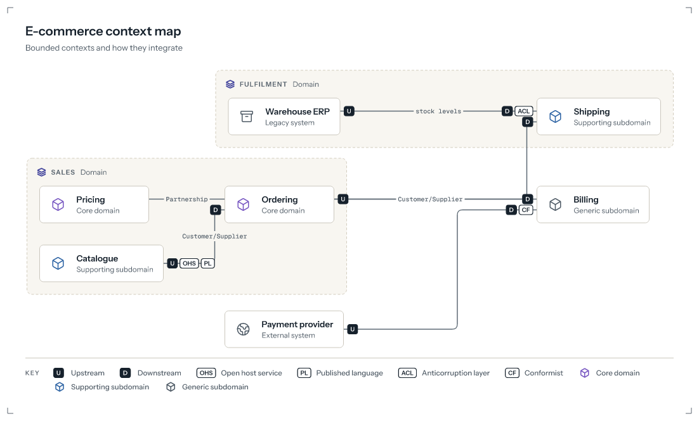

# Context maps

`type: context-map` draws the bounded contexts of a domain-driven design and how they relate, the way [Context Mapper](https://contextmapper.org) and the DDD community draw them: a line between two contexts says at each end who is **upstream** (U) and who is **downstream** (D), and carries the integration patterns of each side, OHS and PL upstream, ACL and CF downstream. Symmetric relationships are named on the line.



```yaml
type: context-map
title: E-commerce context map

groups:
  sales: { kind: domain, label: Sales }

nodes:
  catalog: { kind: context, label: Catalogue, domain: supporting, in: sales }
  ordering: { kind: context, label: Ordering, domain: core, in: sales }
  pricing: { kind: context, label: Pricing, domain: core, in: sales }
  warehouse: { kind: legacy, label: Warehouse ERP }

edges:
  - catalog -> ordering: { relation: customer-supplier, upstream: [OHS, PL] }
  - pricing -- ordering: { relation: partnership }
  - warehouse -> ordering: { relation: anticorruption-layer, label: stock levels }
```

The full example: [examples/context-map/e-commerce.yaml](../examples/context-map/e-commerce.yaml).

## Contexts

| Kind | For |
| --- | --- |
| `context` | A bounded context |
| `legacy` | A legacy system you integrate with (the big ball of mud) |
| `external` | A third party: a payment provider, a SaaS |
| `team` | A team, when the map shows who owns what |

`domain: core | supporting | generic` classifies a context's subdomain: it says so under the name (*Core domain*) and tints the card, and the key lists the classes used. Groups are `domain` and `team`, nestable.

## Relationships

A line is written `upstream -> downstream`. Its `relation:` says how they relate:

| `relation:` | Short | Drawn |
| --- | --- | --- |
| `partnership` | `p` | a line named *Partnership* |
| `shared-kernel` | `sk` | a heavier line named *Shared kernel* |
| `customer-supplier` | `cs` | U and D at the ends, *Customer/Supplier* on the line |
| `upstream-downstream` | `ud` | U and D at the ends |
| `conformist` | `cf` | U and D, CF on the downstream end |
| `anticorruption-layer` | `acl` | U and D, ACL on the downstream end |
| `open-host-service` | `ohs` | U and D, OHS on the upstream end |
| `published-language` | `pl` | U and D, PL on the upstream end |
| `separate-ways` | | a dotted line named *Separate ways* |

`upstream: [OHS, PL]` and `downstream: [ACL, CF]` add patterns to any upstream/downstream relationship, so `catalog -> ordering: { relation: customer-supplier, upstream: [OHS, PL], downstream: [ACL] }` reads as Context Mapper's `Catalogue [U,OHS,PL] -> [D,ACL] Ordering`. A `label:` names what flows (*stock levels*); on a symmetric relationship it follows the name (*Shared kernel: Money types*).

Lines have no arrowheads: who depends on whom is in the U and D tags. U and D are filled tags, patterns outlined ones; the key spells out each abbreviation used.

## Why a type of its own

A context map has its own words (bounded context, upstream, conformist), and the thirty service kinds of `systems` would drown them. It is built on the same graph as `systems`, so focus, steps, presenting, views of a model (`ref:`), exports and the builder work the same way.

## Limits

- Where several lines meet one side of a context close together, their end tags can crowd; a tag that would cover another slides along its own line, up to the middle of the line.
