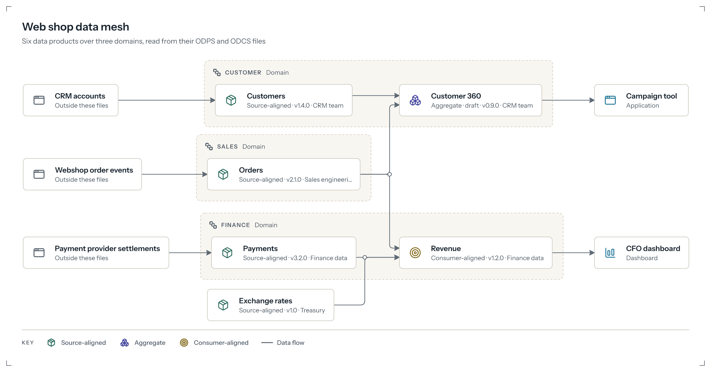
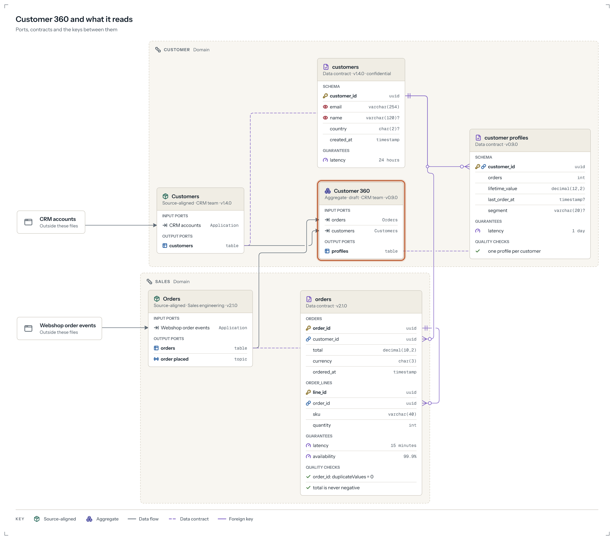
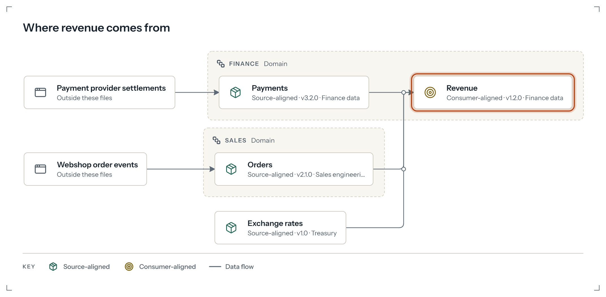

# Data products, contracts and lineage

A data mesh as one map: the products per domain, their ports, which product reads which, and the contracts behind the ports. A contract can be an Open Data Contract Standard file ([ODCS](#what-is-read-from-a-data-contract-odcs)) next to the diagram: its schema, guarantees and checks are read from there. No catalogue, no server, nothing leaves your machine.

```sh
carto render examples/data-products/mesh.yaml -o mesh.svg
```



The diagram is [examples/data-products/mesh.yaml](../examples/data-products/mesh.yaml): six products of a fictional web shop over three domains, with four contracts (ODCS 3.1) in [mesh/contracts](../examples/data-products/mesh/contracts). Your products are written down already, as ODPS files or in a catalogue? Ask your own AI to write the diagram from them ([ai.md](ai.md)).

## Ports, contracts and keys

`view: detailed` opens the products up: input and output ports, and the contract behind a port with its schema, guarantees and quality checks.



This is [examples/data-products/mesh-detailed.yaml](../examples/data-products/mesh-detailed.yaml): the same mesh (`include: [mesh.yaml]`), cut down to one product and what it reads. The violet lines between fields are the `relationships` of the contracts, new in ODCS 3.1, drawn with crow's feet like in a database design:

```yaml
schema:
  - name: orders
    properties:
      - name: customer_id
        relationships:                       # on a property: where it points, here into another contract
          - type: foreignKey
            to: customers.odcs.yaml#/schema/customers_tbl/properties/customer_id_pk
  - name: order_lines
    relationships:                           # on the object: both ends
      - type: foreignKey
        from: order_lines.order_id
        to: orders.order_id
```

A key into another contract is drawn when that contract is in the drawing; lines between contracts do not pull the layout around, the data flow decides where things stand. Contracts written for ODCS 2 or 3.0 are drawn as before.

## The focus view

A whole mesh answers "what is there?". The questions people actually ask are about one product: *where does this number come from?* and *what breaks when I change this?* A focus draws one element and what is within a few lines of it, from the same file.

```yaml
focus: revenue                                         # revenue and what is one line away
focus: { on: revenue, hops: all, direction: upstream } # everything that feeds it
focus: { on: [orders, tag:pii], hops: 2 }              # two lines around several things
```



| Key | Says |
| --- | --- |
| `on` | What it is about: an id, a group (everything in it), `id.*`, `tag:x`, `kind:x`, or a list of these. The same selectors [steps](steps.md#selectors) take |
| `hops` | How many lines away: a number (default 1, 0 is the thing alone) or `all` for everything connected |
| `direction` | `both` (default), `upstream` (what feeds it, against the arrows) or `downstream` (what it feeds). A line without an arrow counts both ways |

What the focus is about gets a ring, the groups around what is left stay, and the key explains only what is still in the drawing. The subtitle says what you are looking at.

It is a property of the drawing, so it can be written at the top of a diagram or per view, and one file holds the landscape and its cuts:

```yaml
views:
  revenue-lineage: { title: Where revenue comes from, focus: { on: revenue, hops: all, direction: upstream } }
  orders-impact: { title: What a change to Orders touches, focus: { on: orders, hops: all, direction: downstream } }
```

On the command line, without touching the file:

```sh
carto render mesh.yaml --focus revenue --hops all --upstream -o lineage.svg
carto render shop.yaml --focus api --hops 2            # any diagram of boxes and lines
```

`--focus` wins over a `focus:` in the file. A step's `focus:` in [steps](steps.md) is its relative: that one dims what is around, this one leaves it out.

**It works for every type that is elements and lines**: architecture, C4, Azure, AWS and Google Cloud, Kubernetes, network, database, access, GitHub, data products. A sequence diagram, a git graph, a roadmap, a journey map or a matrix is one drawing with nothing to walk from: it is drawn whole, with a remark that says so.

### In the editor

| Key | Does |
| --- | --- |
| `F` | Focus on what is selected. While focused: select something else and press `F` to walk on |
| `+` `-` | One hop more, one fewer. Past six it becomes everything connected |
| `D` | Both ways, upstream, downstream |
| `Esc` | Back to the whole drawing (first press clears the selection) |

A chip at the top of the drawing says what is shown (*Focused on Revenue*, how many of the elements are drawn, the hops and the direction) with the same actions as buttons, and each of them is in the command palette (`⌘K`) under *Focus*. The focus you set with keys is a way of looking: it is not written to the YAML, and an export (`⌘E`) is what you see. When the file itself has a `focus:`, `Esc` shows everything and `Esc` again goes back to it.

## What is read from a data contract (ODCS)

**Open Data Contract Standard** (Bitol) 2.x, 3.0 and 3.1: `kind: DataContract`, with `schema[].properties[]` (3.x) or `dataset[].columns[]` (2.x).

| In the file | In the diagram |
| --- | --- |
| `id` | What ports refer to with `contractId`. Two files with one id: a warning |
| `name`, `version` | The contract's card |
| `dataProduct`, `domain`, `team` | Where a contract nobody has a port for belongs |
| `schema[]`, `properties[]` | Objects and fields in the detailed view: `physicalType` (else `logicalType`), primary key, unique, optional, and a mark on personal data |
| `classification` | On the card: the contract's own, else the strictest of its fields |
| `slaProperties[]` | Guarantees |
| `quality[]` on the contract, an object or a field | Quality checks |
| `relationships[]` on an object or a field (3.1) | Lines between fields; `customProperties` named `label` or `description` label the line |

A relationship can name its ends as `table.column`, as `schema/<object>/properties/<property>` by id, or in another file as `other.odcs.yaml#/schema/…`. Composite keys (lists in `from` and `to`) draw a line per pair. One that cannot be followed is listed as a remark, with the file.

Not read: `servers`, `roles`, `price`, `support`, `description`, `tags`, `authoritativeDefinitions`, `transformLogic`, and relationship types other than `foreignKey`.

## The standards

- Open Data Contract Standard (Bitol): <https://bitol-io.github.io/open-data-contract-standard/>

Writing a data-products diagram: see [Data products](types.md#data-products) and [examples/data-products](../examples/data-products).
