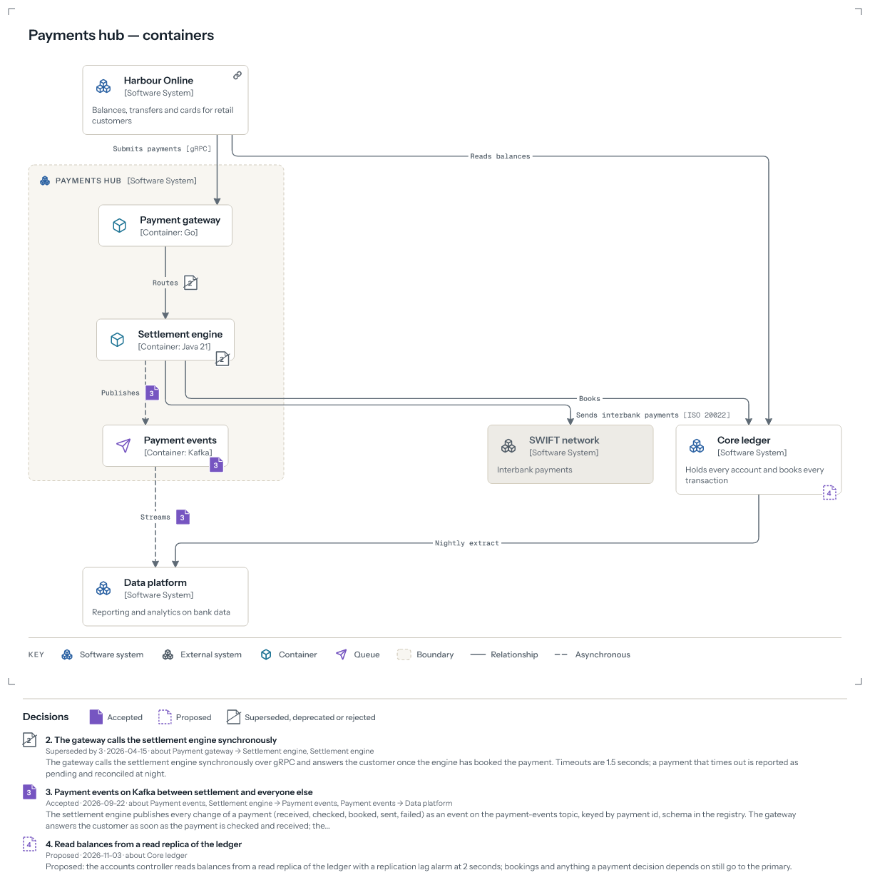
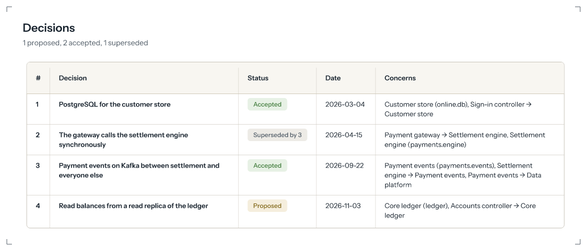

# Architecture decisions

An architecture decision record (ADR) says what was decided, why, and what it costs. Cartography keeps them where teams already keep them, as Markdown files in a folder next to the diagrams, and ties them to the drawing: each decision lists the elements, lines and views it is about, the drawing shows a numbered marker on each of them, and the folder's model keeps those links right when an element is renamed.

Decisions are not review notes. A [review note](notes.md) is a conversation about the diagram that gets resolved; a decision is durable, numbered, and replaced only by another decision that supersedes it.

```
model.yaml, containers.yaml, …          the diagrams
decisions/0001-postgres-for-the-customer-store.md
decisions/0002-gateway-calls-settlement-synchronously.md
decisions/0003-kafka-for-payment-events.md
```

The example is [examples/workspace/decisions](../examples/workspace/decisions): four decisions about Harbour Bank, one of them superseded by another and one still proposed.



## The file

The default form is [MADR](https://adr.github.io/madr/) with front matter:

```markdown
---
status: accepted
date: 2026-09-22
deciders: [team-payments, team-data]
supersedes: 2
concerns: [payments.events, "payments.engine -> payments.events", "containers.yaml#payments"]
---

# Payment events on Kafka between settlement and everyone else

## Context
## Options
## Decision
## Consequences
```

- `status`: `proposed`, `accepted`, `rejected`, `deprecated` or `superseded` (with `superseded-by: 5`).
- `concerns`: what it is about. An element or group by its id (in a folder the model id, `payments.engine`, also where a deployment draws it as `engine`); a line as `"from -> to"`; a view as `"file.yaml#view"`. Quote what has `->` or `#` in it.
- `date`, `deciders` (or `decision-makers`), `tags`: shown and searched.
- The number comes from the file name, `0003-…`. The title is the first `#` heading.

Existing folders are read as they are:

| Tool | Folder | What is read |
| --- | --- | --- |
| [adr-tools](https://github.com/npryce/adr-tools) (Nygard) | `doc/adr`, or what `.adr-dir` says | `# 3. Title`, `Date: …`, the `## Status` section with `Superseded by [5. …](0005-….md)` and `Supersedes …` lines |
| [log4brains](https://github.com/thomvaill/log4brains) | `docs/adr`, or `adrFolder` in `.log4brains.yml` | MADR front matter, or `- Status: accepted` and `- Date:` lines; dated file names (`20210403-…`) are numbered in name order |
| MADR | `docs/decisions` | front matter, `## Decision Outcome`, `## Considered Options` |

Without any of those, the folder is `decisions/`. A file that has no front matter gets one the first time it is linked to an element; its status is changed where it is written (the front matter, the Status section or the Status line), and nothing else in the file changes.

## On the drawing

A decision is a small page with a folded corner and its number, on the bottom-right corner of what it is about, or just after a line's label. It reads apart from the other marks without colour: a review note is a speech bubble at the top-left corner, a threat a `T1` tag on the top edge. Its status is in the outline:

- **accepted**: filled;
- **proposed**: dashed outline;
- **superseded, deprecated or rejected**: struck through, in grey.

Exports carry them only when asked (`carto render --decisions`, or *Exports include decisions* in the editor): the markers, and under the drawing a key of the three outlines and each decision it shows, with its status, date, what it is about here and what was decided. PowerPoint gets them in the speaker notes.

The **Decisions view** is the whole folder as a table (number, title, status, date, concerns), for a deck or a page:

```bash
carto decisions examples/workspace -o decisions.png    # or .svg, .pptx, .pdf
```



## In the editor

| Do this | Keyboard | Trackpad / mouse |
| --- | --- | --- |
| Show or hide the Decisions panel | <kbd>⇧D</kbd> (with a selection: its decisions first) | the *Decisions* tab of the side panel (it shows when something is selected); in a narrow window also the toolbar's ⋯ |
| New decision about the selection | <kbd>⌥⇧D</kbd> | the + in the panel |
| Open a decision | its marker, or a row of the panel | click |
| Edit its Markdown | *Markdown*, then <kbd>⌘S</kbd> (<kbd>Esc</kbd> cancels) | *Markdown*, *Save* |
| Everything above | <kbd>⌘K</kbd>, type "decision" | |

The panel lists the decisions of the folder: *Standing* (accepted and proposed), *Proposed*, *Accepted*, *History* (superseded, deprecated, rejected) or *All*, and *About …* the selection. A decision opens with its status, its dates, what it is about and its text as it reads. In it:

- **About**: each concern; click one to select it in the drawing and zoom to it, × unlinks it. *Link the selection* adds what is selected.
- **Status**: a menu; the change is written to the file.
- **Supersede…**: a new decision, numbered next, about the same things, that says `supersedes: 3`; decision 3 is marked superseded by it.
- **Preview / Markdown**: the text as it reads, or the file to edit.

A new decision takes the next number, the template's sections (Context, Options, Decision, Consequences) and the selection as its concerns, and is `proposed`.

While the panel is open the drawing shows the markers; click one to open its decision. With a folder open, *Where is this used* lists the decisions about the selected element, and ⌘P finds decisions by number, title, status, what they concern and what they say.

Decisions are written to the folder at once (File System Access API), as a rename writes other files. Without a folder they are kept in this browser, numbered as they would be in `decisions/`, and each has *Download*.

## Renames and checks

- *Rename everywhere* (⇧F2) rewrites `concerns:` in every decision about the element, its parts and its lines, and shows them in the preview with the diagrams.
- `carto validate <folder>` warns about a decision that concerns an id the folder does not have (with the nearest id there is), a view that is not there, a `superseded-by` or `supersedes` that names no decision, and two decisions with one number.

## Command line

```bash
carto decisions examples/workspace                    # the decision log as markdown (a table, then each decision in a line)
carto decisions examples/workspace -o docs/log.md     # to a file, links relative to it
carto decisions examples/workspace -o decisions.png   # the Decisions view
carto decisions new "Use Kafka for payment events" --concerns payments.events,"payments.engine -> payments.events"
carto decisions new "Payment events on Service Bus" --supersedes 3    # marks 3 superseded by the new one
carto render examples/workspace/containers.yaml --view payments --decisions -o payments.png
carto export-html examples/workspace --decisions      # a Decisions page, markers, decisions in the details
```

`carto decisions new` looks for the folder from where it runs (or `--into`), up to the repository's root; `--status accepted` writes another status than proposed.

## Interactive HTML

With `--decisions` (or *Exports include decisions* in the editor) the [interactive HTML](html-export.md) gets a *Decisions* page in its sidebar (the table), a page per decision with its text and the drawings it is on, markers on the drawings that open their decision, and the decisions about an element in its details panel.

## Where it lives

`packages/core/src/decisions.ts` (reading, writing, concerns, checks, log, table), `packages/render/src/decisions.ts` (markers and the key), `packages/cli/src/decisions.ts`, and in the editor `packages/web/src/decisions-panel.tsx` and `decisions-state.ts`.
