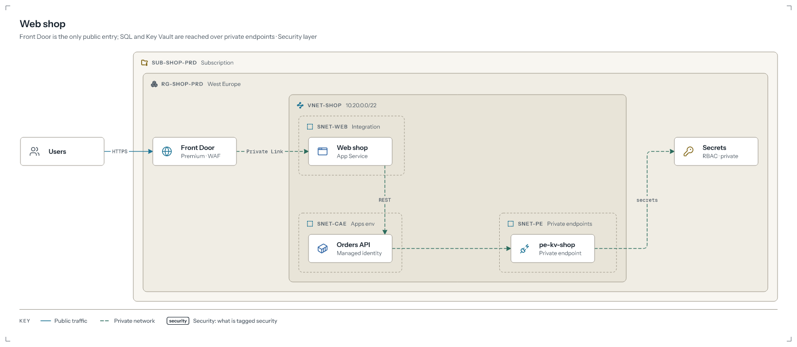
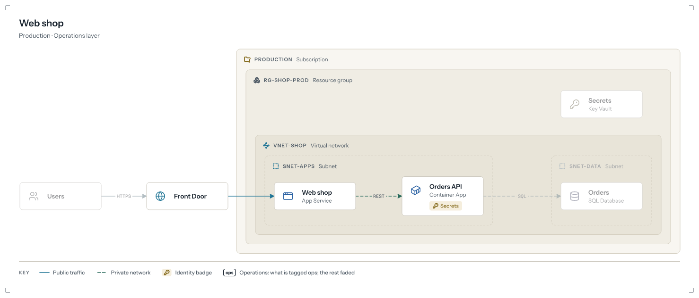
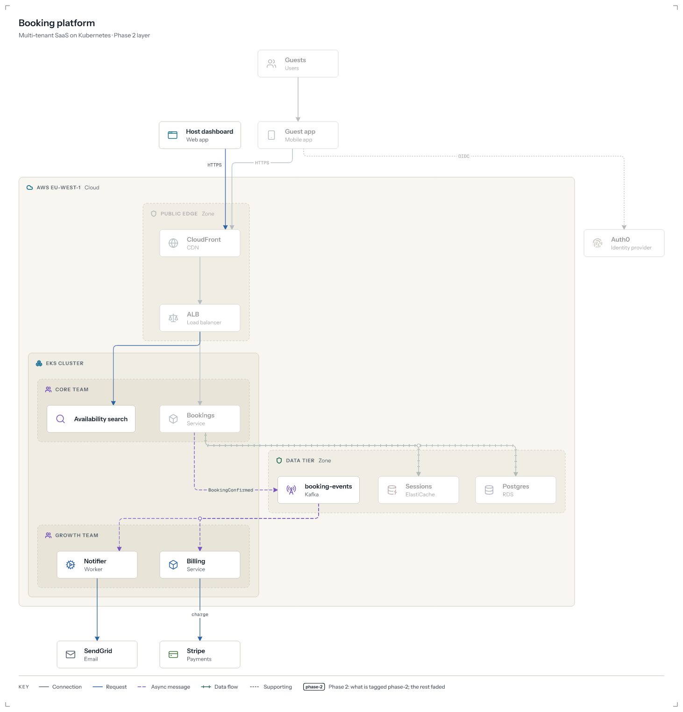

# Layers: one diagram, a view per concern

One drawing of a system is looked at by different people: security wants the trust paths, the data team where the data lives, operations what runs, the roadmap what comes in phase 2. Layers give each of them their view of the same file, without a copy to keep in step.

Put `tags:` on what belongs to a concern (nodes, groups, lines, model elements and relations), and name the layers by their tags:

```yaml
nodes:
  edge: { kind: front-door, label: Front Door, tags: [security, ops] }
  pe-sql: { kind: private-endpoint, label: pe-sql-shop, in: pe-snet, tags: [data] }
  db: { kind: sql-database, label: Orders, in: rg, tags: [data] }
  vault: { kind: key-vault, label: Secrets, in: rg, tags: [security] }
edges:
  - users -> edge: { label: HTTPS, style: public, tags: [security] }
  - api -> pe-sql: { style: private, tags: [data] }
  - pe-sql -> db: { label: TDS, style: private, tags: [data] }

layers:
  security:
    tags: [security]            # any of these tags puts a thing on the layer
    title: Security             # how the key, the subtitle and the picker name it
    caption: Only the front door is public.   # said when presenting
  data: [data]                  # the tags alone
  ops: { tags: [ops], dim-others: true }
```

Examples: [azure/web-shop.yaml](../examples/azure/web-shop.yaml) (security, data and operations) and [systems/saas-platform.yaml](../examples/systems/saas-platform.yaml) (phase 1, phase 2 and the data stores).

## What a layer draws

A layer shows what carries one of its tags, and what that needs to read:

- a **group** on the layer takes everything inside it along;
- a **line** on the layer brings its two ends;
- the **groups around** all of that stay, so you still see where things sit;
- a **line without tags** between two things that stay, stays too; a line tagged for something else does not.

There are two ways to draw it:

- **Only** (the default): just the layer, laid out on its own, compact. It has its own layout memory, so it does not jump around while you edit, and `--stable` notes it in the sidecar under `"@security"` (or `"view@security"`), apart from the whole drawing's note. Pins are the view's own: a pin set while a layer is on moves the element in the whole view too.
- **Faded** (`dim-others: true`): everything stays exactly where it is in the whole drawing, and what is not on the layer is drawn quietly, the way a step stands things back. Lines without tags that touch the layer keep their strength, so you see what the layer connects to. Nothing is laid out again, so switching faded layers on and off never moves anything.





Several layers at once show what any of them is about. The rest is faded when every one of them says `dim-others`, else left out. The key names each active layer as an outlined tag (the same chip as environment tags), and a layer asked for from outside adds "Security layer" under the title, so an export is never taken for the whole picture.



## Views name layers

```yaml
views:
  secure: { include: ['*'], layers: [security] }
```

A view drawn through a layer is that layer of the view. In the editor the Layers control starts from what the view says, and `--layer` or the control wins over it (`layers: null` in the render API draws none).

## In the editor

- **Layers** in the canvas tools (key **L**) opens a small panel: a switch per layer, several at once, how many elements are on each, **Only / Fade the rest**, **Whole drawing** and, when you changed what the view says, **As written**. In the panel **1**–**9** switch a layer, **⌥1**–**⌥9** (or ⌥-click) show one alone, **0** shows everything, **D** switches Only and Faded, **Esc** or **L** closes it.
- The **chip** under the tools says what is drawn ("Layers Security, Data · 5 of 6 · Only ×"). It is the one place that says which lens is on.
- **⌘K** has "Show layer Security", "Only layer Security", "All layers" and "Layers: fade the rest". Type **#security** (or `tag:security`) in ⌘K to list only the elements that carry the tag.
- The properties panel edits **Tags** as chips: type a few letters and the tags already in the file are suggested (↓ ↑, Enter or Tab takes one), a comma or Enter adds, Backspace in the empty field takes the last off. Lines take tags too.
- Nothing of this touches the YAML: the layers are a way of looking, kept per document and view.

### What wins

Comparing versions wins over a focus, and a focus wins over layers. A focus is a neighbourhood of the whole drawing: while one is drawn the layers wait, and the chip says so ("Layer Security · wait: the focus wins"). Leave the focus (Esc) and the layers are back. A view that writes both a focus and layers draws the focus, with a warning. While comparing, the compare view draws both versions whole.

## Presenting and exporting

- **Present** (P) keeps the layers that are on. Press **L** while presenting to add a slide per layer after each view's steps (empty layers are left out); the slide says which layer it is and its caption. L again leaves them out.
- **SVG, PNG and the other single pictures** are what is on screen, layers included.
- **PowerPoint** from the editor: the drawing on screen, its views, then a slide per layer.
- On the command line:

```sh
linework render web-shop.yaml --layer security -o security.png   # one layer
linework render web-shop.yaml --layer security,data               # several (or --layer twice)
linework render web-shop.yaml --layer security --dim              # faded, whatever the layer says
linework render web-shop.yaml --all-layers -o out/                # the whole and out/web-shop--<layer>.svg each
linework render web-shop.yaml --all-layers -o deck.pptx           # one deck: the whole, then a slide per layer
```

In a deck the whole drawing keeps a slide per step; a layer is one slide (`--all-steps` steps through each layer as well). A faded layer is faded on every slide and page.

## For tools: the render API

`render(text, { layers: ['security'], layerMode: 'dim' })` returns `layers` (every layer with its tags, title, caption and how many elements are on it, the active ones, the mode, every tag in the file, and `paused: 'focus'` when a focus wins) and, for a faded layer, `faded` (the ids drawn quietly). Exports that draw for themselves (slides, PDF pages) fade the same ids. An interactive page can render each layer once and switch between them.

## Problems it reports

- a layer's tag that nothing in the file carries (a warning at the tag);
- a view, `--layer` or the API naming a layer that is not there;
- a layer without `tags:`;
- a layer that leaves nothing in the drawing.
