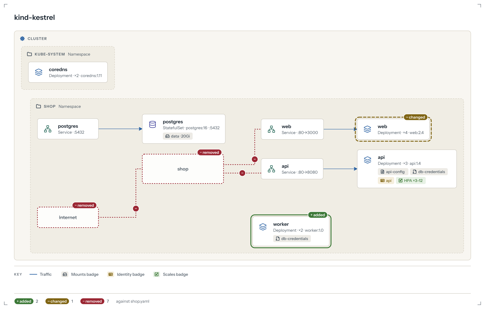

# Read live: your own kubectl, az and gh, read-only

The [Kubernetes](types.md), [Azure](azure-import.md), [access](access-import.md) and [GitHub](access-import.md#github) imports read files you saved with the tools you already have. `carto import --live` runs those same tools for you and hands their answers to the same importers. It has no API client and no credentials of its own: it uses the `kubectl`, `az` or `gh` on your PATH, logged in as you, and reads only what you could read yourself. It never runs anything that changes something.

```sh
carto import --live k8s                          # the current context and namespace → <context>.yaml
carto import --live k8s --context prod -A        # every namespace of the prod context (kube-system and kin left out)
carto import --live azure --rg 'rg-shop-*'       # Resource Graph → azure.yaml
carto import --live azure --with-access          # and role assignments → azure-access.yaml beside it
carto import --live access                       # role assignments, custom roles, group members → access.yaml
carto import --live github --org kestrel         # the organisation as the docs' gh script reads it → kestrel.yaml

carto import --live k8s --into shop.yaml         # import over a diagram: your edits stay
carto diff --live k8s shop.yaml -o drift.png     # what changed in the cluster since the diagram was saved
```

This is the command line only: a web page cannot run programs on your machine.

## Before anything runs

Every run first prints the commands it is about to run and asks:

```text
carto runs these read-only commands, with your own kubectl and its login:
  kubectl config current-context
  kubectl get deployments,statefulsets,daemonsets,cronjobs,jobs,services,ingresses,persistentvolumeclaims,serviceaccounts,networkpolicies,horizontalpodautoscalers -o json
  kubectl get gateways.gateway.networking.k8s.io,httproutes.gateway.networking.k8s.io -o json   # when the Gateway API is installed
  kubectl get configmaps -o custom-columns=NAMESPACE:.metadata.namespace,NAME:.metadata.name --no-headers   # names only
  kubectl get secrets -o custom-columns=NAMESPACE:.metadata.namespace,NAME:.metadata.name,TYPE:.type --no-headers   # names only
Run them? [y/N]
```

- `--dry-run` prints them and stops: nothing runs.
- `--yes` (`-y`) runs them without asking, for a script or a scheduled check. Without a terminal to ask on and without `--yes`, nothing runs.
- Each command is printed as it runs (`$ kubectl get …`), and how many ran at the end. Where an answer names more to read (each team, each repository, the next page), the plan says so with `<team>`, `<repo>`, `<token>`.
- `--timeout 120` is how many seconds one command may take (120 by default); a slower one is stopped and the import says so.

## What runs: the allow-list

The commands are not built from a template and passed to a shell. Each is a list of arguments, spawned directly (no shell, so nothing in a name can become a second command), and each passes one check first, `refusal()` in [packages/import/src/live.ts](../packages/import/src/live.ts): the tool, its verb, every flag and the shape of every value must be on this list, or it is not run. The tests run the import against stand-ins for the three tools and check every command they were called with against the same function.

| Tool | Allowed | Flags |
| --- | --- | --- |
| kubectl | `config current-context` | `--context` |
| | `get` of deployments, statefulsets, daemonsets, cronjobs, jobs, services, ingresses, persistentvolumeclaims, serviceaccounts, networkpolicies, horizontalpodautoscalers, gateways and httproutes (Gateway API), with `-o json` | `-n`, `-A`, `--context` |
| | `get configmaps` and `get secrets`, each on its own, only with `-o custom-columns=` of metadata (never `.data`), never `-o json` or `yaml` | `--no-headers`, `-n`, `-A`, `--context` |
| az | `account show` | `-o json` |
| | `graph query` | `-q`, `--first`, `--skip-token`, `--subscriptions <ids>`, `-o json` |
| | `role assignment list` | `--all`, `--include-inherited`, `--subscription`, `-o json` |
| | `role definition list` | `--custom-role-only`, `--subscription`, `-o json` |
| | `ad group member list` | `--group <object id>`, `-o json` |
| gh | `auth status` | |
| | `api <path>`, a GET: no `-X`/`--method`, no `-f`/`-F`/`--input` (which would make it a POST) | `--paginate --slurp`; `-H 'Accept: application/vnd.github.raw'` for CODEOWNERS only |

The GitHub paths are exactly those of the [export script](access-import.md#github): `orgs/<org>` and its teams, members, owners (`members?role=admin`), outside collaborators, repositories, rulesets, Actions secrets, variables, runners and runner groups, installations; each team's members and repositories; each repository's direct collaborators, environments, rulesets, Actions secrets and variables, the default branch's protection, and `.github/CODEOWNERS`. Archived repositories are listed but not read.

Also refused: any other verb (`delete`, `apply`, `exec`, `create`, `use-context`, `az rest`, `gh auth token`, …), any other flag (`--kubeconfig`, `--debug`), a value that starts with `-` (a flag in disguise) or `@` (az reads a file for it), a tool by path, and anything run through a shell.

## Privacy

- **Secret values are never read.** Secrets and ConfigMaps are listed by namespace, name and type only; kubectl gets them from the cluster, carto never sees their data. Belt and braces: anything else that comes back is stripped before it is imported, kept or printed: `data`, `stringData` and `binaryData` of any Secret or ConfigMap, env values written into a pod spec (an env entry keeps its name and its `valueFrom`), container `command` and `args`, annotations (`kubectl.kubernetes.io/last-applied-configuration` copies a whole manifest, Secret data included; only `helm.sh/hook` stays), managed fields and status. GitHub never gives a secret's value; Actions variables are kept by name only, as in the file import.
- **Nothing is stored** unless you ask: the answers live in memory for the import. `--keep-raw <dir>` writes them (already stripped) as the files the export scripts save, so `carto import <dir>` reads them again later, offline.
- **No credentials of ours.** carto never asks for, reads or writes a token; the tools use their own login (kubeconfig, `az login`, `gh auth login`). `gh auth status` is run to know you are logged in; its output is not shown.
- **Nothing else is contacted.** The tools talk to your cluster, Azure or GitHub as they always do; carto makes no network call of its own.

## When it does not work

| Said | Means |
| --- | --- |
| `kubectl is not installed, or not on PATH` (or az, gh) | install it, with the link given |
| `az is not logged in: run az login first` | as it says; `gh auth login` for gh |
| `az graph query needs the Resource Graph extension` | `az extension add --name resource-graph` (carto does not install it) |
| `kubectl is not logged in to the cluster` | your cluster's own way: `az aks get-credentials`, `aws eks update-kubeconfig`, `gcloud container clusters get-credentials` |
| `kubectl has no such context` | `kubectl config get-contexts`, then `--context` |
| `your account may not read this` | a role binding or Azure role is missing; carto cannot do more than you |
| `took longer than 120s and was stopped` | `--timeout 600`, or narrow it (`-n`, `--rg`, `--subscription <id>`) |

A member list of one group that may not be read, or a repository's answer GitHub refuses (*Not Found*, *Branch not protected*), does not stop the import: it is said, or saved as GitHub said it, as the export script does.

## Per source

**k8s**: `--context` (else the current one), `-n`/`--namespace` (else the context's namespace) or `-A`/`--all-namespaces` (every namespace but kube-system, kube-public and kube-node-lease; `-n kube-system` draws those). Without the Gateway API installed the import says so and draws Ingresses. The title is the context's name; `--title` gives another.

**azure**: `--subscription` and `--rg` narrow the query itself when they are subscription ids and plain resource group names (`resources | where resourceGroup in~ ('rg-a', 'rg-b')`, `--subscriptions <id>`); names of subscriptions and wildcards (`rg-shop-*`) are picked out by the import after the query, as with saved files. Pages of 1000 rows, followed by `--skip-token` up to 100 pages. The other flags of [the Azure import](azure-import.md) (`--all`, `--depth`, `--collapse-above`) work as there. Diagnostic settings are not read live (one call per resource); save them as in the Azure docs if you want those badges.

**access**: role assignments at every scope of the subscription (`--all --include-inherited`), custom role definitions, and the members of each group that holds a role, and of the groups in those (up to 200 groups). Users, service principals and directory roles are not listed: identities are named as the role assignments name them. For Graph data (access packages, directory roles), save the files as in [the access docs](access-import.md).

**github**: `--org` is needed. Six requests run at once; an organisation of 100 repositories is about 900 requests, a few minutes and well inside GitHub's hourly limit for a logged-in user.

## Importing again, and drift

`--into diagram.yaml` imports over that diagram, the way importing a folder again does: what the cluster (estate, organisation) says follows it, what was gone goes, and what you wrote stays: title, comments, labels you changed, cards and lines you added, views. Pins in `<diagram>.layout.json` stay, since ids stay. Without `--into`, an existing file is not written over (`--force` starts it over). `-o -` writes the YAML to the terminal.

A Kubernetes diagram imported live carries the tag `imported` on what the cluster put there; take the tag off and the import leaves that entry alone. Importing over a diagram that `carto import manifests/` made (no tags yet) takes an entry of the same id and kind as the same thing from then on, and keeps anything else as yours.

`carto diff --live <source> saved.yaml` imports live over the saved diagram, in memory, and compares: what was added, removed and changed since, in words, and with `-o drift.png` as the picture. `--exit-code` exits 1 when something drifted, for a scheduled check. What you drew by hand is not drift.

```text
live k8s against shop.yaml: 2 added, 7 removed, 1 changed
- node  internet                  "Internet"
- node  shop
~ node  web                       kind: "Deployment · ×2 · web:2.3" → "Deployment · ×4 · web:2.4"
+ node  worker
- line  internet -> shop          "HTTPS"
…
```


