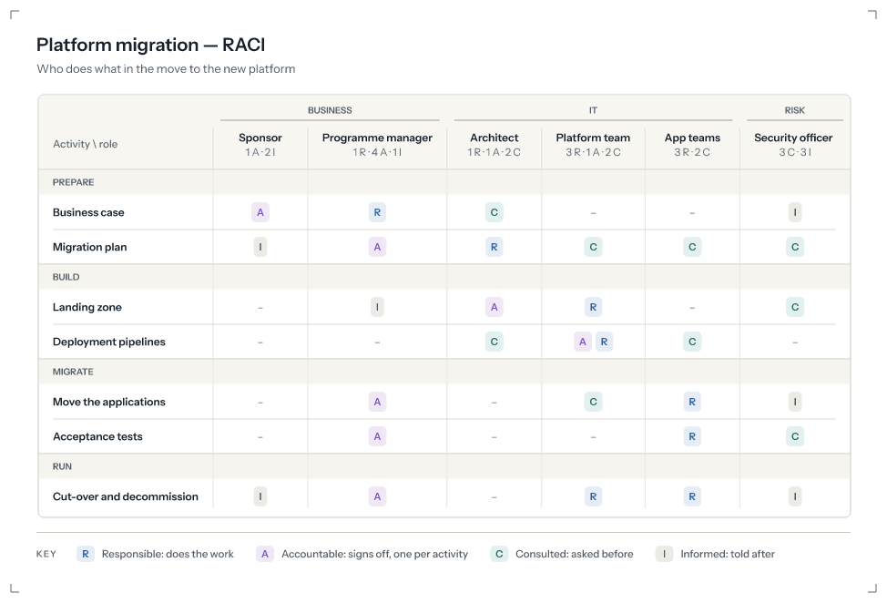
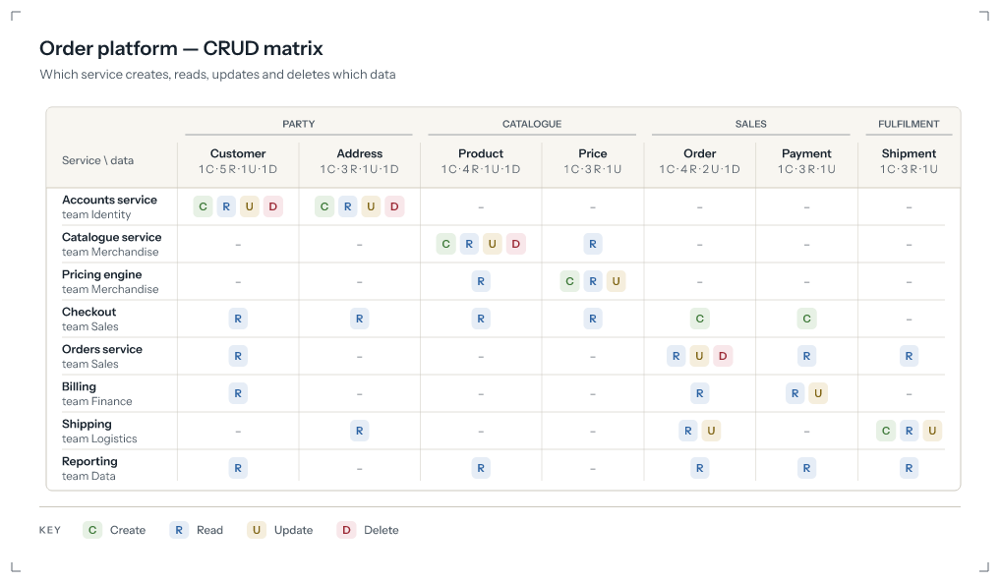

# Matrices: RACI, CRUD and your own

`type: matrix` is a grid of rows against columns with a value from a declared legend in each cell. The legend can check itself: a RACI chart warns about an activity without exactly one *Accountable*, a CRUD matrix about data nobody creates.



```yaml
type: matrix
title: Platform migration — RACI
legend: raci
counts: true

columns:
  sponsor: { label: Sponsor, group: Business }
  pm: { label: Programme manager, group: Business }
  arch: { label: Architect, group: IT }

rows:
  case: { label: Business case, group: Prepare }
  plan: { label: Migration plan, group: Prepare }

cells:
  case: { sponsor: A, pm: R, arch: C }
  plan: { sponsor: I, pm: A, arch: R }
```

Examples: [raci-migration.yaml](../examples/matrix/raci-migration.yaml), [crud-services.yaml](../examples/matrix/crud-services.yaml).

## Rows, columns and cells

`rows:` and `columns:` map an id to a label (`pm: Programme manager`) or to `{ label, caption, group, icon, tone }`. Neighbours with the same `group` are named once: a band over grouped columns, a section line between grouped rows (the phases of a RACI chart). `cells:` holds, per row id, `{ column id: value }`; an empty cell is a dash.

A cell holds one value or several: `CRU`, `C R U`, `A/R` or `R, A`. Each value is a small pill in its tone, with its letter, so the cell reads in print and in grey.

## Legends

| `legend:` | Values | Checked |
| --- | --- | --- |
| `raci` (default) | R Responsible, A Accountable, C Consulted, I Informed | each row has exactly one A and at least one R |
| `crud` | C Create, R Read, U Update, D Delete | each column (each kind of data) is created and read by someone |
| your own | any keys | what you ask |

Your own legend maps keys to labels, or to `{ label, tone, per-row, per-column }` where the rules are `exactly-one`, `at-least-one` or `at-most-one`:

```yaml
legend:
  Own: { label: Owner, tone: violet, per-column: exactly-one }
  Use: { label: User, tone: blue }
  Ask: Consulted
```

A broken rule is a warning on the row or column: *"Business case" has 0 × A; it needs exactly one (Accountable)*. A value that is not in the legend, or a cell under a row or column that does not exist, is an error.

`counts: true` (or `columns`) writes how many of each value a column holds under its name (*3 R · 1 A*: how much one role carries); `rows` does it under each row name, `both` under both.



## Linked to the model

With `include:` a model, a row or column whose id names a model element (its full id `shop.api`, or its own key `api` when that is unique) takes the element's label and its first link: `rows: { api: null }`.

## Exports

PowerPoint gets a real table, with merged cells for the groups and each value as bold text in its tone, so the chart can be edited in the deck. PDF, SVG and PNG are the drawing; draw.io and Excalidraw get its text in place.

## Not for

Who may access which resource through which group or role is `access`, which computes the who × where matrix from assignments. Steps in order, and who does them, is `process`.
