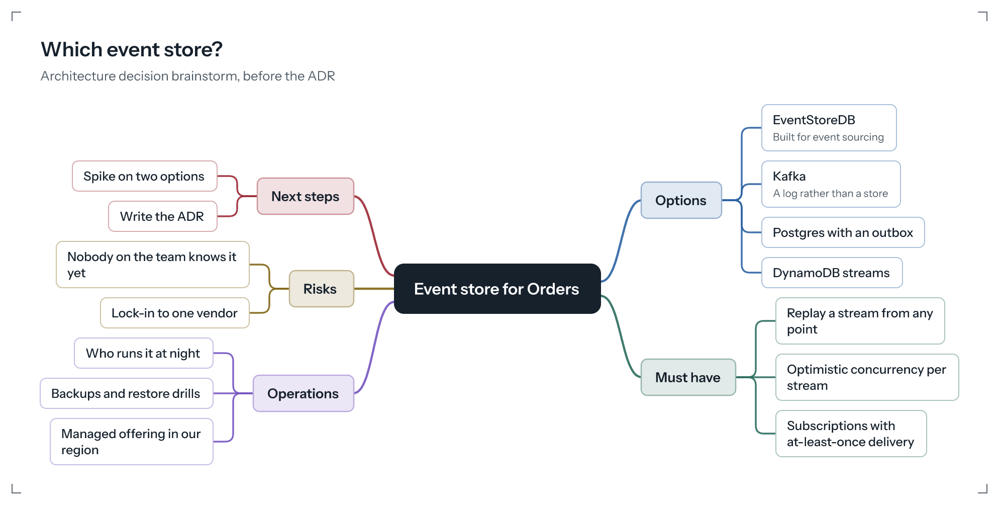
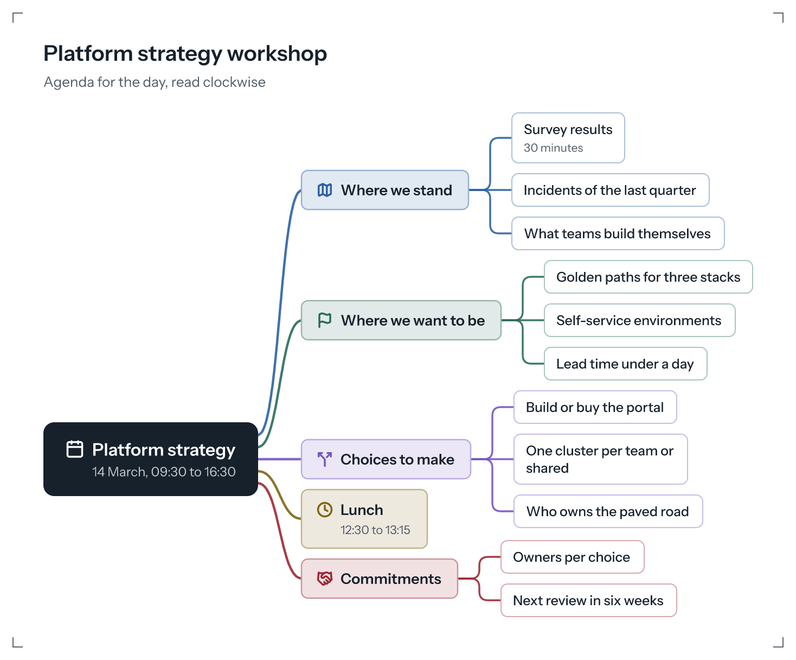
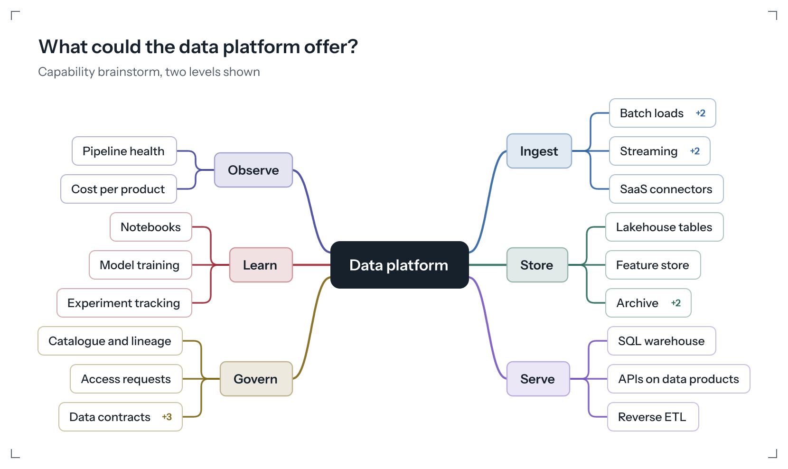

# Mind maps

`type: mindmap` draws a central topic with branches around it: a brainstorm before a decision, the agenda of a workshop, the parts of a subject on one slide. Each level out is a step lighter than the one inside it (a filled centre, tinted branches, outlined topics, then words on their own), and each branch keeps its own colour from the theme.

```sh
carto new mindmap ideas.yaml
carto render ideas.yaml -o ideas.png
carto render ideas.yaml -o ideas.pptx        # every topic a native shape
```



## Topics

```yaml
type: mindmap
title: Which event store?
center: Event store for Orders       # without it, the title
topics:
  Options:                           # a branch, its topics as a list
    - EventStoreDB: { note: Built for event sourcing, icon: database }
    - Kafka: [Retention, Compaction] # a topic with topics under it
  Risks:                             # or as a map, with topics:
    tone: rose
    topics: [Nobody knows it yet]
  Budget: Not more than last year    # a string is a note
  Replay: { parent: Options }        # or anywhere, with parent:
```

| Key | Means |
| --- | --- |
| `center` | the central topic: its words, or `{ label, note, icon }` |
| `note` | a short line under a topic |
| `icon` | an icon before it |
| `tone` | the colour of a branch; its topics keep it. By default branches take the theme's colours in turn |
| `side` | `left` or `right`: which side of the centre a branch stands on |
| `parent` | the topic it hangs under, instead of writing it inside (what the builder writes) |
| `label`, `description`, `link` | as everywhere |

The same words under two branches are two topics.

## Layout

- `layout: both` puts the branches on both sides of the centre, balanced by how much each holds, read clockwise from the top right. `layout: right` (or `left`) puts them all on one side: the order reads top to bottom, which suits an agenda. Left out, whichever fills a 16:9 slide best is drawn.
- `depth: 2` draws two levels; the topics deeper down fold into a count on the topic that holds them (`+3`).

From the centre each branch leaves on a curve of its own, so no two colours share a line; further out the topics hang square from their branch's bus, as an outline does. Each side is a tidy tree, packed as close as the topics allow.

Like the org chart, a mind map keeps to the drawing before: a branch stays on its side, and a topic added moves only its neighbours, never the other side.





## In the builder

Pick a topic to give it a note, an icon, a colour or a side. `A` adds a topic under the one picked (as `parent:`); drag a line from a topic to a branch to hang the branch there.

## Importing and exporting

- **Mermaid** `mindmap`: the indents are the levels; shapes (`(( ))`, `[ ]`, `{{ }}`) are taken off, `::icon()` is named in the report.
- **PlantUML** `@startmindmap`: `*`, `+` and `-` topics, `left side`, boxless `_` topics, multi-line `:…;` topics.
- **Export**: PowerPoint, draw.io and Excalidraw get a shape per topic and the lines as drawn; Mermaid export writes a `mindmap`.

## Mind map, capability map or teams?

- **A brainstorm, an agenda, ideas without a structure yet** are a mind map. It says nothing about who or what; it collects.
- **What the business does, to invest by** is a `capabilities` map: levels with a fixed meaning, a heatmap, the systems behind each capability.
- **Who reports to whom** is `teams`: a tree of people, with vacancies and dotted lines.

Examples: [examples/mindmap](../examples/mindmap)
