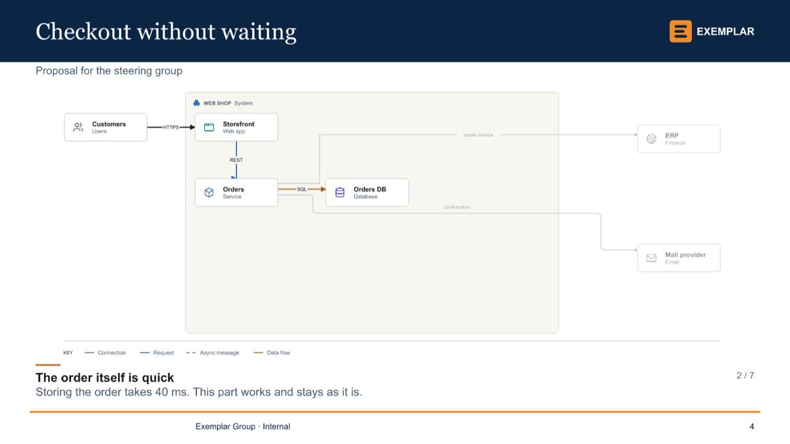
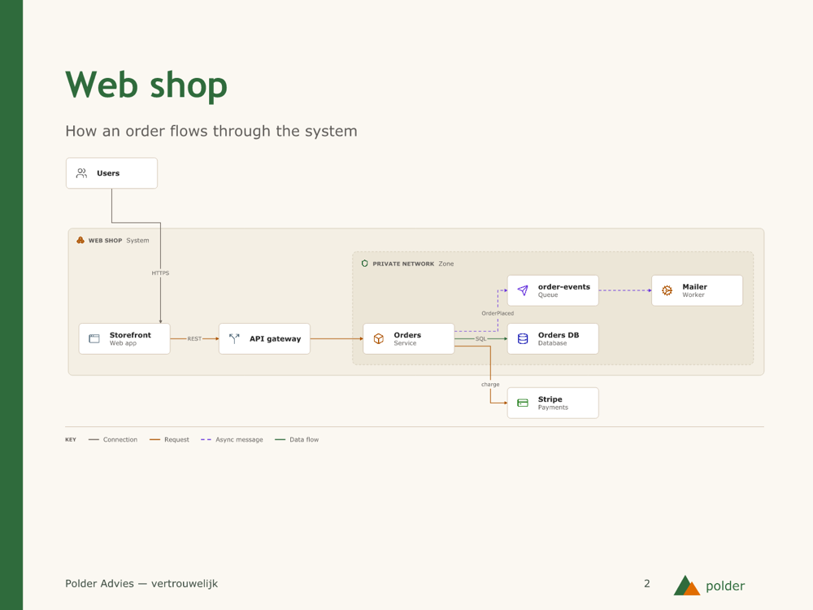

# PowerPoint in your own template

A client hands you their PowerPoint template (`.potx`, or a `.pptx` that serves as one) and wants the
architecture slides in it. Cartography makes the deck inside that template: the slides use the template's
layouts, master, logo, footer and slide numbers, the title goes into the template's title placeholder, and the
diagram is drawn in the template's colours and fonts, still as native shapes you can edit. A sequence
diagram, git branching and a roadmap are the exception: they are one picture on the slide, with a warning
(see [types](types.md)).



## Where

- **Editor:** Export → **Use a template…** picks a `.potx` or `.pptx`. A template in the open folder (for
  example `brand/template.potx`) is offered in the menu by itself: **Use template.potx**. The PowerPoint row then
  reads *PowerPoint in template.potx*. The choice is remembered for that folder, file and all, so it is still
  there after a reload. **Keep the diagram's own look** and **Stop using …** are in the same menu.
- **Command line:**

  ```sh
  carto render shop.yaml -o shop.pptx --template customer.potx
  carto render shop.yaml -o shop.pptx --template customer.potx --layout "Title and Content"
  carto deck *.yaml -o review.pptx --template customer.potx --title "Architecture review"
  ```

  `--keep-look` keeps the diagram's own theme, `--keep-slides` keeps the template's own slides in front of the
  diagrams.
- **Brand theme:** a theme file can name the template its decks are made in, relative to the theme file:

  ```yaml
  name: client
  extends: light
  pptx: client-template.potx            # or { template: …, layout: Title Only, keepLook: false }
  ```

  Every PowerPoint export of a diagram in that theme is then made in it; `--template` and the menu win over it.

## What goes where

| On the slide | From |
| --- | --- |
| Slide size, master, background, logo, decoration | the template, untouched |
| Layout | **Title Only** (by type, or by its name in another language: *Alleen titel*, *Nur Titel*, *Titre seul*…), else **Title and Content**, else a layout with only a title, else **Blank**. `--layout` picks one by name (the whole name, or part of it). |
| Diagram title | the layout's title placeholder: position, face, size and colour are the template's |
| The drawing | the layout's content or picture placeholder when it has one; otherwise the room under the title, between the master's text margins, down to the footers. It keeps clear of what the master and the layout draw there (a logo, a rule, a stripe). In a template it starts under the title rather than in the middle. |
| Subtitle | a text box under the title, in the template's body face |
| Step title and caption | the layout's caption placeholder (*Picture with Caption*) when it has one, otherwise under the title, in the subtitle's row; beside the drawing when the drawing is too tall for what is left under it |
| Footer, slide number, date | copied from the layout onto each diagram slide, where the master shows them (a master that hides the date keeps it hidden) |
| Speaker notes | as without a template, on the template's notes master; one is added when it has none |
| Title slide (`--title`) | the template's **Title Slide** layout, its title and subtitle placeholders |

The template's own sample slides are left out, with their pictures, notes, sections and custom shows; the
thumbnail is dropped, as it showed the template's first slide. The template's masters, layouts, theme, embedded
fonts and media stay byte for byte as they were.

### How small the text gets

A template usually leaves the drawing less room than Cartography's own slide: a title bar, a footer, a logo, wider
margins. The drawing is scaled into the room the table above describes, and that is the room it is measured in.
The editor's PowerPoint export names the slides whose smallest text a reader needs (names on cards, lines and
groups) comes out under 6 pt, as made in the template. On the command line, `carto validate --template
customer.potx` (with `--layout` as for `carto render`) says the same per diagram before you make the deck; a
diagram whose brand theme names a template (`pptx:`) is measured in it without asking. `carto render` and `carto deck` say it too when they make a deck, in the template or on a 4:3 slide (`--aspect 4:3`), as a warning per drawing that does not stop the deck. The editor's page frame
(⇧P) does the same: with a template chosen in the Export menu (or named by the theme) it is that template's
slide, named after the file, and says the smallest text the deck in it would have. Without a template,
validate and the page frame measure Cartography's own slide: the title top left, the drawing in
the rest with modest margins, nearly as large as the drawing fitted whole.

## Colours and fonts

By default the diagram takes on the template, through the same derivation a [brand theme](themes.md) goes
through:

- the page is the slide background of the chosen layout (or the master's, or `lt1`); a dark layout gives a dark
  theme;
- text is `tx1`, or the scheme colour that reads on that background;
- **accent 1** is the main tone (blue: what most things are drawn in), **accent 2** the second (teal: data flow,
  the step rule); accents 3–6 go to the tone nearest in hue, so a red accent is still what says *danger*, and a
  grey one is the neutral tone;
- every word is set in the template's body font (its *minor* font), the technical labels too; the title keeps
  the template's heading font.

Every colour is checked. An accent too close to the background to draw with (a near-white grey, a pale yellow on
cream) keeps Cartography's tone for that slot, and the export says so; an accent that reads only when darkened is
darkened just enough, and said when that is far from the colour itself.



`--keep-look` (menu: **Keep the diagram's own look**) draws in the diagram's own theme instead, on the template's
slides with the template's title and footers.

## Checking a deck without PowerPoint

The tests check each deck as PowerPoint would before it opens one: every part well-formed, every relationship
resolves, every part has a content type, slide and shape ids unique, the presentation's lists in schema order,
placeholders filled. To look at slides without PowerPoint or Keynote, a small renderer draws each slide to PNG
(background, master and layout shapes, placeholders with their inherited frames and styles, the diagram):

```sh
tsx packages/export/test/support/render-deck.ts deck.pptx out/
tsx packages/export/test/support/template-demo.ts out/     # the two made-up templates and decks made in them
```

It is good enough to see where things land, not a full renderer (no autofit, effects, tables drawn as boxes).
The templates in the tests are made up (*Exemplar Group*, *Polder Advies*); a real company's template never goes
into the repository.

## An SVG for PowerPoint, Word and Keynote

PowerPoint, Word and Keynote take an SVG, but drop or misdraw much of what a browser draws: style sheets, CSS variables, filters, markers, `foreignObject`, web fonts. `--svg-safe` (in the editor: the *SVG for PowerPoint / Word* switch in the Export menu, remembered) writes the same drawing without them:

- every style is a presentation attribute (`fill="…"`), variables become their value;
- no filters, patterns, gradients, clip paths, masks, markers or links; shadows and the dot grid go;
- text is in Arial (or Courier New for code), which every machine has;
- one group per node and per line, so *Ungroup* in PowerPoint gives shapes you can recolour.

`--outline-text` goes one step further: every word becomes a path in the theme's own font, so the drawing looks exactly as in Cartography on any machine. The text can then no longer be edited or searched.

## Limits

- Fonts are named, not embedded, as in every deck Cartography writes: where the template's face is not installed,
  PowerPoint substitutes. A template that embeds its fonts keeps them.
- Text boxes are sized with Inter's widths, as for any brand font without font files: in a much wider face
  (Verdana) labels sit a little tight in their boxes, in a narrow one (Calibri) a little loose.
- Strict Open XML templates (the *Strict* save option) are not read.
