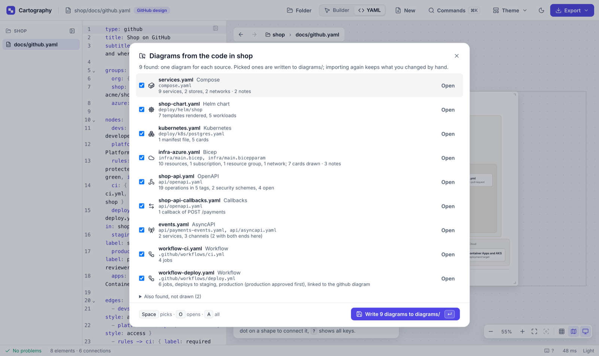
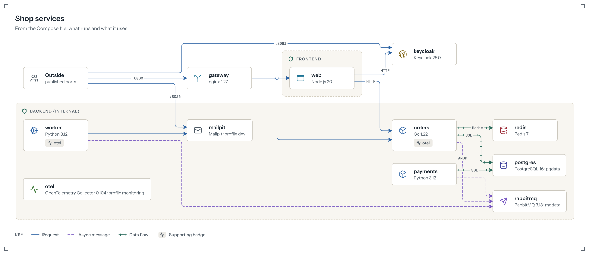
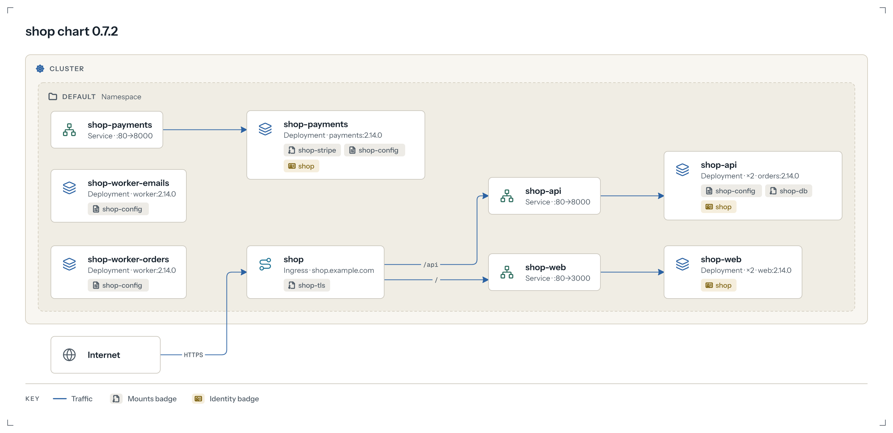
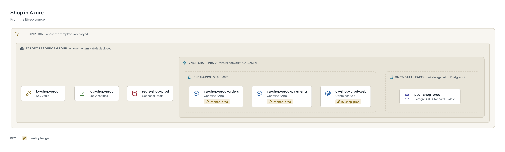
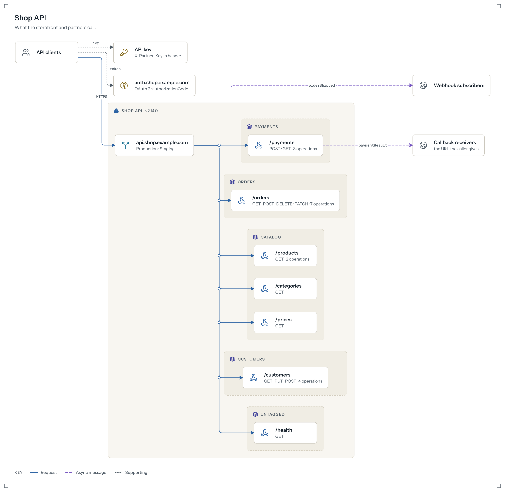
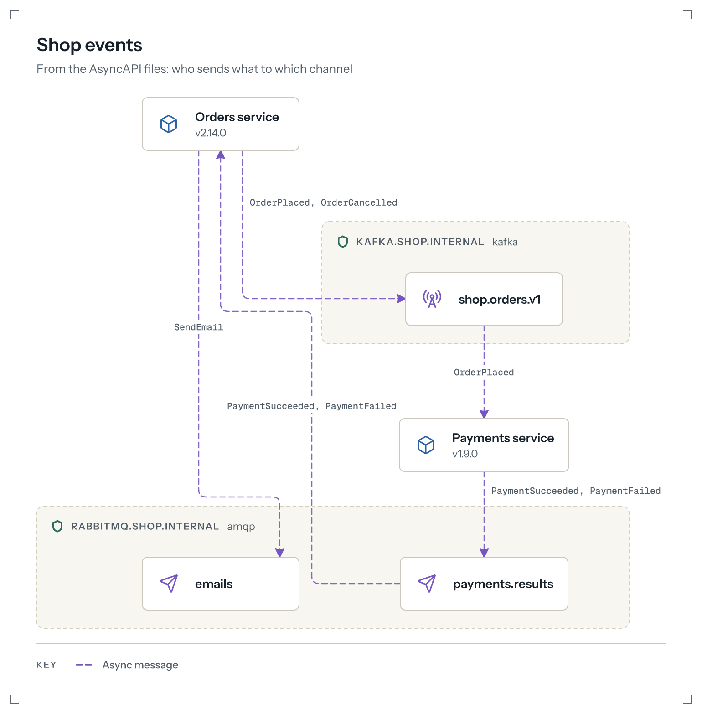
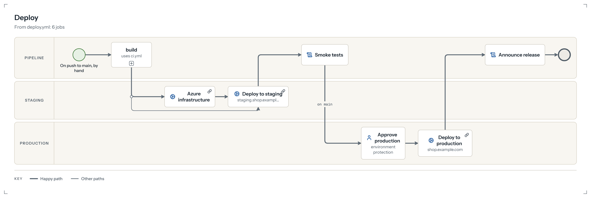

# Diagrams from a code repository

Most of what an architecture diagram says is already in the repository, in files written for other tools: the Compose file that starts everything on a laptop, the Helm chart that deploys it, the Bicep that makes the Azure resources, the OpenAPI and AsyncAPI files that describe the interfaces, the workflows that build and ship it. `carto import <repo>` reads them and draws one diagram of each, into a `diagrams/` folder next to them. Importing again (after the code changed) brings the diagrams up to date and keeps what you changed by hand.

```sh
carto import .                                  # every source, a diagram each, into diagrams/
carto import . --dry-run                        # what it would write, nothing written
carto import . --diagrams docs/architecture     # somewhere else
carto import . --values deploy/helm/shop/values-prod.yaml   # charts drawn with production's values
carto import . --force                          # start the diagrams over, hand edits dropped
carto render . -o pictures/ --format png        # the pictures only, nothing else written
```

Nothing runs: no Docker, Helm, Bicep or Azure CLI, no network. The importers have their own readers (a Go template subset for Helm, a Bicep compiler to ARM JSON), so what they cannot work out is named with its file and line instead of guessed. The examples below are of the made-up shop in [examples/repo/shop](../examples/repo/shop); its `diagrams/` folder is what `carto import examples/repo/shop` writes.

In the web app, open the repository with **Open folder** and pick **Diagrams from the code in …** in the command palette (⌘K): a dialog lists what it found, one row a diagram with what it holds. <kbd>Space</kbd> leaves one out, <kbd>O</kbd> opens the one at hand (or click **Open**), <kbd>Enter</kbd> writes the picked ones into `diagrams/` and opens the first; <kbd>A</kbd> picks all or none. A folder dropped on the page (or some of its files) gets the same dialog, to open one.



## What is read

| Source | Found by | Diagram |
|---|---|---|
| Docker Compose | `compose.yaml`, `docker-compose*.yml` with `services:` | `services.yaml`, [systems](types.md) |
| Helm chart | a folder with `Chart.yaml` | `<chart>-chart.yaml`, [kubernetes](types.md) |
| Kubernetes manifests | YAML with `apiVersion` and `kind`, outside a chart | `kubernetes.yaml` (or `<folder>-kubernetes.yaml`), one per folder |
| Bicep | `.bicep` files no other file uses as a module, and their `.bicepparam` | `<folder>-azure.yaml`, [azure](azure-import.md) |
| ARM templates, `terraform show -json` | JSON with a deployment template `$schema`, or `format_version` | `<file>-azure.yaml` or `<file>-cloud.yaml` |
| OpenAPI 3, Swagger 2 | `openapi: 3.x` or `swagger: "2.0"` | `<title>.yaml` (systems), `<title>-callbacks.yaml` ([sequence](types.md)) |
| AsyncAPI 2, 3 | `asyncapi:`; all files together | `events.yaml`, systems |
| GitHub Actions | `.github/workflows/*.yml` | `workflow-<name>.yaml`, [process](process.md) |
| Dockerfiles | `Dockerfile` | what a Compose service is built from (its caption) |

Also named, not drawn, with what would draw them: Terraform source (`.tf`: save `terraform show -json` in the repository), kustomizations (`kustomize build` into a file), values files next to a chart (`--values`), Dockerfiles no Compose file builds. `node_modules`, build output, hidden folders (except `.github`) and the diagrams folder itself are skipped, and so are files that are Cartography diagrams already.

## Docker Compose



- **Services** are cards. The kind comes from the image: `postgres`, `mysql`, `mongo` … a database; `redis`, `valkey`, `memcached` a cache; `rabbitmq`, `nats` a queue; `kafka`, `redpanda` an event stream; `nginx`, `traefik`, `envoy`, `haproxy`, `caddy` a gateway; `keycloak`, `authentik`, `dex` the identity provider; `minio`, `azurite` storage; `elasticsearch`, `opensearch` search; `prometheus`, `grafana`, `otel` monitoring; `mailpit`, `mailhog` email; `vault` secrets. A service built here (`build:`) is a service of your own, a worker when its name or command says so (`celery`, `worker`, `consumer`). The caption is the product and version (*PostgreSQL 16*); for what is built, the language from its Dockerfile (*Node.js 20*; the build stage's when the image it runs on says nothing, as `distroless` does).
- **Lines** come from `depends_on` (short and long form), `links`, and the URLs in the environment that name another service (`postgres://…@db` is *SQL*, `amqp://` *AMQP*, `http://` *HTTP*). Lines to stores are drawn as data, to queues as async; telemetry (to a monitoring service) is a badge on each card rather than a line across the drawing.
- **Networks** are zones when there are two or more: a service in one network is inside it, a service in several (the gateway) stands between them. An `internal` network says so.
- **Published ports** come in from *Outside*, labelled with the port; ports published on `127.0.0.1` only are not, and the import says which.
- **Named volumes** are badges on the card that keeps them; one shared by several services is a store of its own. Bind mounts of the repository's files are configuration and left out.
- `x-` anchors and `<<:` merges are read; `extends` within the file too. `compose.override.yaml` is read over `compose.yaml`, as `docker compose` does. Services with `profiles:` are drawn with the profile as a badge and named in a warning; `extends` from another file and `include:` are named, not followed.

## Helm charts



The templates are rendered here, with the chart's `values.yaml` (and `--values file` over it), the release named after the chart and the namespace `default`, then read as manifests by the [Kubernetes importer](types.md): workloads, services, ingress and routes, what each mounts and runs as as badges. What the renderer knows of Go templates and Sprig:

- actions with `{{-` / `-}}` trimming and `{{/* comments */}}`; `if` / `else if` / `else`, `with`, `range` over lists, maps (sorted keys), numbers, with `$i, $v :=` and `else`, `break` and `continue`; variables (`$x :=`, `$x =`, `$`); pipelines and parentheses;
- `define`, `template`, `include`, `block`, `tpl`; `.Values`, `.Release`, `.Chart`, `.Capabilities` (every API version is there), `.Files.Get` / `.Glob`, `.Template`;
- `default`, `required`, `empty`, `coalesce`, `ternary`, `quote`, `squote`, `toYaml`, `toJson`, `indent`, `nindent`, `trim`, `trunc`, `trimSuffix`, `trimPrefix`, `lower`, `upper`, `title`, `replace`, `printf`, `print`, `cat`, `contains`, `hasPrefix`, `hasSuffix`, `regexReplaceAll`, `split`, `splitList`, `join`, `list`, `append`, `first`, `last`, `has`, `uniq`, `dict`, `get`, `set`, `hasKey`, `keys`, `values`, `pluck`, `dig`, `merge`, `mergeOverwrite`, `deepCopy`, `index`, `len`, `eq`, `ne`, `lt`, `le`, `gt`, `ge`, `and`, `or`, `not`, `add`, `sub`, `mul`, `div`, `mod`, `max`, `min`, `int`, `toString`, `kindIs`, `typeOf`, `b64enc`, `b64dec`, `semverCompare` (always true), `lookup` (always empty).

What depends on the cluster or on chance (`lookup`, `randAlphaNum`, `sha256sum`, generated certificates) reads `…`. A function it does not know is named once, with the template and line, and left empty; the rest renders. A template that cannot be rendered at all (a `{{ if }}` without `{{ end }}`, an include of a template that is not there) is named with its line, and what the file clearly says is still drawn: lines that are only an action are left out, a name made by an include becomes the chart's name. Subcharts in `charts/` are rendered with their own values, those under their name in the parent's and `global`; one with `enabled: false` is left out; a packed one (`.tgz`) is named. `helm test` hooks are not part of the release.

## Bicep



Bicep is compiled here to the ARM template `az bicep build` would write, then read by the [Azure importer](azure-import.md) like any compiled template: networks and subnets as containers, each resource where it sits, what references what. Read: `param` with defaults, `var`, `resource` (with `parent:`, children declared inside it, `existing`, `if (…)` conditions, `[for … in …]` and `[for (x, i) in …]` loops, `scope:` on another resource), `module` (the file it names, compiled too, with its `params`, the resource group it is deployed to and its `outputs` read by others), `output`, decorators, string interpolation, `?:`, `??`, `==`, `&&`, `!` and the ARM functions. A `.bicepparam` file next to the entry file gives its values (those it can know). Entry files are those no other uses as a module: a diagram each.

Named instead of guessed: modules from a registry (`br:`, `ts:`), `loadTextContent` and its kin, `readEnvironmentVariable` and `getSecret` in a parameters file, a parameter without a default (its words stay in braces: `{env}`), and syntax it cannot read, each with the file and line.

## OpenAPI and AsyncAPI



An OpenAPI (3.x) or Swagger (2.0) file is drawn as the API, not as a list of endpoints: its **tags** are groups, and under each the **resources** (`/orders`, with `/orders/{id}` and `/orders/{id}/items` in it) are a card each with their methods and how many operations; past six resources in a tag the rest are one counted card. Without tags, the resources group themselves. The **servers** are one card (*Production · Staging*), **security schemes** are where callers get a token or key, **callbacks** go to *Callback receivers* and **webhooks** (3.1) to *Webhook subscribers*. The first operation with callbacks also gets a [sequence](types.md): the call, its answer, the callback and its answer.



AsyncAPI files (2.x and 3.x) are read together: each is one service, its **channels** are topics or queues (from the `amqp` binding, else from the protocol: Kafka, MQTT, NATS, SNS are topics; AMQP, SQS, JMS queues), each **broker** a zone. A line goes from a service to a channel it sends to and from a channel to a service that receives, labelled with the message names. AsyncAPI 2 speaks from the other side (`publish` is what the application receives, `subscribe` what it sends); that is read the right way round. Two files that name the same channel on the same broker meet there, so the picture shows who talks to whom.

## GitHub Actions



Each workflow is a [process](process.md): what starts it (*On push to main, by hand*), its jobs as tasks (named as in the workflow), `needs:` as the flow, a job's `if:` on the line into it, the jobs nothing needs into the end. A matrix is noted on its job (*matrix ×6: os × node*), a reusable workflow (`uses:`) is a subprocess. A job that deploys to an `environment:` stands in a lane of that environment, with its URL; before a production environment (`prod`, `production`, `live`) someone approves, drawn as a task in its lane. When the repository has a [github diagram](types.md) that has that environment, the job links to it.

## Importing again

Every entry an import writes carries the tag `imported`. The next import (over the files in `diagrams/`) follows the code for those: new services appear, removed ones go, a moved one moves. What you wrote yourself stays: a label or caption you changed, comments, entries and lines of your own, the order of things, views, steps and layers. An entry you renamed is found again by what it is. A sequence (the callbacks) is not merged into: once there, it stays as you left it. `--force` starts the diagrams over.

## Weak spots

- The Helm renderer is not Helm: a chart that leans on functions or constructs not listed above renders in part (and says where). `lookup` is always empty, every API version is available, and the release namespace is `default`.
- Bicep: user-defined functions, `import`, lambdas, loops inside expressions and resource methods (`listKeys()`) are not read; outputs of a looped module are not known.
- Compose: the kind of an image not in the list is guessed from the service's name; environment from `env_file` is not read.
- OpenAPI: `$ref`s to other files are not followed.
- Kubernetes manifests in a folder are one diagram per folder; Kustomize and Jsonnet are not run.
