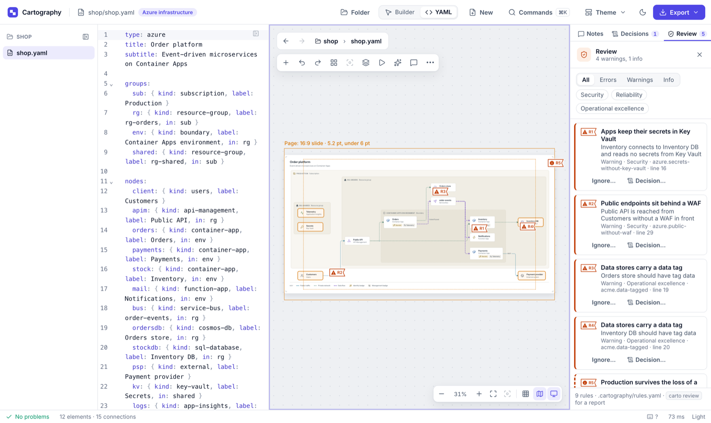
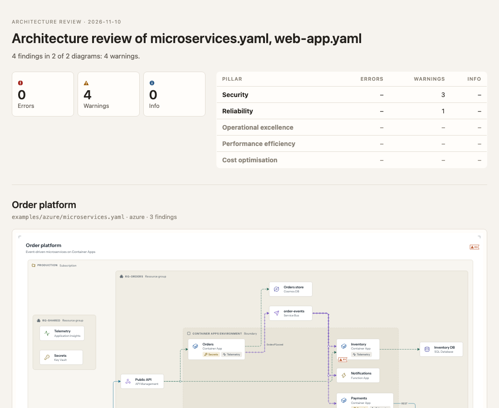

# Architecture review

A drawing says a lot about an architecture: what the internet reaches, where the data sits, what everything depends on. The **architecture review** reads it the way a reviewer would and asks the questions of the Azure and AWS Well-Architected frameworks that a drawing can answer: is the public endpoint behind a WAF, does the database have a private endpoint, does production survive the loss of a zone, does anything send logs anywhere. Each finding says what it found, why it matters and how to fix it, and points at the element and the line of YAML.

It is a lint, not an audit: it only knows what the drawing shows and says. A rule stays quiet where the drawing does not say (a setting that is not written is not assumed wrong), and where nothing of a kind is modelled at all it says so once for the drawing, not once per element.



```sh
carto review shop.yaml                       # findings, with file and line
carto review architecture/ --fail-on warn    # a folder, for CI
carto review architecture/ -o review.html    # a report to hand over (.md, .html or .pdf)
```

## In the editor

**Review** in the side panel (<kbd>⇧W</kbd>, or the palette: *Architecture review*) lists the findings of the open diagram, worst first: `R1`, `R2`… While it is open each finding is a flag on the drawing. Filter by severity (All, Errors, Warnings, Info) and by pillar. A finding selects what it is about and says why and how to fix it; *Next review finding* in the palette walks them from the keyboard.

- **Ignore…** sets a finding aside with a reason, written in the YAML (below), so the next reviewer reads why. Set-aside findings are listed at the end of the tab and in every report.
- **Decision…** opens a new architecture decision ([decisions.md](decisions.md)) named after the finding, about its element, with the finding, its reason and the suggested fix as its context: for findings that are a trade-off rather than a mistake.

The flags tell their severity by shape, never by colour alone: an **octagon** for an error (and the flag filled), a **triangle** for a warning, a **circle** for information. They sit at the bottom-left corner of an element, over a line's label, or top right for the diagram as a whole, apart from review notes (a bubble, top left), threats (a T-tag, top edge) and decisions (a folded page, bottom right).

In an open folder the review reads the folder's own rules (below).

## On the command line and in CI

```text
carto review <file.yaml…|folder>   [--pack azure] [--fail-on error|warn|info|never] [-o report.md|.html|.pdf] [--json]
```

| Exit code | When |
| --- | --- |
| 0 | No finding at or above `--fail-on` (default `error`) is left; set-aside findings never count |
| 1 | At least one is left |
| 2 | Something could not be reviewed: a YAML error, a broken rules file, an unknown pack |

A folder is reviewed file by file (blocks, contracts and snapshots are left out), each with every view of its model that is a drawing; a finding found in two views is listed once. `--pack` (again for more) runs only those packs. `--json` prints the findings for other tools.

In a GitHub workflow, after the action has put `carto` on the PATH ([ci.md](ci.md)):

```yaml
      - uses: misja-pronk/cartography/packages/action@main
        with:
          mode: setup
      - run: carto review architecture/ --fail-on warn -o review.md
      - uses: actions/upload-artifact@v4
        if: always()
        with:
          name: architecture-review
          path: |
            review.md
            review-files/
```

## Reports

`-o` writes a report for someone who does not read YAML: a summary per Well-Architected pillar, then for each diagram the drawing with the flags on it and each finding with what, why, fix and where in the YAML; what was set aside, with its reason.

- **`.html`**: one file, light and dark, with a crop of the drawing beside each finding; works offline.
- **`.md`**: for a repository or a ticket; the pictures (PNG, with the flags) go to `<report>-files/`.
- **`.pdf`**: a page with the summary per pillar, then a page per diagram with the findings written under it.



## What the rules read

Besides kinds, groups, lines, styles, labels, badges and tags, a few properties of an element are there for the review (on every node-and-edge type):

| Property | Means |
| --- | --- |
| `public: true` / `false` | Reachable from the internet (public network access), or only privately. In cloud diagrams `exposure: public` says the same |
| `zones: 3`, `[1, 2, 3]`, `redundant` | Runs in several availability zones |
| `sku: WAF_v2` | Its tier or SKU (an Application Gateway without WAF in its SKU is not a WAF) |
| `props: { network-policy: calico, multi-az: true, limits: cpu 500m }` | Any other setting worth checking; rules and customer rules read them by name |
| `env: prod` | The environments it is part of; a drawing whose title, subtitle, subscription or account says production, or whose elements are all `env: prod`, is reviewed as production |

## Setting a finding aside

On the element or line it is about:

```yaml
nodes:
  web: { kind: app-service, review: { ignore: [{ rule: azure.public-without-waf, reason: Internal tool, only reached over the VPN }] } }
```

For the whole file, or for one element or line of a type whose entries do not take `review:`:

```yaml
review:
  packs: [azure]                         # only these packs for this file
  rules: { azure.no-diagnostics: info }  # off, info, warn or error, for this file
  ignore:
    - azure.prod-single-region           # everywhere in this file
    - { rule: arch.deep-sync-chain, on: checkout, reason: Accepted for the pilot, see decision 7 }
    - { rule: azure.public-without-waf, on: users -> web, reason: Test environment }
review: off                              # (instead) not reviewed at all
```

A reason is optional but every report says when it is missing. An unknown rule id is a warning that names the one meant.

## Your own rules

`.cartography/rules.yaml` in the folder (or the files in a `rules/` folder; both are read, in that order) holds an organisation's settings and rules. The nearest folder up from a diagram that has one counts (not past a git root).

```yaml
packs: [azure, systems]                  # only these built-in packs (default: every pack for the type)
rules:
  azure.no-diagnostics: off
  azure.public-without-waf: error
  arch.deep-sync-chain: { severity: error, max-chain: 3 }
ignore:
  - { rule: azure.prod-single-region, reason: One region by decision, see ADR 7 }
custom:
  - id: acme.sql-backup
    title: Every SQL database is backed up
    why: The backup policy only covers what is tagged.
    category: reliability                 # security, reliability, operations, performance or cost
    severity: warn                        # info, warn (default) or error
    applies-to: [azure]                   # diagram types; default all
    fix: Add tags: [backup] once it is in the backup policy
    every: { kind: sql-database }
    must: { tag: backup }
  - id: acme.dmz-to-data
    title: Nothing in the DMZ talks to the data subnet
    severity: error
    no-edge: { from: { in: dmz }, to: { in: data } }
  - id: acme.db-in-subnet
    title: Databases sit in a subnet
    every: { kind: [sql-database, postgres] }
    must: { in: { kind: subnet } }
  - id: acme.log-analytics
    title: A Log Analytics workspace is drawn
    exists: { kind: log-analytics }
```

A rule is one of three checks: **`every:`** a selector **`must:`** (or **`must-not:`**) have something; **`no-edge:`** `{ from, to, style }`, no line between what the two selectors pick; **`exists:`**, at least one element matches. A selector is a map, and everything written in it must hold:

| Key | Matches |
| --- | --- |
| `id`, `kind`, `tag`, `env`, `label` | One value or a list of them (any of them); `label` is a part of the label, any case |
| `in` | Inside a group, at any depth: a group id, or a selector for the group (`in: { kind: subnet }`) |
| `group` | `true`: a group; `false`: an element |
| `prop` | Settings: `prop: { sku: premium, multi-az: true }` (also `public`, `zones`, `sku` and anything under `props:`) |
| `has` | Settings that are written at all: `has: [sku]` |
| `not`, `any` | A selector that must not hold; a list of selectors of which one must |
| `edge-to`, `edge-from` | (in `must:`) a line to or from something the selector picks |

Nothing in a rules file is run as code: these words are all there is. A broken rule is reported with its line and left out; the rest still counts. Custom rules show and report like the built-in ones, under their own pack (the part of the id before the dot).

## The rules

Severity is the default; a rules file or the file's `review:` changes it.

### Azure (`azure`)

| Rule | Severity | Pillar | Why | Fix |
| --- | --- | --- | --- | --- |
| `azure.public-without-waf`<br>Public endpoints sit behind a WAF | warn | Security | An app reached straight from the internet takes every bot, scan and injection attempt itself. | Put Front Door (with a WAF policy) or an Application Gateway WAF_v2 in front, and draw the line through it; or set public: false when it is only reached privately |
| `azure.data-without-private-endpoint`<br>Data stores in a network design are reached through a private endpoint | warn | Security | A database or storage account on its public endpoint is one firewall rule away from the internet, whatever the network around the apps. | Add a private endpoint in a subnet (kind: private-endpoint, a line to the store) and turn public network access off; or draw the store in the subnet its endpoint is in. public: false says it is private |
| `azure.secrets-without-key-vault`<br>Apps keep their secrets in Key Vault | warn | Security | Connection strings and keys in app settings or code leak with every copy of the configuration and are never rotated. | Read secrets from Key Vault with the app's managed identity (a line to the key-vault, style identity), or connect with the managed identity itself (style: identity on the line to the store) |
| `azure.prod-single-region`<br>Production survives the loss of a zone | warn | Reliability | A production workload in one zone of one region goes down with that datacentre. | Set zones: 3 (or zones: redundant) on what must stay up, or draw a second region group for a paired-region setup |
| `azure.no-diagnostics`<br>Resources send diagnostics to Log Analytics | warn | Operational excellence | Without logs and metrics in one place nobody sees an outage, an attack or a cost spike until a user does. | Draw the Log Analytics workspace (or Application Insights) and the diagnostics lines to it, style management; badges: [management] keeps them out of the way |
| `azure.aks-network-policy`<br>AKS clusters enforce network policy | warn | Security | Without a network policy engine every pod can reach every other pod, so one compromised pod reaches the whole cluster. | Turn on a network policy engine (props: { network-policy: azure } or calico, cilium) and write policies per namespace |
| `azure.aks-private-cluster`<br>AKS API servers are private | warn | Security | A public Kubernetes API server is a target for credential stuffing and the next CVE, from anywhere. | Make it a private cluster (props: { private-cluster: true }), or at least limit authorized IP ranges (props: { authorized-ip-ranges: … }) |
| `azure.storage-public-access`<br>Storage accounts allow no anonymous access | error | Security | Anonymous blob access hands every file to whoever guesses the URL; it is how most cloud data leaks start. | Disallow blob public access on the account and serve public files through Front Door with a private origin; then set public: false |
| `azure.owner-at-subscription`<br>People get broad roles through groups, not directly | warn | Security | Owner or Contributor on a whole subscription, held by a person directly, is never reviewed when they change jobs and is the first thing an attacker uses. | Give the role to a group (with an access review), or make it eligible through PIM; keep standing Owner for break-glass accounts only |

### AWS (`aws`)

| Rule | Severity | Pillar | Why | Fix |
| --- | --- | --- | --- | --- |
| `aws.alb-without-waf`<br>Internet-facing load balancers have AWS WAF | warn | Security | An internet-facing ALB without a web ACL passes every injection, scan and bot straight to the app. | Associate an AWS WAF web ACL with the ALB, or put CloudFront with WAF in front and draw the line through it; tags: [waf] or a waf node beside it says so |
| `aws.rds-single-az`<br>Production databases are Multi-AZ | warn | Reliability | A single-AZ RDS instance is down for the length of a zone outage or a host failure, and its backups restore slowly. | Turn on Multi-AZ (props: { multi-az: true }) or run an Aurora cluster with a replica in another zone, and draw it there |
| `aws.s3-public`<br>S3 buckets block public access | error | Security | A public bucket hands its objects to anyone with the URL; most AWS data leaks are one. | Turn on Block Public Access for the bucket and the account, and serve public files through CloudFront with origin access control; then set public: false |
| `aws.no-audit-trail`<br>Accounts record API calls and metrics | warn | Operational excellence | Without CloudTrail and CloudWatch nobody can say who changed what, or see trouble before users do. | Draw the CloudTrail trail (organisation-wide) and CloudWatch the workloads report to; tags: [monitoring] on a shared logging account says it is elsewhere |
| `aws.nat-single-az`<br>Each zone has its own NAT gateway | warn | Reliability | One NAT gateway for private subnets in several zones takes all their outbound traffic down with its zone, and costs cross-zone data. | Run one NAT gateway per availability zone, each in that zone's public subnet, and route each private subnet to the one in its zone |

### Kubernetes (`kubernetes`)

| Rule | Severity | Pillar | Why | Fix |
| --- | --- | --- | --- | --- |
| `k8s.resource-limits`<br>Workloads set resource limits | warn | Reliability | A pod without limits can take a node's memory and CPU from everything else on it, and the scheduler cannot plan for it. | Set requests and limits on every container and write them down (props: { limits: cpu 500m · memory 512Mi }); a LimitRange per namespace catches the rest |
| `k8s.loadbalancer-service`<br>Services are not exposed one by one as load balancers | warn | Security | Each LoadBalancer service is a public address of its own, outside the ingress where TLS, auth and rate limits live. | Route the traffic through an ingress or Gateway; when a load balancer is needed, make it internal (props: { internal: true }) or public: false |
| `k8s.no-network-policy`<br>Namespaces have a NetworkPolicy | warn | Security | Without a policy every pod accepts traffic from every other pod in the cluster: one compromised pod reaches all. | Add a default-deny NetworkPolicy to the namespace and allow what is drawn; draw it (kind: networkpolicy) so the review sees it |
| `k8s.secret-as-env`<br>Secrets are mounted as files, not environment variables | info | Security | Environment variables end up in crash dumps, logs and child processes; a mounted file does not, and can be rotated in place. | Mount the Secret as a volume (or use the Secrets Store CSI driver with a vault) and label the line volume |

### Systems and C4 (`systems`)

| Rule | Severity | Pillar | Why | Fix |
| --- | --- | --- | --- | --- |
| `arch.external-to-datastore`<br>Outside parties reach data through a service | warn | Security | A person or another company's system writing to a database directly bypasses every check, log and limit a service would apply. | Put an API or service in front of the store that authenticates, validates and logs; draw the line through it |
| `arch.deep-sync-chain`<br>Synchronous call chains stay short | warn | Performance efficiency | Every synchronous hop adds latency and multiplies the chance of failure: five services at 99.9 % each are up 99.5 % together. | Cut the chain: answer from a cache or a read model, or hand the rest of the work to a queue (an async line); max-chain in rules.yaml sets how deep is too deep (option: `max-chain`, default 4) |
| `arch.single-point-of-failure`<br>What many depend on runs more than once | warn | Reliability | One instance with many dependents takes them all down when it fails or is patched. | Run it at least twice, in different zones, and say so: props: { count: 2 } (count: on a deployment node), zones: 3 or tags: [ha] (option: `min-dependents`, default 3) |
| `arch.service-cycle`<br>Services do not call each other in a circle | warn | Reliability | A cycle of synchronous calls deadlocks under load, retries amplify through it, and none of the services can be deployed alone. | Break the cycle: let one side publish an event instead of calling back, or move what both need into one service |

### GitHub (`github`)

| Rule | Severity | Pillar | Why | Fix |
| --- | --- | --- | --- | --- |
| `github.repo-without-ruleset`<br>Default branches are protected | warn | Security | Without a ruleset or branch protection anyone with write access can push to main, skip review and rewrite history. | Add a ruleset on the default branch (pull request with review, status checks, no force push) and draw it in the repository, or a protects line from an organisation ruleset |
| `github.admin-on-many-repos`<br>Admin rights stay with few people per repository | warn | Security | A team that is admin everywhere can turn off every protection; its members' tokens are the organisation's keys. | Give the team maintain or write and keep admin to a small platform group; admin-above in rules.yaml sets how many repositories are many (option: `admin-above`, default 5) |
| `github.outside-collaborator-admin`<br>Outside collaborators are never admin | warn | Security | An admin from outside the organisation can change who has access and turn off protection, outside your offboarding. | Give the collaborator write or maintain, or make them a member under your SSO |

### Data products (`data-products`)

| Rule | Severity | Pillar | Why | Fix |
| --- | --- | --- | --- | --- |
| `data.output-without-contract`<br>Output ports that others read have a data contract | warn | Operational excellence | Without a contract a consumer builds on whatever the port happens to hold today, and every change of it breaks someone silently. | Write a data contract for the port (contracts: with fields, SLA and quality, or file: an ODCS file) and set contract: on the port |
| `data.pii-without-classification`<br>Contracts with personal data say how it is classified | warn | Security | Personal data without a classification gets copied, joined and kept like any other data: a GDPR breach waiting for an audit. | Set classification: on the contract (confidential, restricted, …) and keep the pii marks on the fields |

## Next to threat models

[Threat models](threats.md) suggest STRIDE threats from trust boundaries; the review asks the design questions of all five pillars. Some ground is shared (an outside party writing to a data store is both a suggested threat and `arch.external-to-datastore`); the threat table lists threats, the review lists findings with fixes, and each keeps its own marks on the drawing.
