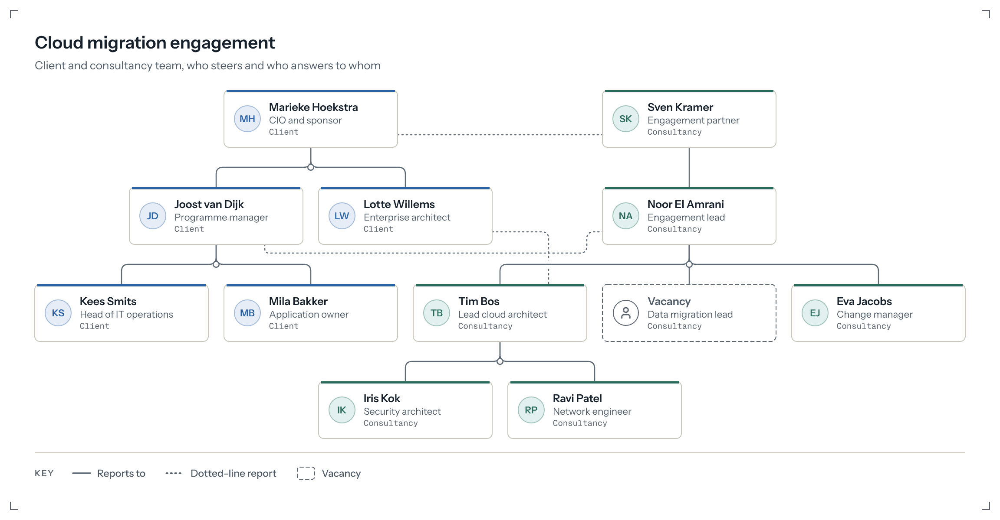
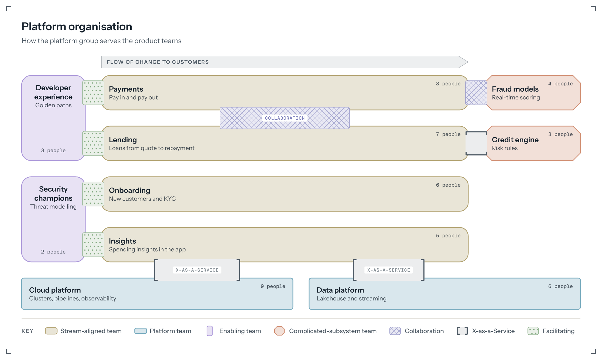

# Teams and org charts

`type: teams` draws people and teams from one file, two ways: an **org chart** (who reports to whom, vacancies, dotted-line reports) and a **Team Topologies** view (stream-aligned, platform, enabling and complicated-subsystem teams, and how they interact).

It is not an HR system: there are no photos, no headcount maths, no import from Workday. Initials stand in for photos, which keeps a chart printable and free of personal pictures.

```sh
linework new teams org.yaml
linework render org.yaml --format png              # the org chart
linework render org.yaml --view topology -o teams.png # the Team Topologies view
linework render org.yaml --focus bo --format pptx  # Bo's branch on a slide
```



## People

```yaml
type: teams
title: Cloud migration engagement
people:
  sponsor: Marieke Hoekstra, CIO          # "Name, Role"
  Joost van Dijk: Programme manager       # or the key is the name and this the role
  lead: { name: Noor El Amrani, role: Engagement lead, reports: sponsor, dotted: Joost van Dijk }
  data: { role: Data migration lead, reports: lead, vacant: true }
  arch: { name: Tim Bos, role: Lead cloud architect, reports: lead, team: platform, location: Utrecht }
```

| Key | Means |
| --- | --- |
| `name`, `role` | what the card says; the initials come from the name (van, de, der… skipped) |
| `reports` | their manager: a solid line from above |
| `dotted` | one or more dotted-line managers: a dotted line, routed around the cards |
| `vacant: true` | a role nobody fills yet: a dashed card |
| `team`, `location` | a small line under the role |
| `tone` | the colour of their branch; by default every branch under the top has its own |

People without a manager are tops: several tops are drawn side by side (the client and the consultancy above).

The chart is a tidy tree: each manager centred over the reports, branches packed as close as they go, square connectors on a bus. To fit a slide, reports without reports of their own can hang in a list under their manager (two columns either side of a spine when there are many), and a wide tree wraps its biggest level into rows with the trunk between them. Which of these a chart gets is tried, not guessed: the arrangement that comes out largest on 16:9 wins, and the one drawn before is kept unless another is clearly better. 150 people still fit one slide (readable when projected, comfortable when printed A3).

**Focus** on a person (`F` in the editor, `--focus` on the command line, `focus:` in the YAML) draws their whole branch and the line up to the top; one hop adds their dotted-line contacts.

## Teams and Team Topologies

```yaml
teams:
  payments: { kind: stream-aligned, caption: Pay in and pay out, size: 8 }
  devex: { label: Developer experience, kind: enabling, size: 3 }
  fraud-models: { label: Fraud models, kind: complicated-subsystem }
  cloud-platform: platform                 # short for { kind: platform }
interactions:
  - devex -> payments: facilitating
  - payments <-> fraud-models: collaboration
  - payments -> cloud-platform: x-as-a-service   # the first uses what the second provides
flow: Flow of change to customers          # or false for no arrow
```



The view follows the book's conventions: stream-aligned teams are wide yellow bars, one under the other, with the flow of change running along them; enabling teams are upright purple bars beside the streams they help; complicated-subsystem teams are red octagons at the end of the stream they serve; platforms are wide blue bars underneath. An interaction between two teams that meet is a **zone** in the gap between them, reaching into both: collaboration cross-hatched, X-as-a-Service bracketed, facilitating dotted, each with its name where it fits. An interaction between teams that do not meet is a line in the same colour (dotted for facilitating), routed around the others.

`size:` (or `members:`) puts "7 people" in the corner; `lead:` names a person (an entry of `people:`) after the caption.

With both `people:` and `teams:` the file has two views, `org` and `topology`, in the editor's view picker and on the command line (`--view`). A file with only one of them draws that.

## In the editor and on slides

The palette has Person and the four team types. With a person selected, a new person reports to them; dragging from one person to another makes the second report to the first, or, when they already have a manager, adds a dotted line. Dragging between two teams adds an X-as-a-Service interaction. Cards are not dragged: the tree places them.

PowerPoint export draws cards, initials, team shapes and zones as native shapes with their text, and the reporting lines as connectors bound to the cards.
