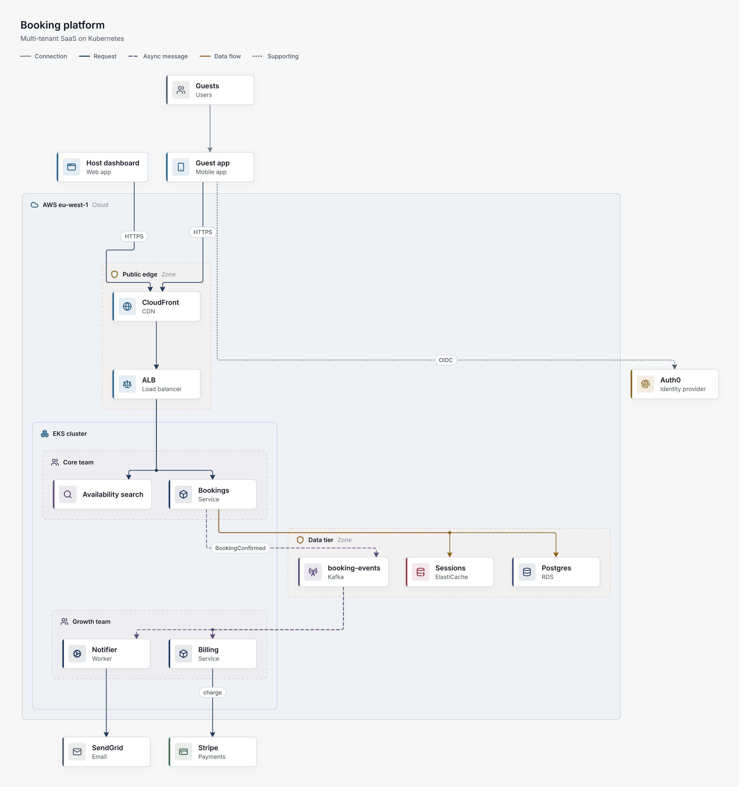

# Brand themes and icon packs

Diagrams for a client should look like the client's deck. A **theme** sets colours, font, corners, line weight,
legend position and a title block (logo, client, version, footer). **Icon packs** put the official Azure, AWS or
GCP icons you downloaded yourself on the cards.

## Built-in themes

| Theme | Look |
| --- | --- |
| `light`, `dark` | The defaults |
| `slate` | Sober consulting: navy and brass on a paper-grey page, tight corners, a tone bar on every card, legend on top |
| `ocean` | Fresh and bright: deep sea blue, seafoam and coral, round corners, solid icon tiles |
| `mono` | Print-friendly: greyscale with one vermilion accent, outlined tiles, no shadows |



Previews of every theme are in [themes/png](themes/png); `pnpm themes` renders them again.

Use one with `theme: slate` at the top of a diagram, `carto render x.yaml --theme slate`, or the theme picker in the
editor's Export menu. A `--theme` flag or the picker wins over the diagram's own `theme:`.

## A theme file

```yaml
# acme.theme.yaml
name: acme
extends: light                # light, dark, slate, ocean, mono or another .theme.yaml

colors:
  primary: '#E4572E'          # the main tone (blue slot): services, apps
  accent: '#178F8A'           # the second tone (teal slot), title rule, classification
  canvas: '#FBF8F4'           # page background
  text: '#1E2B3C'             # optional: surface, border, muted, faint, edge

tones:                        # up to 8 brand colours on our tone slots
  ink: { slot: indigo, color: '#2E4A6B' }
  amber: '#E0A526'            # or simply slot: colour

font:
  family: Space Grotesk
  files:                      # woff2, ttf or otf, relative to this file
    400: fonts/SpaceGrotesk-400.woff2
    600: fonts/SpaceGrotesk-600.woff2
  # scale: 1.04               # width against Inter; measured from the files when left out

radius: 0.7                   # sharp, soft, round, or a scale (1 = default)
lineWeight: 1.2               # scale of line and border weight
shadow: 0.5                   # 0 = flat
tile: soft                    # icon tiles: soft, solid or outline
cardBar: false                # a tone bar on the left of each card
legend: bottom                # bottom, top, right or none

titleBlock:
  logo: acme-logo.svg         # SVG (with a viewBox) or PNG, drawn as-is
  client: Acme Corporation
  project: Platform modernisation
  version: v1.3
  date: 2026-11-09            # or: today
  classification: Confidential
  footer: Prepared for Acme Corporation
```

A diagram uses it with `theme: ./acme.theme.yaml`, or extends it inline to add its own version:

```yaml
theme:
  extends: ./acme.theme.yaml
  titleBlock: { version: v2.0, date: today }
```

A full example with a fictional brand, logo and an OFL font is in [themes/acme](themes/acme):


### What is derived, and the contrast check

Give one or two brand colours and the rest follows: tile tints, group washes and borders for every tone, and
neutrals (text, borders, lines) tinted slightly towards the primary. Tones you did not name keep their hue
(databases stay indigo) but take on the brand's saturation, so the set reads as one palette (`harmonize: false`
turns that off).

Every text/background pair the renderer draws is checked against WCAG 2.2 AA: 4.5:1 for text, 3:1 for lines and
faint captions. Brand colours that are too light for text on their tile (a bright yellow) are darkened just enough
for labels and icons, while tints keep the real brand colour. A colour you set for a text role (`text`, `muted`,
`faint`, `edge`, or a tone's explicit `fg`) that fails is fixed the same way, with a warning that says the ratio
and the colour used instead.

### Fonts

Font files are embedded in exported SVG (`@font-face`, base64) and used for PNG (the CLI hands them to resvg,
decompressing woff2 and naming the copy after `font.family`, so web-font builds with odd internal names work).
Text is measured with Inter's metrics times the brand font's width ratio, so cards fit a wider or narrower face.
Only use fonts you may embed: OFL fonts (Google Fonts) are fine; check your client's licence for their brand font.
In the browser editor, a theme loaded through the picker embeds its fonts too; a `theme:` file read from the open
folder uses the font if it is installed locally.

## Icon packs (bring your own)

Cartography ships only its own line icons. Official cloud icons stay with their owners; you download them and
point Cartography at them. They are drawn **as-is**: scaled into the card's icon tile on a neutral background,
never recoloured, never stretched, and never copied into your repository or the npm package.

### Import a download once

```sh
carto icons import ~/Downloads/Azure_Public_Service_Icons_V21.zip --pack azure
carto icons import ~/Downloads/Architecture-Service-Icons_07312025 --pack aws
carto icons list
```

The importer copies the SVGs into your config dir (`~/.config/cartography/icons/<pack>`, or `$XDG_CONFIG_HOME`,
`%APPDATA%` on Windows, `CARTO_CONFIG_DIR` to override) and maps file names to kind ids by their words:
`10245-icon-service-Key-Vaults.svg` → `key-vault`, `Arch_Amazon-Simple-Storage-Service_64.svg` → `storage`.
It prints the kinds it could not match; `index.json` next to the pack lists every icon by name.

### Use it

```sh
carto render shop.yaml --pack azure
```

or in the diagram:

```yaml
icons:
  pack: azure                       # from your config dir (CLI)
  front-door: ./icons/afd.svg       # any kind → an SVG file, relative to the diagram
```

`icons:` can also name a pack file kept next to your diagrams, for teams that keep icons in a private repo:

```yaml
# azure.icons.yaml
name: azure
root: ../azure-icons               # relative to this file
icons:
  key-vault: security/10245-icon-service-Key-Vaults.svg
```

In the editor, **Export → Icon folder…** picks the unzipped folder once; the browser remembers it and asks for
permission again after a reload.

### Licences

- **Microsoft Azure icons**: Microsoft allows using its Azure architecture icons in architecture diagrams,
  training material and documentation; it does not allow modifying them or redistributing the set. Download them
  from the Azure Architecture Center ("Azure icons") yourself. Cartography never bundles, edits or recolours them.
- **AWS Architecture Icons**: AWS provides them for architecture diagrams; follow AWS's terms and trademark
  guidelines (no changes to the icons, no implied endorsement).
- **Google Cloud icons**: likewise from Google's architecture diagramming page, under Google's terms.

The terms are the vendors'; check the current text when you download. Because the icons never leave your machine
(or your client's repository), Cartography itself stays MIT with only ISC (Lucide) and OFL (Inter) assets.
