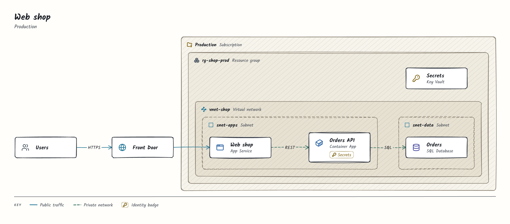
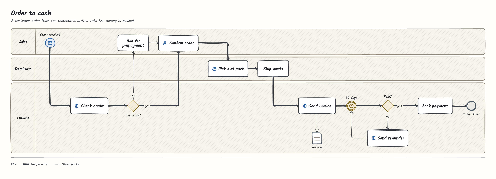
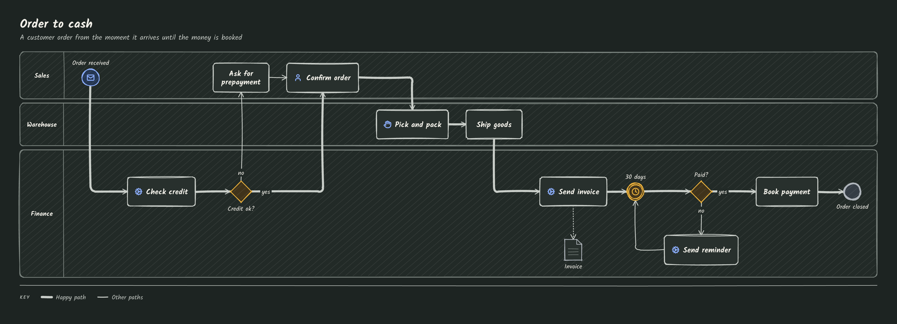
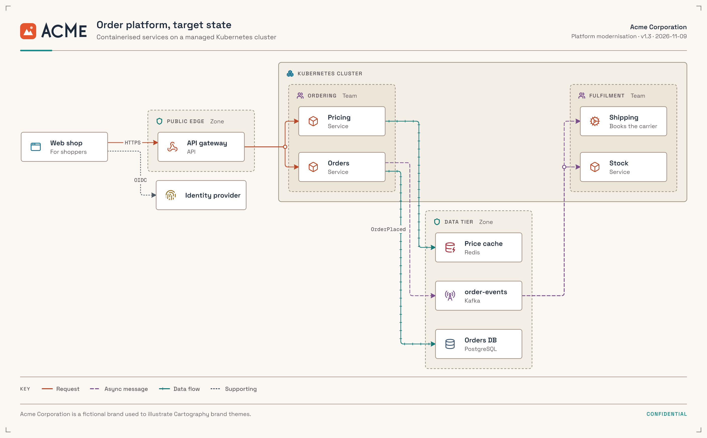

# Brand themes

Diagrams for a client should look like the client's deck. A **theme** sets colours, font, corners, line weight,
legend position and a title block (logo, client, version, footer). The vendors' official icons, which you
download yourself, are in [icons.md](icons.md).

## Built-in themes

| Theme | Look | Pick it for |
| --- | --- | --- |
| `survey` | **The default.** A map sheet: white page, paper-tinted zones that deepen as they nest, bare icons, labels set on the lines, a key with the kinds' own icons | Anything, and customer decks first of all |
| `survey-dark` | Survey at night | Dark slides and screens |
| `survey-cool` | Survey with cool grey zones instead of warm paper | Decks with a cold palette |
| `transit` | A network map: thick routes cut at 45 degrees, round stations, flat grey zones | Flows where the lines are the story |
| `transit-dark` | Transit on a dark page | The same, on dark slides |
| `drafting` | An engineering drawing: ink lines, square corners, monospace lettering, a frame with zones | Specifications and print |
| `drafting-dark` | Drafting as a blueprint | The same, on a dark page |
| `sketch` | Drawn by hand: marker lines that wobble a little, hachured zones, a handwriting face (Kalam) | Workshops, whiteboard sessions, early ideas that should not look final |
| `sketch-dark` | Sketch in chalk on a blackboard | The same, on a dark screen or slide |
| `classic`, `classic-dark` | The look before Survey: Inter, soft icon tiles, tone-washed groups, pill labels | Diagrams that must keep looking as they did |
| `slate` | Sober consulting: navy and brass on a paper-grey page, tight corners, flat cards (built on Classic) | Formal reports |
| `ocean` | Fresh and bright: deep sea blue, seafoam and coral, round corners, solid icon tiles (built on Classic) | Product and marketing pages |
| `mono` | Print-friendly: greyscale with one vermilion accent, outlined tiles, no shadows (built on Classic) | Black-and-white print |

`light` and `dark` are other names for `survey` and `survey-dark`, so a diagram that says `theme: dark` follows the
product's default look. What Survey is and the rules behind it are in [style.md](style.md).


Previews of every theme are in [themes/png](themes/png); `pnpm themes` renders them again and `carto themes` lists
the names.

Use one with `theme: transit` at the top of a diagram, `carto render x.yaml --theme transit`, or the theme picker in
the editor's Export menu. A `--theme` flag or the picker wins over the diagram's own `theme:`.

### Sketch, for workshops

A diagram that is still being argued about should look like it. `sketch` draws the same layout by hand: every
outline and line becomes a slightly wobbly stroke (cards and zones get a second, overshooting pencil line), tinted
zones, tiles and headers get hachure, arrows are two open strokes, and all text is set in Kalam, a handwriting face
under the SIL Open Font License. The wobble is seeded per element (by its id in the editor, by its shape in an
export), so a redraw comes out exactly the same and a card you drag keeps its own hand.







The look is plain SVG paths, no filters, so PNG, PDF and Office-safe SVG keep it. A PowerPoint deck keeps the
layout and colours but draws ruled native shapes in Arial: editable shapes in Office cannot wobble. Where Kalam is
installed on every machine that shows the deck, `--font Kalam` names it.

A theme file can make any look hand-drawn, or a sketch ruled again:

```yaml
extends: survey
sketch: true                    # or { roughness: 0.5, fill: solid, double: false }; false turns it off
```

`roughness` runs from 0 (a ruler) to 3 (a quick marker), 1 by default; `fill: solid` leaves out the hachure;
`double: false` draws each outline once.

## A theme file

```yaml
# acme.theme.yaml
name: acme
extends: light                # any built-in theme (light = survey) or another .theme.yaml

colors:
  primary: '#E4572E'          # the main tone (blue slot): services, apps
  accent: '#178F8A'           # the second tone (teal slot), title rule, classification
  canvas: '#FBF8F4'           # page background
  text: '#1E2B3C'             # optional: surface, border, muted, faint, edge

tones:                        # brand colours on our ten tone slots
  ink: { slot: indigo, color: '#2E4A6B' }
  amber: '#E0A526'            # or simply slot: colour

font:
  family: Space Grotesk
  files:                      # woff2, ttf or otf, relative to this file
    400: fonts/SpaceGrotesk-400.woff2
    600: fonts/SpaceGrotesk-600.woff2
  # scale: 1.04               # width against Inter; measured from the files when left out

radius: 0.7                   # sharp, soft, round, or a scale (1 = default)
lineWeight: 1.2               # scale of line and border weight
shadow: 0.5                   # 0 = flat
tile: soft                    # icon tiles: soft, solid, outline, bare, disc or ring
cardBar: false                # a tone bar on the left of each card
legend: bottom                # bottom, top, right or none

titleBlock:
  logo: acme-logo.svg         # SVG (with a viewBox) or PNG, drawn as-is
  client: Acme Corporation
  project: Platform modernisation
  version: v1.3
  date: 2026-11-09            # or: today
  classification: Confidential
  footer: Prepared for Acme Corporation
```

A diagram uses it with `theme: ./acme.theme.yaml`, or extends it inline to add its own version:

```yaml
theme:
  extends: ./acme.theme.yaml
  titleBlock: { version: v2.0, date: today }
```

A full example with a fictional brand, logo and an OFL font is in [themes/acme](themes/acme):



### The look: what a theme can change beyond colour

The built-in looks (Survey, Transit, Drafting, Classic) differ in more than colour, and a theme file can set every
one of these on top of the theme it extends. All are optional. A wrong value gives a warning that lists the
allowed ones, and the rest of the theme still applies.

```yaml
extends: survey

font:
  family: Instrument Sans     # bundled: Inter, Instrument Sans, Barlow, IBM Plex Sans, Kalam (or your own files)
  mono: Geist Mono            # bundled: Geist Mono, IBM Plex Mono; or { family, files }
  monoFor: [edgeLabel, type]  # what is set in the monospace face: edgeLabel, type, title

tile: bare                    # soft, solid, outline, bare (icon only), disc or ring
iconSize: 22                  # 10 to 34; by default what suits the tile
cardLine: border              # card outline: border, or tone (the card's own colour)
chip: fill                    # fill or outline
number: ink                   # step numbers: solid (accent), ink (text colour) or ring
tableHead: paper              # table headers: tone, paper (the group tint) or plain (a rule)

group:
  tints: ['#F8F6F1', '#F0EDE4', '#E8E4D8']   # one fill per nesting depth, instead of a wash per tone
  line: '#D3CDBE'             # outline colour, or none
  dash: '4 3'                 # dash pattern of dashed group outlines
  label: caps                 # plain or caps
  labelSize: 10.5             # 8 to 18
  tracking: 1                 # letter-spacing in px, 0 to 4
  labelColor: muted           # tone, muted or text
  captionColor: muted         # faint or muted
  icon: 14                    # size of the header icon; false leaves it out

edgeLabel: halo               # pill, halo (bare text on the line) or plate (a small bordered box)
edgeLabelInk: muted           # muted, text or line (the line's own colour)
edgeLabelCaps: false

lines:
  bridge: 4                   # gap in px where one line crosses another; 0 for none
  junction: ring              # dot or ring where lines join
  junctionSize: 3.4
  corner: round               # round, chamfer (cut at 45 degrees) or square
  arrow: filled               # filled, slim or open
  arrowScale: 1               # 0.5 to 2.5
  dashScale: false            # dashes grow with the line weight

legendStyle: key              # row, or key: under a rule, with a KEY heading and the kinds' own icons

sheet: corners                # none, corners or frame; or a map:
# sheet: { marks: frame, inset: 12, zones: true, ticks: true }

title: { mono: false, caps: false, size: 20, weight: 600, tracking: 0 }
background: { dots: true }    # a dot grid; or { step: 16, r: 0.6, color: '#CDD3DA' }
contrast: normal              # or high

titleBlock:
  imprint: true               # one line of client, project, version, date, classification beside the key
```

| Token | What it does |
| --- | --- |
| `font.mono`, `font.monoFor` | A second, monospace face for the technical layer: labels on lines (`edgeLabel`), type captions such as column types and addresses (`type`), the title (`title`). Text is measured in the face it is drawn in, so mono labels fit their room. |
| `tile`, `iconSize` | `bare` draws the icon alone in the kind's colour; `disc` and `ring` put it in a circle. `soft`, `solid` and `outline` are the square tiles from before. |
| `group.tints` | Groups are filled by how deep they nest, not by tone: zones get darker inward like height tints on a map. Text on any tint is checked against the deepest one. Without `tints`, groups keep their tone's wash. |
| `group.label`, `labelSize`, `tracking`, `labelColor`, `captionColor`, `icon` | The group header: capitals with letter-spacing, in muted ink, with a small icon. |
| `edgeLabel`, `edgeLabelInk`, `edgeLabelCaps` | `halo` sets the label on the line with a patch of the ground it lies on (page, group tint or card), so it reads on every tint. `plate` is a square box with a border. `pill` is the rounded pill from before. |
| `lines.bridge` | Where two lines cross, the crossed one is opened by this many px, so a crossing never reads as a junction. The gap shows the ground under that point. |
| `lines.junction`, `junctionSize` | Lines that really join get a dot or a ring. |
| `lines.corner`, `arrow`, `arrowScale`, `dashScale` | How lines bend and end. |
| `legendStyle: key` | The legend sits under a rule with a small KEY heading. Node kinds are shown with their own icon, so the key also works in greyscale. |
| `sheet` | `corners` draws four small marks at the page corners. `frame` draws a border, with `zones` a numbered and lettered grid and with `ticks` centring marks. The page padding grows with the frame, so nothing collides with the title. |
| `titleBlock.imprint` | Sets the title block's fields as one small line beside the key. Only fields you filled in are shown; a date is never invented (`date: today` is yours to ask for). |
| `tableHead`, `number`, `chip`, `cardLine` | Table headers, step numbers, chips and card outlines. |
| `title` | Size, weight, capitals, letter-spacing and face of the title. |
| `background.dots` | A dot grid behind the drawing. |
| `contrast: high` | Borders and outlines get at least 3:1 against what they sit on, faint text and lines 4.5:1. |
| `tones` | All ten slots can be set: blue, sky, indigo, violet, teal, green, amber, orange, rose, slate. |

Every diagram type follows these: sequence, gitflow, roadmap, tables, matrices and ERD tables are drawn from the
same tokens as cards and groups. Theme files written before these tokens existed keep working unchanged. One that
says `extends: light` now builds on Survey; `extends: classic` keeps the old base.

### What is derived, and the contrast check

Give one or two brand colours and the rest follows: tile tints, group washes and borders for every tone, and
neutrals (text, borders, lines) tinted slightly towards the primary. Tones you did not name keep their hue
(databases stay indigo) but take on the brand's saturation, so the set reads as one palette (`harmonize: false`
turns that off).

Every text/background pair the renderer draws is checked against WCAG 2.2 AA: 4.5:1 for text, 3:1 for lines and
faint captions (4.5:1 with `contrast: high`). Text is checked on cards, on the page and on the deepest group tint.
Survey, Transit and Drafting pass at 4.5:1 for every text role in every variant, faint captions and tone inks
included. Classic and the themes built on it keep the values they shipped with: text and muted text pass at
4.5:1, faint captions and some tone inks sit between 3:1 and 4.5:1. Brand colours that are too light for text on their tile (a bright yellow) are darkened just enough
for labels and icons, while tints keep the real brand colour. A colour you set for a text role (`text`, `muted`,
`faint`, `edge`, or a tone's explicit `fg`) that fails is fixed the same way, with a warning that says the ratio
and the colour used instead.

### Fonts

Cartography ships these families, all under the SIL Open Font License 1.1, each with its licence file next to it
in `packages/theme/fonts`:

| Family | Used by | Weights |
| --- | --- | --- |
| Instrument Sans | Survey | 400, 500, 600 |
| Geist Mono | Survey | 400, 500 |
| Barlow | Transit | 400, 500, 600 |
| IBM Plex Sans, IBM Plex Mono | Drafting | 400, 500, 600 and 400, 500 |
| Kalam | Sketch | 400 and 600 (its Bold; there is no medium) |
| Inter | Classic, slate, ocean, mono | 400, 500, 600 |

Name one of them in `font.family` or `font.mono` and nothing else is needed. Text is measured with that face's own
advance widths and kerning, the same in Node and in the browser, so cards and labels fit.

A brand font brings its files (`font.files`). They are embedded in exported SVG (`@font-face`, base64) and used
for PNG (the CLI hands them to resvg, decompressing woff2 and naming the copy after `font.family`, so web-font
builds with odd internal names work). Its text is measured with Inter's metrics times the brand font's width
ratio, so cards fit a wider or narrower face. Only use fonts you may embed: OFL fonts (Google Fonts) are fine;
check your client's licence for their brand font. In the browser editor, a theme loaded through the picker embeds
its fonts too; a `theme:` file read from the open folder uses the font if it is installed locally.

Per export:

- **SVG** embeds the faces the theme uses as woff2. Instrument Sans, Geist Mono, Barlow and Inter are Latin
  subsets. IBM Plex declares the Reserved Font Name "Plex", so its files are embedded whole and unmodified.
- **PNG and PDF** use the TTF files directly.
- **PowerPoint** keeps text as real, editable text. Fonts are not embedded in a .pptx: Apple's importer (Quick
  Look, Keynote, Mail, an iPhone) leaves embedded fonts out and sets a face it does not have in Times. So for the
  faces Cartography brings along (Instrument Sans, Inter, Geist Mono, Barlow, IBM Plex, Kalam), which few
  machines have, a deck names faces every Mac and Windows machine has: Arial (no wider than Instrument Sans or
  Inter, so text still fits) and Courier New for the monospace text (as wide as Geist Mono). A brand theme's own
  face is named as it is. `carto render --format pptx --font "Instrument Sans"` names another typeface for the
  whole deck, where it is installed.
- **In a client's PowerPoint template:** `pptx: template.potx` in a theme file makes every deck in that template,
  its layouts, master, colours and fonts; see [powerpoint-templates.md](powerpoint-templates.md).

## Icon packs (bring your own)

The official Azure, AWS, Google Cloud and Kubernetes icons are downloaded by you and imported once, in the editor
(top bar **⋯** → **Diagram theme, icons, language…** → **Official icons…**) or with `carto icons import <zip>`; a diagram then uses them with
`icons: official`. Where to download each set, how matching and hand mapping work, how they look in each theme
and in each export, and what may be shared: [icons.md](icons.md).
