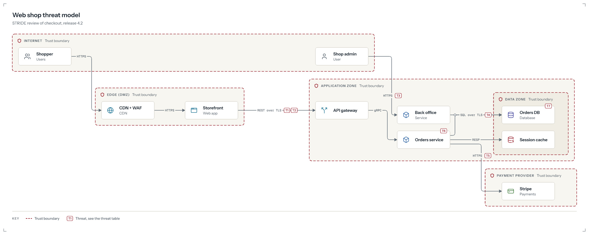
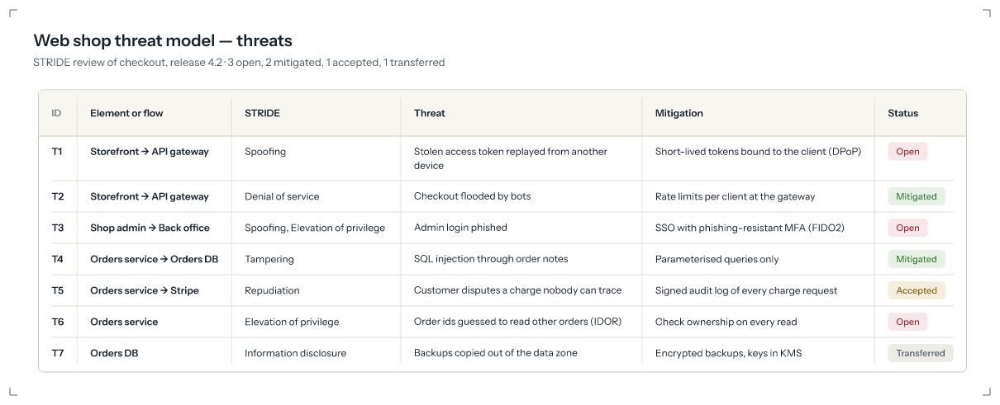

# Threat models

An architecture diagram becomes a threat model when you mark its **trust boundaries** and write down its **STRIDE threats**. Cartography draws the boundaries the way threat models draw them (heavy dashed lines in the threat colour), puts a small numbered tag on every element and line that has a threat, and turns the same file into a **threat table** for the report. Simple rules suggest the threats a reviewer asks about first.

It works on `systems`, `c4` and `azure` diagrams. Another type drawn as nodes, groups and lines switches it on with one line in its config (`threats: true`).





The example: [examples/systems/threat-model.yaml](../examples/systems/threat-model.yaml).

## Trust boundaries

Any group can be a trust boundary:

```yaml
groups:
  internet: { kind: trust-boundary, label: Internet }       # the kind says it
  app: { kind: zone, label: Application zone, trust: true } # or a flag on any group
  psp: { kind: system, label: Stripe, trust: PCI scope }    # a string names the boundary
```

A boundary is drawn as a dashed line in the threat colour, a little heavier than other groups, and says *Trust boundary* next to its name, so it reads without colour too. The key explains it.

Diagrams drawn from a model (C4 views) do not write their groups themselves; name them in a list instead:

```yaml
trust: [shop, ledger]       # groups of this drawing that are trust boundaries
```

## Threats

On an element, a group or a line, `threats:` lists STRIDE categories, short or in full:

```yaml
nodes:
  api: { kind: service, label: Orders API, threats: [S, E] }
edges:
  - orders -> db:
      label: SQL over TLS
      threats:
        - { id: T4, stride: T, title: SQL injection through order notes, mitigation: Parameterised queries only, status: mitigated }
```

| Field | What it is |
| --- | --- |
| `stride` | One category or a list: `S` Spoofing, `T` Tampering, `R` Repudiation, `I` Information disclosure, `D` Denial of service, `E` Elevation of privilege (the full names work too) |
| `title` | What could go wrong |
| `mitigation` | What stops it |
| `status` | `open` (default), `mitigated`, `accepted` or `transferred` |
| `id` | Its number; without one threats are numbered T1, T2… in the order written, skipping the ids you gave |
| `owner` | Who follows it up (kept in the YAML, not drawn) |

Threats can also stay apart from the drawing, in a list of their own. This is the way for C4 views and for a threat model kept next to someone else's architecture:

```yaml
threats:
  - { on: orders, stride: E, title: Order ids guessed (IDOR), mitigation: Check ownership on every read }
  - { on: "web -> api", stride: D, title: Checkout flooded by bots }
```

`on:` names an element or group by id, or a line as `from -> to`. A name that is not in the drawing is a warning.

Every threat gets a tag on what it is about: on the top edge of a card or group, after the label of a line. More than three on one thing show as `T1 T2 +3`. The tag is text, so the drawing and the table point at each other in print and in grey.

## Suggested threats

When a diagram has a trust boundary or a threat, a few rules look for what a reviewer asks first:

| Rule | Suggests |
| --- | --- |
| A line crosses a trust boundary and is not encrypted | T, I: data crosses the boundary unencrypted |
| A line crosses a trust boundary, or comes from an outside party, without authentication | S: the caller is not authenticated |
| An outside party writes to a data store directly | T, I |
| A data store is not encrypted at rest | I |

A line counts as encrypted with `encrypted: true` or when its label says HTTPS, TLS, mTLS, SSH, SFTP, WSS, IPsec or VPN; as authenticated with `auth: true` or `auth: OAuth2` (any text), or a label that says OAuth, OIDC, JWT, mTLS, SAML, API key, token or signed. A store is encrypted with `encrypted: true` or `tags: [encrypted]`. Outside parties are users, people, external systems, payment providers and email, or anything tagged `external`; stores are databases, caches, object storage, warehouses and search (in Azure: SQL Database, Cosmos DB, storage accounts, Redis).

Suggestions are **quiet**: they are warnings in the editor and on the command line, never drawn. A category already listed on an element or line is not suggested again, and `threats: []` says it was reviewed and has none. `threat-rules:` at the top of the file changes this:

```yaml
threat-rules: warn    # default: warnings only
threat-rules: table   # also rows in the threat table, with status Suggested and a number on the drawing
threat-rules: off     # no suggestions at all
```

## The threat table

A diagram with a threat model gets a second view, *Threat table*: the editor's view picker offers it, and on the command line it is a view like any other.

```sh
carto render shop.yaml --view threats -o threats.png    # the table as a drawing
carto render shop.yaml --view threats -o threats.pptx   # a real PowerPoint table, cells you can type in
carto threats shop.yaml -o threats.md                   # the table as markdown, for a design doc or a ticket
carto threats shop.yaml --view containers               # of one view of a model
```

The table lists every threat by number with what it is about (an element, or a line as *Storefront → API gateway*), its STRIDE categories spelled out, the threat, the mitigation and the status; the subtitle counts them per status. Long text wraps instead of widening the table.

## Limits

- The rules read labels and flags, not protocols: `label: REST` over plain HTTP and over TLS look the same. Say `encrypted: true` where it matters.
- Trust boundaries are groups: a boundary that cuts through a group, or a boundary between two elements without a group around either, cannot be drawn.
- draw.io and Excalidraw exports carry the boundaries as groups but not the threat tags.
