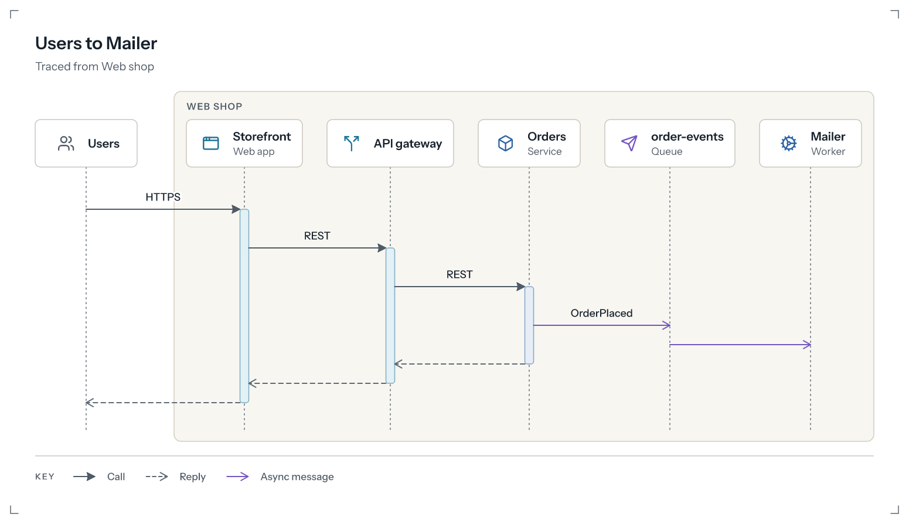
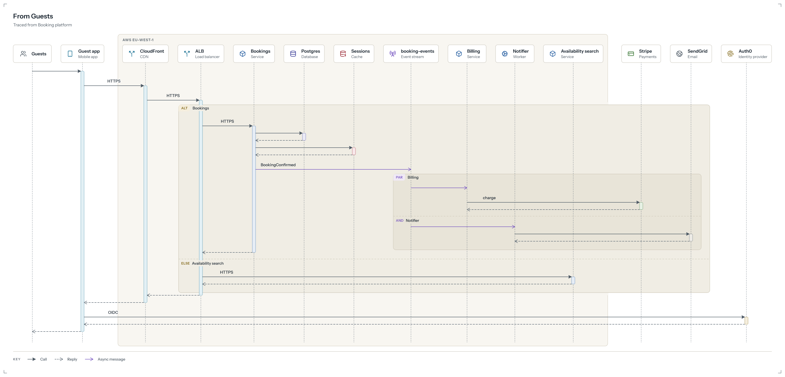
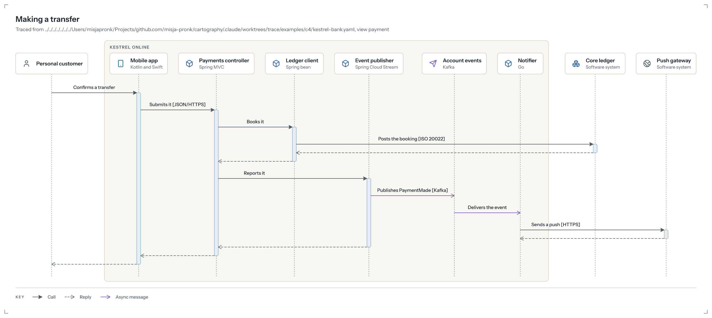

# Trace a request

An architecture diagram says what talks to what; a sequence diagram says in which order, and who waits for whom. Tracing makes the second from the first: pick where a request starts and where it ends, and the relations of the diagram become the messages of a `type: sequence` diagram, with a reply for every call that waits for one.



It works on every diagram of elements and lines (systems, C4, Azure, cloud, Kubernetes, network, a model) and on any of their views: what is traced is what the view draws.

## In the editor

- **Two elements**: select the first, ⇧-click the second, press **⇧Q** (or right-click, or ⌘K "Trace a request from … to …"). The request goes from the first to the second.
- **One element**: ⇧Q, or "Trace a request from … until it ends": every relation followed downstream until it reaches a store, an external system or a person. "Trace a request from … to…" asks for the end from a list.
- **The steps**: a diagram with `steps:` routes, or a dynamic view, has "Trace the steps as a sequence diagram" in the palette.

The dialog lists the routes, shortest first, next to a preview of the one picked. ↑↓ or 1–9 picks another (a click does too); a click on the preview or **Z** shows it at its own size. **↵** opens it as a new diagram (in a folder: next to the source, named `trace-<from>-<to>.yaml`, written on ⌘S; outside a folder the toast's Undo brings the source back). For a model, **⌥↵** adds the calls to its `views:` as a dynamic view instead and shows it; ⌘Z takes it out. "Copy YAML" copies the sequence.

The way back: a traced sequence has "Show *participant* in *source*" in the palette for each participant, which opens the source in the folder with the element selected (in the view it was traced from, or a view that draws it). The source lists "Traces of this diagram" in the palette. For a model, where-used (in the workspace panel) lists the sequence among the drawings of each element it passes.

## On the command line

```sh
carto trace web-shop.yaml --from customers --to db              # the shortest route, to standard output
carto trace web-shop.yaml --from customers --to db --all        # every route (up to 20), one document each
carto trace web-shop.yaml --from customers --to db --pick 2 -o checkout.yaml
carto trace saas-platform.yaml --from guests                    # until each call ends
carto trace kestrel-bank.yaml --view payment --steps            # a dynamic view told as a sequence
carto trace kestrel-bank.yaml --from customer --to ledger --dynamic   # a C4 dynamic view to paste under views:
```

`--from` and `--to` take an id, the end of a dotted model id (`api.payments`) or a label (`"Orders DB"`). With `-o` and `--all`, the routes go to `x.yaml`, `x-2.yaml`, …; the route list is printed to standard error.

## What a trace decides

- **Which way**: along the arrows. A line without a direction (`--`, `<->`, a network link) can be walked either way. A request does not pass *through* a person or a store: it ends there.
- **Which route**: the fewest calls first; then fewer external systems on the way and fewer lines without a direction; then the order the relations are written in. Up to two calls longer than the shortest are offered as alternatives. Two lines between the same two elements make one route.
- **Replies**: a call is answered once the callee is done with whatever it called in turn. An **async** message is not answered: a relation styled `async` (any style whose name says async, event or message), or one into or out of a queue, topic or bus.
- **Labels**: the relation's label, with its technology in brackets as C4 writes it ("Places orders [JSON/HTTPS]"). A line without a label out of a gateway, a load balancer, a CDN or a proxy carries the request that came in: it takes that call's label, so the REST call can be followed through the gateway. Replies have no label; write one where it says something.
- **Groups**: participants are the elements. Their groups become participant boxes: the outermost group around each, and when every participant sits in the same one (one subscription around everything), the next level down. A group a line ends on is a participant itself.
- **Until it ends**: relations are followed in the order written. An element reached a second time is called but not walked again. A **loop**, a call back into an element still busy with this request, is drawn once with a note and not followed.
- **Fan-out**, conservatively: async messages from one element to several (a topic and its subscribers) go out together, as a **par** frame. A router (gateway, load balancer, CDN, ingress, proxy) sends each request one of its ways, so its calls are an **alt** frame. All other calls to several elements go one after the other, in the order written: the relations say nothing about parallelism there. A step whose routes leave one element for several at once (`path: [api -> db, api -> cache]`) is a par frame too.
- **Steps**: each hop of a route takes the relation between its two ends; where there is none, the shortest path between them (said in a comment). A step's title, or the first sentence of its caption, becomes a divider. What one step left open is answered before the next begins.
- **A whole model**: a model without `--view` is traced at every level, so a request is followed down to the components that handle it. A relation written coarsely next to the same one in detail (`web -> api` besides `web -> api.signin`) is left out. In the editor the view on screen is traced.

What the trace decided is said once, as comments at the top of the sequence and as notes in the dialog.



## What it writes

```yaml
# Traced from web-shop.yaml: from customers to db.
# Again: carto trace web-shop.yaml --from customers --to db
type: sequence
title: Users to Orders DB
subtitle: Traced from Web shop
traced: { file: web-shop.yaml, from: customers, to: db }

boxes:
  shop: Web shop

participants:
  customers: { kind: people, label: Users, ref: customers }
  web: { kind: client, label: Storefront, box: shop, ref: web }
  gateway: { kind: gateway, label: API gateway, box: shop, ref: gateway }
  orders: { kind: service, label: Orders, box: shop, ref: orders }
  db: { kind: database, label: Orders DB, box: shop, ref: db }

messages:
  - customers -> web: HTTPS
  - web -> gateway: REST
  - gateway -> orders: REST
  - orders -> db: SQL
  - db --> orders
  - orders --> gateway
  - gateway --> web
  - web --> customers
```

- `traced:` says where it came from: the file (relative to the sequence), the view, and the start and end, or `steps: true`, or `until: end`. The workspace takes that file's model into scope, as an include's.
- `ref:` on each participant names the element it stands for: a model id (`online.api.ledger`) or a node of the source. Ids are short and stable: the last part of the id, more of it where two would clash (`ledger`, `api-ledger`).
- Kinds are the sequence kinds nearest the source's; where only near, the source kind is the caption ("Key vault", "SQL database"), or the technology when the model has one.

The sequence is an ordinary diagram from then on: edit it, add reply texts, notes and frames. Tracing again makes a new one; it does not merge into an edited trace.

## As a C4 dynamic view

For a model (C4 or `type: model`, its own `elements:` or an included model) the same calls are a dynamic view: numbered steps between model elements, label and technology apart, replies left out.

```yaml
views:
  trace-customer-ledger:
    kind: dynamic
    title: Personal customer to Core ledger
    subtitle: Traced through the model
    steps:
      - customer -> online.web: { label: Banks online, technology: HTTPS }
      - online.web -> online.api.accounts: { label: Gets accounts, technology: JSON/HTTPS }
      - online.api.accounts -> online.api.ledger: Gets balances
      - online.api.ledger -> ledger: { label: Reads and books, technology: ISO 20022 over MQ }
```

A diagram without a model (plain `nodes:` and `edges:`) has no dynamic views: its ids are not model elements. Steps with routes (`steps:`) tell such a story instead, and trace the other way.

The other way round, a dynamic view traced is its sequence diagram:



## Limits

- The order of calls to several elements is the order the relations are written; the trace cannot know that two calls run in parallel unless they are async or the step says so.
- A request that comes back the same way as an answer, written as a relation of its own (`db -> api: rows`), is a call in the trace, not a reply.
- Only routes along drawn relations: what a view leaves out is not traced. Trace the model without a view for every level.
