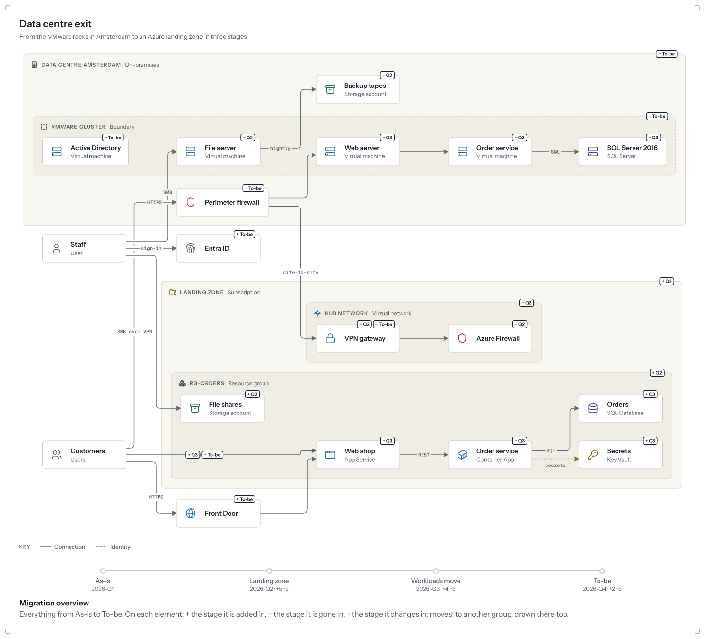
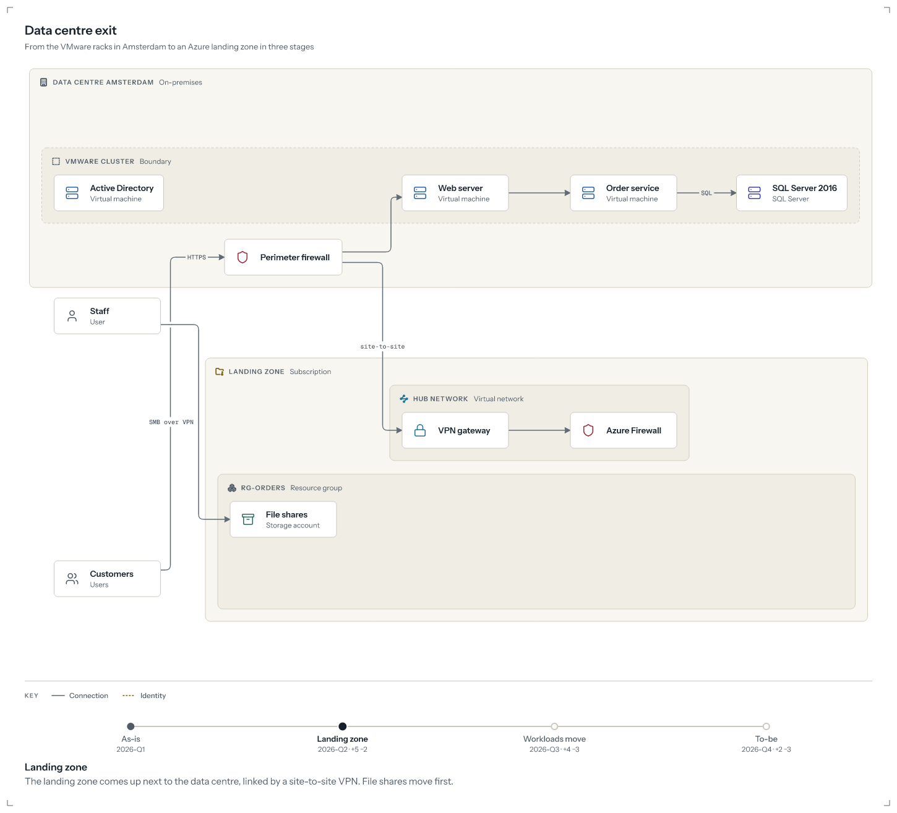
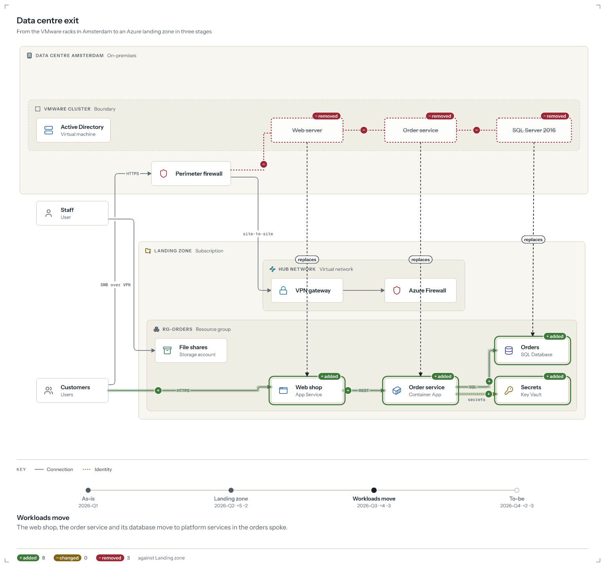
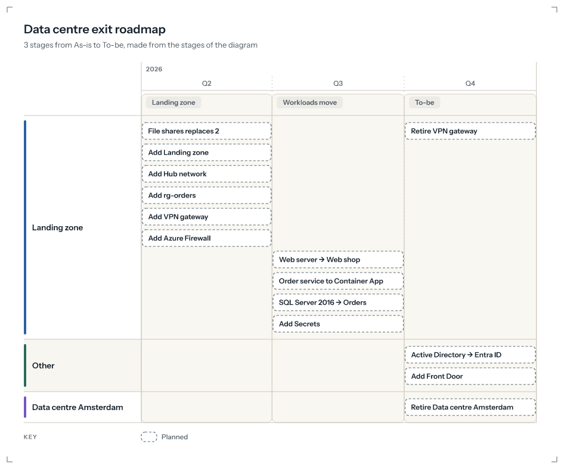

# Transitions: as-is, the stages, to-be

A consultant presents three things: where we are, the stages we go through, and where we end up. `stages:` keeps all of that in one file. The drawing as written holds everything that is there at *any* stage; each stage says what it changes against the one before it. The first stage is the **as-is**, the last the **to-be**.

From that one file you get each stage as its own drawing, the as-is and to-be side by side, a **transition** between any two stages (what is added, changed, removed and what replaces what), a **migration overview** (everything, each element marked with the stage it comes and goes in), a **roadmap**, a deck, the stages in words and a review per stage.



Examples: [transitions/datacenter-exit.yaml](../examples/transitions/datacenter-exit.yaml) (VMware racks to an Azure landing zone in three stages, with replacements) and [transitions/app-modernisation.yaml](../examples/transitions/app-modernisation.yaml) (a monolith strangled capability by capability: `from:`/`until:` on elements, a rename and a move between groups).

## Writing stages

```yaml
type: azure
groups:
  dc: { kind: on-premises, label: Data centre Amsterdam }
  azure: { kind: subscription, label: Landing zone }
  spoke: { kind: resource-group, label: rg-orders, in: azure }
nodes:
  web-vm: { kind: vm, label: Web server, in: dc }
  web: { kind: app-service, label: Web shop, in: spoke }
  front-door: { kind: front-door, label: Front Door }
  # …
stages:
  - id: as-is
    title: As-is
    when: 2026-Q1
    description: Everything runs on six VMs in one data centre.
  - id: q2
    title: Landing zone
    when: 2026-Q2
    add: [azure]                          # there from this stage on
  - id: q3
    title: Workloads move
    when: 2026-Q3
    replace: { web-vm: web }              # the old goes, the new comes: drawn as "replaces"
    change: { db: { label: Orders DB } }  # properties from this stage on
  - id: to-be
    title: To-be
    when: 2026-Q4
    add: [front-door]
    remove: [dc, 'users -> web']          # gone from this stage on
```

| Key | Means |
| --- | --- |
| `id` | Short name: for `--stage q2`, `from:` and `until:` |
| `title` | How the stage is called on the timeline, slides and the roadmap |
| `when` | A quarter (`2026-Q2`), a month (`2026-06`) or a day (`2026-06-30`). With one on every stage the roadmap has a time axis |
| `description` | A sentence or two, under the stage's drawing and in the speaker notes |
| `add` | There from this stage on: ids, `a -> b`, `tag:x`, `kind:x` |
| `remove` | Gone from this stage on |
| `change` | Properties from this stage on, by id: `{ web: { kind: app-service, label: Web app } }`. A line by its ends: `{ 'web -> db': { label: TLS } }`. `in:` moves an element to another group |
| `replace` | `{ old: new }`: the old one goes and the new one comes in this stage. Several old ones may be replaced by one new one |

The name is `stages:`, not `states:`, so it never mixes with the [state machine diagram type](states.md).

**What is there when**:

- Everything written is in the as-is, unless a stage adds it (`add`, the new side of `replace`, or `from:` on the element).
- A group carries what is inside it: a group that comes in Q2 brings its contents (unless they have a stage of their own), and a group removed takes them along.
- A line is there while both its ends are, unless it is added or removed itself (`users -> web` above stops in the to-be while both ends stay).
- The first stage is the drawing as written: `add` and `remove` there do nothing, and you are told.

**On the element instead**: `from: q2` (it comes in q2) and `until: to-be` (it is gone in the to-be) can be written on a node, a group or a line. `until` names the stage it is *gone* in, like `remove` in that stage.

```yaml
nodes:
  gateway: { kind: gateway, label: API gateway, from: strangle }
  batch: { kind: service, label: Nightly batch, in: legacy, until: split }
edges:
  - shop -> monolith: { label: HTTPS, until: strangle }
```

### Problems it reports

Each at its line and column:

- `Nothing drawn here is called "ghost"`: a name in `add`, `remove`, `change` or `replace` that the file does not have.
- `Web VM is removed in Q2 but only added in To-be`, `… is already removed in Q2`, `… is not there in As-is: it cannot be removed`.
- `Web app is already added in Q2`, `… is already there in As-is: only what is not there yet can be added`.
- `Cache is added and removed in Q2: it is never there`; `… is not there in Q3: only what is there can change`.
- `There is no stage "q9"` (in `from:`/`until:`, `--stage`), `until: as-is is the first stage`.
- A warning for an element no stage draws, and for a file with only one stage.

## The pictures

**Positions never change between stages.** The layout is made once, for everything there is at any stage, and a stage leaves out what is not there yet or any more: its place stays empty, the canvas is the same size, so slide 2 lines up with slide 5 (as [steps](steps.md) do). Under each stage's drawing is a **timeline**: a stop per stage, the one drawn filled and in bold, its date and what it changes (`+5 −2 ~1`), then its title and description.



A **move** (`change: { db: { in: platform } }`) is the one exception: the element needs a place in its new group too. It is laid out twice, once in each group; each stage draws the one that is true then, and the overview shows both (the old one marked *moves Q3*).

A **change** of label, kind or style is drawn in the stage it is made in, in the element's own place (a much longer label may need a word less).

### Transition

Two stages compared as the [compare view](compare.md) compares two versions: one drawing of the later stage with what is added and changed outlined and tagged, what is gone drawn as a dotted ghost where it stood, and a dashed **replaces** arrow from each old element to what replaces it. The sentences tell a replacement as one: *Replaced Web server by Web shop in rg-orders*. Marks never rest on colour alone: **+**, **~** and **−**, solid, dashed and dotted outlines, and the words.



Side by side gives the as-is and the to-be (or any two stages) next to each other, each with its own marks.

### Migration overview

Everything at once, each element that comes or goes tagged like an [environment tag](layers.md): **+ Q2** (comes in Q2), **− To-be** (gone in the to-be), **~ Q3** (changes in Q3), **moves Q3**. A stage with a short title is called by it; a long one by the quarter in its `when` (Q2), else its id. A line is only tagged when it comes or goes on its own, not with its ends. The editor opens a file with stages on this view, so everything can be picked and edited.

### Roadmap

The stages make a roadmap (`type: roadmap`, see [the roadmap type](../examples/roadmap)): a lane per outermost group (`Other` for what is in none), an item per change of a stage (*Add Hub network*, *Web server → Web shop*, *File shares replaces 2*, *Retire Data centre Amsterdam*; what goes with its group is part of the group's item), and a band per stage. With a date or quarter on every stage it has a time axis (items in their stage's quarter); otherwise the stages are its periods. It is a YAML file of its own: change it as you like, or make it again from the stages.



## Command line

```sh
carto render exit.yaml                           # the to-be (where the stages end)
carto render exit.yaml --stage q2 -o q2.png      # one stage, by id, number or title
carto render exit.yaml --stage overview          # the migration overview
carto stages exit.yaml -o out/ [-f png]          # every stage, the overview, each transition, as-is and
                                                 # to-be side by side, the roadmap (YAML and drawn), the story
carto stages exit.yaml --from as-is --to q2      # one transition (--side-by-side for both next to each other)
carto deck exit.yaml --stages -o exit.pptx       # a slide per stage and per transition, overview, before
                                                 # and after, roadmap; the changes in the speaker notes
carto describe exit.yaml --stages [-o x.md]      # "In Landing zone (2026-Q2): added …; replaced File server …"
carto export-html exit.yaml                      # interactive: the overview, stepped through stage by stage
```

- **Review**: the to-be is reviewed as the drawing; each earlier stage is reviewed too, and what it finds that the to-be does not have is listed with the stage's id (`· view q2`). So "Q2 has SQL on a public endpoint" shows up even when the to-be fixes it.
- **Deck** slides are pictures (as the compare view's export is), so the marks come along; every stage slide is the same size.
- **Describe** is also in every SVG and PNG: a stage's text alternative is about that stage ("…, stage 2 of 4: Landing zone").

From code: `render(text, { stage: 'q2' })` (or a number, a title, `'overview'`); the result lists `stages` (id, title, when, description, how much each adds, removes and changes, what it replaces) and the `stage` drawn. `compareStages(text, 'q2', 'q3')`, `stageStory(text)`, `storyMarkdown`, `storyText` and `stagesRoadmap(text)` are in `@cartography/diff`.

## In the editor

A file with stages gets a **timeline strip** under the drawing: **Overview**, then a chip per stage with its date. Click one (trackpad) or walk them:

| Key | Does |
| --- | --- |
| `←` / `→`, `Home` / `End` | On the strip: the previous / next stage, the overview / the to-be |
| `,` / `.` | On the drawing: the previous / next stage |
| `⌘K` | *Show stage …*, *Next stage*, *Compare stages: As-is → Landing zone*, *Make roadmap* |

**Editing in the context of a stage.** The strip says what an edit does there:

- **Overview**: the file as written. Adding and deleting work as everywhere.
- **The as-is**: what you add is there from the as-is on; what you delete is gone from every stage.
- **A later stage**: what you add **comes in that stage** (its id goes into the stage's `add:`); **Delete records that it goes there** (`remove:`), and it stays in the stages before. Deleting what only comes in this stage deletes it, and the stage forgets it.
- Deleting an element anywhere also takes it out of every stage's lists, so no stage is left naming something that is gone.
- Properties (a label, a kind) are edited in the file, for every stage; a `change:` in a stage is written in the YAML (autocomplete knows `stages:` and its keys).

**Compare stages…** opens the [compare view](compare.md) with the earlier stage as before and the picked one as now (from the as-is to the to-be on the overview): overlay or side by side, the list of changes with replacements told as one, **]**/**[** through them, and its exports. Edits show as you type.

**Make roadmap** opens the roadmap the stages make as a new diagram (your file is saved or kept first).

The interactive HTML export draws the overview and steps through the stages with its step switcher; exports from the editor (SVG, PNG, PowerPoint) are of the stage on screen.

## Limits, said plainly

- Stages are for drawings of elements and lines (systems, C4, Azure, cloud, Kubernetes, network, …), not for a roadmap, sequence, git graph, journey or matrix.
- A file with stages does not tell its `steps:` at the same time: the stages are its story.
- A stage of a view checks what that view draws; problems are reported for the diagram as written.
- An element that moves between groups is laid out twice; a group itself cannot move (replace it with a new one).
