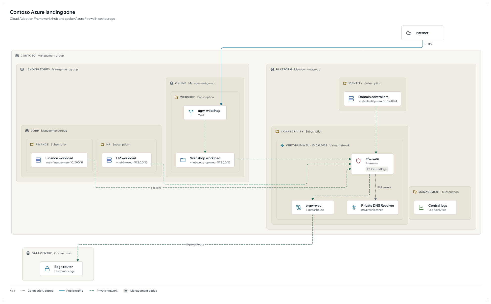
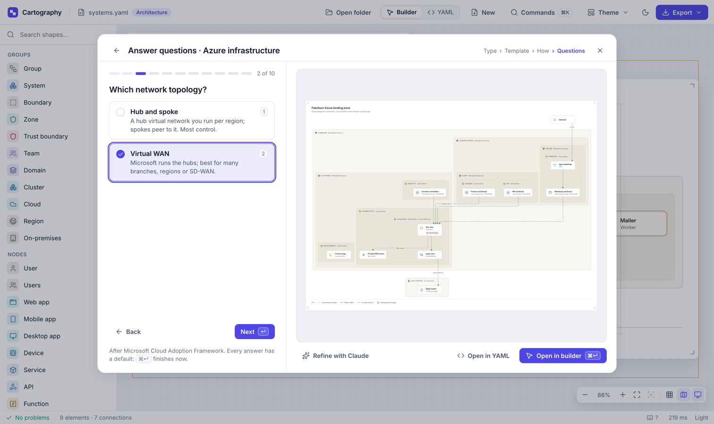

# Wizards: a few answers, a finished diagram

A wizard asks the questions a consultant would ask (how many regions, hub and spoke or Virtual WAN, a firewall or not) and writes the diagram from the answers. No AI and no key: the same answers always give the same YAML, with comments that say why it looks the way it does, stable ids and, where it helps, `steps:` to present it. Each wizard follows a published reference architecture, named at the top of the file it writes.



| Wizard | Type | After | Asks about |
| --- | --- | --- | --- |
| `azure-landing-zone` | azure | Microsoft Cloud Adoption Framework, Azure landing zone architecture | hub and spoke or Virtual WAN, Azure Firewall, ExpressRoute / VPN, regions, corp and online landing zones, identity subscription, sandbox |
| `aks-baseline` | azure | Azure Architecture Center, AKS baseline (mspnp/aks-baseline) | private cluster, Application Gateway or NGINX, user node pools, ACR, Key Vault, monitoring, egress through the hub firewall |
| `hub-spoke` | azure or network | Azure Architecture Center, hub-spoke network topology | drawn as Azure or as a network diagram, spokes, firewall, on-premises link, central DNS, Bastion |
| `aws-three-tier` | cloud | AWS Well-Architected, web application hosting | Availability Zones, ECS / EC2 / EKS / Lambda, Aurora / RDS / DynamoDB, cache, CloudFront and WAF, NAT gateways |
| `aws-landing-zone` | cloud | AWS multi-account whitepaper and Control Tower | workloads, Prod and Test OUs, Infrastructure OU with a Network account, inspection, Direct Connect / VPN, sandbox |
| `data-mesh` | data-products | Zhamak Dehghani, *Data Mesh* | domains, products per domain, an aggregate, a consumer-aligned product, consumers, the self-serve platform |
| `c4-starter` | c4 | Simon Brown, the C4 model | the system, its users, the systems around it, what it is made of; a context and a container view |
| `git-strategy` | gitflow | GitHub Flow, Git Flow, trunk-based development | the strategy, your next feature, branches or the delivery pipeline |
| `team-topologies` | teams | Skelton and Pais, *Team Topologies* | stream-aligned, platform, enabling and complicated-subsystem teams, a collaboration |

## In the editor

*New* (or the first visit) opens the start dialog: pick a type, a template, then **Answer questions** (key `4`; shown for types that have a wizard). One question at a time, the drawing beside it redrawn as you answer.



- **Keyboard**: arrows choose, number keys pick an option (`Y` / `N` for yes or no), `Space` turns an option of a multiple choice on or off, `Enter` goes to the next question, `Esc` back one. `⌘↵` (Ctrl+Enter) finishes at any point: every question has a default.
- **Trackpad**: the options are big buttons; *Back* and *Next* sit under the question, and the bars at the top jump to any question.
- **Finish** (or `⌘↵`) opens the drawing in the **Builder** or as **YAML**, as chosen under the preview (it remembers how you last worked); **Refine it with your AI** opens the Your AI mode with the wizard's drawing in the prompt as the draft to start from. A click on the preview shows it at full size.
- Answers are remembered per wizard in this browser.

A type with several wizards (Azure has three) asks which one first.

## On the command line

```sh
carto new --wizard list                                   # the wizards
carto new --wizard azure-landing-zone lz.yaml             # asks the questions in the terminal
carto new --wizard aks-baseline -y                        # every default, to standard output
carto new --wizard aws-three-tier shop.yaml --answers answers.json
```

In the terminal, `Enter` takes the default (marked `*`); a choice takes its number or its name, a yes/no `y` or `n`, a list names separated by commas (`-` for none). Answers can be piped in, one per line.

`--answers` takes a JSON file of question ids and answers; what it leaves out takes its default, so a file can say only what differs:

```json
{ "network": "vwan", "regions": 2, "onprem": "both", "corp": "Finance, HR, Claims", "sandbox": true }
```

The question ids are in `carto new --wizard <name>` (asked interactively) and in the wizard's source, `packages/wizards/src/wizards/`.

## What comes out

Ordinary Cartography YAML: edit it, render it, add to it. A few choices the wizards make for a readable drawing:

- A landing zone's spoke network is told in the caption of the workload in it (`vnet-hr-weu · 10.2.0.0/16`) rather than as one more box, so the drawing stays mostly content, not frame.
- Diagnostics to the central workspace are drawn as badges (`badges: [management]`), not lines.
- Address ranges are a plan to start from: hubs at `10.0.0.0/22`, `10.64.0.0/22`, …; spokes numbered from `10.1.0.0/16`.
- The platform of a Team Topologies drawing spans all stream-aligned teams; one x-as-a-service line from the team next to it says they all use it.

## Adding a wizard

A wizard is data and one pure function (`packages/wizards/src/engine.ts`): questions (`choice`, `multi`, `number`, `yesno`, `text`, each with a default, some asked only `when` an earlier answer says so) and `build(answers) → YAML`. Register it in `packages/wizards/src/index.ts`; the start dialog, the CLI and the tests pick it up. The tests render every combination of answers (or a fixed sample of 24 for the big wizards) and fail on any error or warning, the presenting steps included.
